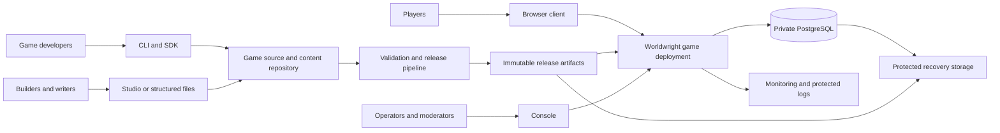
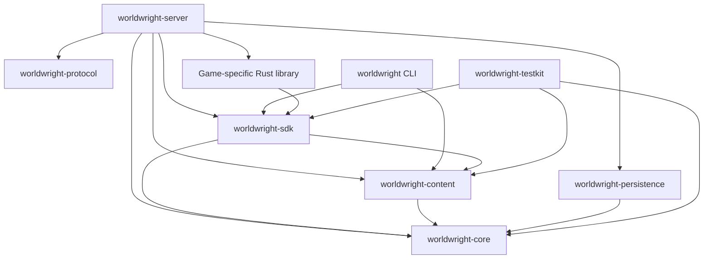
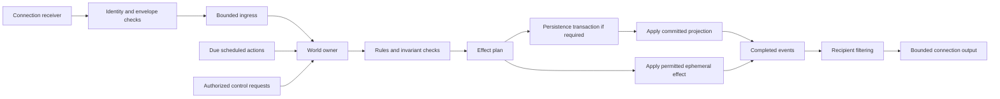
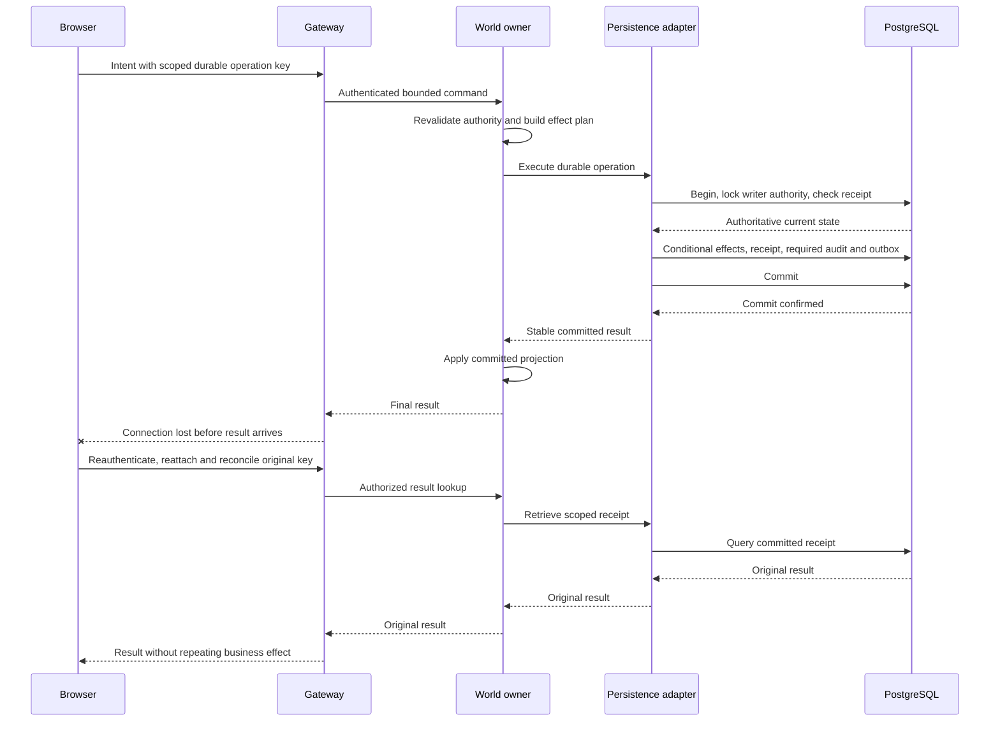
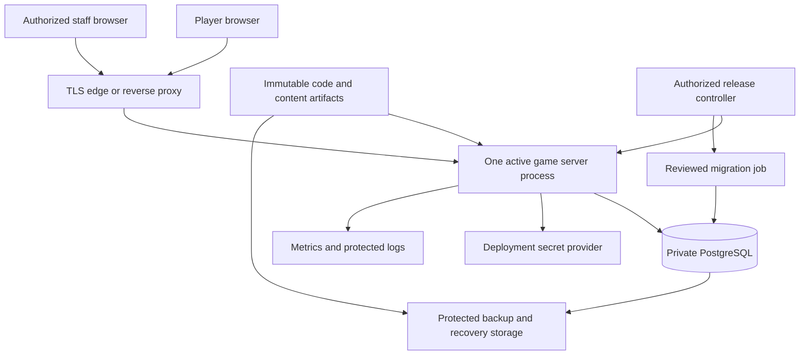

# Worldwright — Architecture

**A Rust toolkit for building and operating persistent multi-user domains**

| Attribute | Value |
|---|---|
| Document version | 0.2 — expanded-roadmap alignment; target architecture remains proposed where noted |
| Updated | October 21, 2026 |
| Delivery authority | [ROAD-MAP.md](ROAD-MAP.md): eight dependency-ordered milestones; M4 is the next active increment, still planned |
| Prepared | October 20, 2026 |
| Architecture style | Modular monolith; one authoritative world per server process initially |
| Implementation status | In-memory runtime, strict JSON content loading, Local Play, and authenticated process-local Transport v0.1; see verification for Windows evidence and provenance limits; no public deployment |
| Companion documents | [README.md](README.md) · [DESIGN.md](DESIGN.md) · [ROAD-MAP.md](ROAD-MAP.md) |

> **Synchronization basis:** This edition reconciles the supplied ARCHITECTURE and DESIGN documents with the expanded ROAD-MAP. Source code, manifests, migrations, and linked verification logs were not inspected in this documentation-only update. “Implemented” below carries forward reported baseline claims; it is not a new test result. New lifecycle and data-model details are planned requirements or labeled proposals, not new APIs, tables, configuration fields, or approved deployment choices.

> **Reading guide:** This file maps the target system, with rationale in [DESIGN.md](DESIGN.md). [RUNTIME.md](docs/RUNTIME.md) documents the implemented local subset: the core runtime owns state and attachment records, evaluates scoped rules, stages changes, and resolves message recipients before returning a committed in-memory result. Testkit builds a two-room world through its public builder. Transport v0.1 adds a separate bounded loopback service; no database participates yet. The wider diagrams remain proposed infrastructure, with prose explanations for readers without Mermaid support.
>
> **Not a deployment specification:** The local default `127.0.0.1:3000` listener is implemented for Transport v0.1. Production listener ports, domains, topology, dependency versions, cloud products, sizing, and public API deployment remain unassigned. Their eventual values must be verified against real code and deployment artifacts. The architecture does not claim production readiness, automatic failover, or measured capacity.

## Contents

- [Architecture at a Glance](#architecture-at-a-glance)
- [System Context](#system-context)
- [Logical Components](#logical-components)
- [Workspace and Dependency Structure](#workspace-and-dependency-structure)
- [Runtime Process Model](#runtime-process-model)
- [Interfaces and Trust Boundaries](#interfaces-and-trust-boundaries)
- [Runtime Flows](#runtime-flows)
- [Data Architecture](#data-architecture)
- [Implemented Content Loading v0.1](#implemented-content-loading-v01)
- [Implemented Transport v0.1](#implemented-transport-v01)
- [Content and Tooling Architecture](#content-and-tooling-architecture)
- [Deployment Views](#deployment-views)
- [Startup and Shutdown](#startup-and-shutdown)
- [Release and Recovery Architecture](#release-and-recovery-architecture)
- [Observability](#observability)
- [Security Placement](#security-placement)
- [Scaling and Evolution](#scaling-and-evolution)
- [Implementation Order](#implementation-order)
- [Architecture Review Checklist](#architecture-review-checklist)
- [Document Control](#document-control)

## Architecture at a Glance

Worldwright separates reusable engine infrastructure, developer tools, and individual games. The target initial durable server combines transport, application services, simulation coordination, and persistence adapters in one process. The reported M3 server has no participating database. Product names do not each become a service.

### Milestone and evidence map

| Milestone | Architectural increment | Reported status / remaining gate |
|---|---|---|
| M1 — Foundation and Core | Ten-package Rust workspace, typed contracts, pure core, verification structure | Reported baseline complete; configured CI is not proof of a hosted run |
| M2 — Runtime, Content, and Local Play | Single-owner runtime, strict JSON v1, named-exit lookup, terminal host | Reported complete; earlier Linux evidence has recorded provenance limits |
| M3 — Multiplayer Transport v0.1 | Process-local identity, browser/WebSocket gateway, bounded owner/route channels | Reported Windows-local verification; Linux Transport rerun, hosted CI, deployment pending |
| M4 — Durable Gameplay v0.1 | PostgreSQL adapter, writer fencing, one valuable operation, receipts/audit/outbox, restart projection | Next active increment, still planned |
| M5 — Content Release and Preview v0.1 | Immutable artifacts, publication workflow, staging activation, isolated preview process | Planned; consumes M4 durable-reference and writer contracts |
| M6 — Operational Control v0.1 | Capability-scoped controls, privileged assurance, audit, drain, observability, exercised restore | Planned; production readiness is a separate assessed gate |
| M7 — Builder Workflow and Studio v0.1 | Editor and workflow clients over M5 preview/release and M6 authority contracts | Planned; no direct production database access |
| M8 — Toolkit Maturity | Independent second game, compatibility policy, tooling and measured scaling | Planned; no speculative distribution or stable-SDK claim |

The historical M3 record reports 164 unit/integration tests and 2 compile-fail doctests, including 32 server library tests, 2 server smoke tests, and 14 protocol tests, plus seven real loopback acceptance cases. These are not additive totals or tests run for this edition. See [ROAD-MAP M3](ROAD-MAP.md#milestone-3--multiplayer-transport-v01) and the actual [verification record](docs/VERIFICATION.md) for provenance.

Design and fixture preparation may overlap milestones. Activating a later capability must not bypass its prerequisites. In particular, preview infrastructure belongs to M5; M7 adds the builder-facing integration, not a second preview implementation.

### Reference stack

| Concern | Proposed choice | Architectural responsibility |
|---|---|---|
| Implementation language | Rust | Typed domain model, explicit ownership, libraries and applications |
| Async networking | Tokio | Connection tasks, timers, bounded I/O coordination |
| HTTP / WebSocket adapter | Axum | Request routing, authentication integration, protocol handling |
| Web presentation | Static HTML/CSS/JS and focused browser interaction; Askama deferred | Local player shell and transport reference client |
| Persistence | PostgreSQL through SQLx | Durable facts, atomic operations, receipts, audit, outbox |
| Content | Versioned JSON and immutable release artifacts | Game definitions and reproducible publication |
| Server configuration | Versioned TOML with secret references | Validated deployment behavior |
| Packaging | Reproducible binaries or containers | Exact code/content release identification |

The workspace selects Rust 1.85.1 / edition 2024 and package version 0.1.0-dev.0. Serde, serde_json, serde_path_to_error, Tokio, Axum, Argon2, getrandom, and futures are integrated for the local transport slice; SQLx/PostgreSQL and Askama remain deferred. Those libraries do not automatically provide the game's authorization, consistency, or recovery guarantees; those belong to the application design.

### Architectural commitments

- One authoritative mutable simulation owner per world.
- One active server writer for that world, with explicit takeover and durable writer fencing.
- PostgreSQL is authoritative for durable state; memory is its execution projection plus permitted ephemeral state.
- Tools use supported contracts, never unrestricted production database writes.
- Game rules are trusted Rust modules compiled with the server, not remotely uploaded native plugins.
- Content activation is a maintenance operation in the first release.
- HTTPS and secure WebSockets are the first player-facing transports.
- Separate preview, staging, and production credentials and data.

See the [decision register](DESIGN.md#decision-register) and [persistence contract](DESIGN.md#persistence-and-recovery) for rationale and failure semantics.

## System Context



Players interact with a deployed game. Developers and builders produce reviewed code and content; the release pipeline produces immutable artifacts. Console submits authorized operations to the game deployment. The private database and recovery storage are infrastructure, not client interfaces.

### Actors and ownership

| Actor | Entry point | Authority |
|---|---|---|
| Player | Browser account and gameplay interface | Own account/character and permitted world actions |
| Developer | CLI, SDK, repository, CI | Approved code changes and local development |
| Builder | Files or Studio | Scoped draft content and isolated previews |
| Publisher | Reviewed release workflow | Approved artifact activation for a specific environment |
| Moderator | Console | Scoped reports, conduct actions, and investigation |
| Operator | Console and deployment control | Drain, deploy, restore, inspect health |
| Security / project owner | Policy and review workflow | Identity, release, licensing, and risk decisions |

A developer workstation, a browser tab, and a production container are different trust domains even if one person operates all three.

## Logical Components

The following modules may initially live inside existing crates or the server application. Extract crates when a stable boundary provides value; do not create empty components just to reproduce this table.

| Component | Responsibility | Main inputs / outputs | Ownership boundary |
|---|---|---|---|
| Transport gateway | HTTP/WebSocket framing, limits, connection lifecycle | Requests and frames → authenticated envelopes | Owns sockets, not world entities |
| Identity service | Login, session lifecycle, account restrictions | Credentials/session handles → verified identity | Owns account/session transactions |
| Application coordinator | Maps requests, authorizes use cases, invokes adapters | Protocol DTOs → domain commands/results | Composition and orchestration |
| Session attachment registry | Character attachment and connection generation | Attach/takeover/revoke → current attachment | Coordinates with world owner |
| World owner | Serializes authoritative command and timer processing | Commands and due work → state transitions | Sole mutable simulation owner |
| Rule evaluator | Resolves reusable and game-specific behavior | Read context + intent → effect plan | No direct transport/persistence calls |
| Scheduler | Ordered delayed work and cancellation | Schedule intents + time → due actions | Mutated by world owner |
| Content registry | Loaded immutable validated definitions | Release artifact → definition lookups | Immutable for active release |
| Persistence adapter | Implements durable operation transactions | Effect/operation plans → committed records/results | Owns SQL, locks, mapping, receipt lookup |
| Audit service | Attributable protected control records | Authorized action metadata → durable audit | Participates in required transactions |
| Output projector | Visibility filtering and presentation messages | Completed events/snapshots → recipient output | Cannot change world state |
| Outbox dispatcher | Retries committed external side effects | Durable outbox rows → delivery attempts | Separate from game-rule execution |
| Supervisor / health | Startup, drain, failure propagation, readiness | Task state and dependencies → service state | Can stop admission and terminate world |

### Milestone ownership and completion boundaries

| Work package | Responsible boundary | Required handoff |
|---|---|---|
| M4.1 schema/migrations | Persistence adapter and controlled migration tooling | Supported schema/constraint map; no migrations owned by socket handlers |
| M4.2 writer fencing | World owner, persistence adapter, authorized takeover coordinator | Checked authority carried into every protected transaction |
| M4.3 identity | Identity/application layer | Stable identity mapping and explicit restart/revocation policy |
| M4.4–M4.6 valuable operation | Trusted rules, owner, persistence adapter | Confirmed effects plus receipt, required audit, and outbox in one transaction |
| M4.7–M4.8 uncertainty/restart | Owner and supervisor with persistence queries | Reconciled projection before mutation/readiness resumes |
| M4.9 failure evidence | Testkit/integration and process-level harness | Real PostgreSQL races and interruption results |
| M5.1–M5.4 artifact/activation | Content tooling and release coordinator | Pinned bytes, expected current release, recoverable activation state |
| M5.5 preview | Isolated process supervisor | Disposable state, denied production access, quota/cleanup result |
| M5.6 publication request | CLI/application workflow | Request identity distinct from approval and activation |
| M6 control/recovery | Authorized application services and operations | Transactional attribution, drain policy, restore-safe authority |
| M7 Studio | Authoring/workflow client | Draft revision, diagnostic snapshot, preview artifact and publication digest |
| M8 reuse | SDK/game packages and benchmark harness | Reuse/gap report, compatibility evidence, measured bottlenecks |

These are responsibilities, not new package names. M4 does not require splitting identity, audit, and release into network services. Add internal modules only after inspecting the actual tree and interfaces.

### What is not a service

“Engine” and “SDK” are not network endpoints. “Studio” is not automatically a production content microservice. “Testkit” is not a second game server with independent rules. “Console” is not an unrestricted shell.

In the initial deployment, staff pages can be modules hosted by the server while preserving distinct authentication, authorization, and route exposure. Separately packaging them is an operational choice, not a prerequisite for a clean design.

## Workspace and Dependency Structure

### Proposed tree

The four application and six library directories below contain the workspace, core interfaces, implemented local transport, and remaining integration stubs. Runtime responsibilities beyond [CORE_INTERFACES.md](docs/CORE_INTERFACES.md) remain proposed. Studio/Console and persistence remain stubs. Cargo.lock is included; `scripts/` and `.github/workflows/ci.yml` supply local/CI checks. Other deployment/content directories remain guidance placeholders. See [development](docs/DEVELOPMENT.md), [SERVER.md](docs/SERVER.md), and [verification](docs/VERIFICATION.md).

```text
worldwright/
├── Cargo.toml
├── Cargo.lock                    # Cargo-generated and supplied; keep committed
├── scripts/                      # Bash and PowerShell developer workflows
├── .github/workflows/ci.yml       # Configured Linux/Windows checks
├── README.md
├── DESIGN.md
├── ARCHITECTURE.md
├── SECURITY.md                   # Proposed security policy; reporting route pending
├── CONTRIBUTING.md               # Proposed contribution and review policy
├── CODE_OF_CONDUCT.md             # Proposed conduct/reporting/appeal policy
├── DEFINITIONS.md                 # MU* terms, traditions, and compatibility limits
├── apps/
│   ├── worldwright/              # Developer CLI
│   ├── worldwright-server/       # Server composition root and reference host
│   ├── worldwright-studio/       # Optional separately packaged builder app
│   └── worldwright-console/      # Optional separately packaged staff app
├── crates/
│   ├── worldwright-core/
│   ├── worldwright-content/
│   ├── worldwright-protocol/
│   ├── worldwright-persistence/
│   ├── worldwright-sdk/
│   └── worldwright-testkit/
├── examples/                     # Reference-game content and scenario fixtures
├── migrations/                   # Reviewed toolkit database migrations
├── tests/                        # Cross-component and deployment verification
├── docs/
│   ├── decisions/
│   ├── content/
│   ├── testing/
│   └── operations/
└── deploy/                       # Future environment/deployment artifacts
```

Keep application directory, Cargo package, and binary names aligned. A separately compiled reference-game binary also belongs under `apps/`; reusable game-specific Rust libraries belong under `crates/` or in their own game workspace. Do not turn the `examples/` content directory into an undocumented alternate location for production application binaries.

### Library boundaries

| Package | Owns | Allowed internal dependencies | Must not depend on |
|---|---|---|---|
| `worldwright-core` | IDs, world records, commands/effects, rule contracts, scheduling primitives | None of the other Worldwright packages | Axum, SQLx, application binaries, game-specific packages |
| `worldwright-content` | JSON models, validation, manifest and runtime-definition conversion | Core | Server app, production DB, SDK facade |
| `worldwright-protocol` | Wire DTOs, envelope/version rules, protocol validation | Prefer none; keep transport representation independent | Core mutation APIs, SQLx, server app |
| `worldwright-persistence` | SQL mappings, transaction implementations, migration integration | Core | Protocol presentation, game UI, server app |
| `worldwright-sdk` | Supported public facade, registration helpers, stable exports | Core, content | Server app, concrete database adapters |
| `worldwright-testkit` | Fixtures, fake clock/RNG, scenarios, assertions | Core, content, SDK; persistence for optional integration support | Production server application internals |

The application coordinator translates between protocol DTOs and core types. This avoids making a wire-format change propagate directly into gameplay rules.

Rule interfaces belong in core and are re-exported or wrapped by SDK; core must not depend on SDK, which would create a cycle. External games depend on SDK and supply implementations registered by their server composition root.



Arrows mean **compile-time dependency**, not network traffic. The game-specific library is optional in the generic host but required when a game supplies custom compiled rules. Optional Testkit persistence integration is omitted from the diagram for readability.

### Composition root

The server application selects concrete adapters, creates bounded channels, loads content and the local account registry, registers game rules, and supervises the owner/connection tasks. Tokio and Axum are assembled here for Transport v0.1; SQLx/PostgreSQL and durable configuration remain future composition-root work.

Keep async orchestration out of pure rule code. Avoid a globally accessible application-state object containing both unrestricted world mutation and database credentials. Transport state should hold only the capabilities required to submit requests and inspect safe service status.

## Runtime Process Model

### Task placement

| Task / activity | Execution location | Blocking / backpressure policy |
|---|---|---|
| HTTP accept and routing | Tokio/Axum tasks | Request-body and concurrency limits |
| WebSocket receive | Per-connection task | Frame limits, bounded ingress admission |
| WebSocket send | Per-connection writer task | Bounded output; disconnect slow consumers |
| Authentication hashing | Bounded blocking-work facility | Explicit concurrency and input limits |
| World owner | One supervised task per process | Ordered state-changing execution |
| Durable world operation | Awaited through SQLx adapter by world owner | One pending mutation initially; transaction deadline |
| Snapshot construction | World-owner boundary or safe versioned projection | Bounded cost and output size |
| Outbox dispatch | Supervised background task | Bounded concurrency, retry/backoff, age monitoring |
| Content validation | CLI/build process; bounded startup validation | Not on the gameplay hot path |
| Preview | Separate process/environment | Separate database/state and credentials |
| Health/metrics | Lightweight handlers and supervisor state | Must not wait on a long world command to report health |

A Rust async task is not a security sandbox. CPU-heavy callbacks can starve their execution thread, and arbitrary native code cannot be safely killed with an async timeout. Enforce code-review constraints and process-level recovery; add isolation only through a separate reviewed design.

### Command flow inside the process



The ephemeral path is permitted only for effects explicitly classified as non-durable. It must not become a shortcut for inventory, rewards, or administrative changes.

### Admission and fairness

Bound both per-connection queues and total world work. Fair scheduling prevents one active account from monopolizing the world even when each individual message is valid.

Reserve a bounded control path for drain, shutdown, revocation, and other supervisory signals so player traffic cannot indefinitely delay them. Control messages still need authorization and cannot interrupt a database transaction by pretending it did not happen.

When the owner awaits a durable operation, socket tasks can continue receiving only until their admission budgets are exhausted. This M4 baseline knowingly couples database latency to world progress. Improve it only after profiling and a revised conflict/recovery design.

A bounded channel is insufficient if unbounded producers are waiting to send into it. Bound producer/task counts, pending database work, authentication waiters, decoded payload allocation, and retained output as well as queue depth. Document each bound together with its rejection, disconnect, retry, or fail-closed action. No new numerical settings are assigned by this architecture.

### Durable completion boundary — M4

The initial owner awaits at most one durable world mutation; the persistence adapter never acquires general mutable access to `WorldRuntime`. Model adapter completion as a confirmed outcome, a terminal business rejection, or an unresolved outcome. These are conceptual categories, not asserted Rust types.

1. Owner checks the current attachment/authority and builds a bounded effect plan.
2. Adapter locks writer authority and authoritative business records, resolves the scoped receipt, and commits required effects/receipt/audit/outbox together.
3. Owner applies or reconstructs the confirmed durable projection before reporting durable success.
4. Uncertain completion pauses state-changing execution. The supervisor remains able to report not-ready and coordinate bounded recovery without waiting on a client socket.
5. A lost output route does not undo a committed effect. Later authorized reconciliation returns the original stable result.

For an asynchronous adapter implementation, completion must carry enough operation/world/authority context for the owner to reject stale application. Introducing concurrent durable mutations is a separate conflict-ordering design, not an implementation detail of the first slice.

**Example:** a reward commits and its client disconnects. The new attachment does not replay an old v1 command ID; a separately designed durable interface reconciles the original scoped operation key.

## Interfaces and Trust Boundaries

These are semantic interface contracts; Transport v0.1 wire schemas are specified in [PROTOCOL_V1.md](docs/PROTOCOL_V1.md), while production URLs and durable interfaces remain open.

| Interface | Caller → receiver | Transport | Authentication / authorization | Contract location |
|---|---|---|---|---|
| Account lifecycle | Browser → identity/application layer | HTTPS at browser boundary; explicit loopback HTTP development exception | M3 registry/session checks; durable lifecycle remains M4 work | Existing routes in `docs/SERVER.md`; future durable HTTP specification |
| Gameplay | Browser → transport gateway | Secure WebSocket at browser boundary; local HTTP exception only | Session, exact allowed origin, authorized character, current attachment generation | Implemented `docs/PROTOCOL_V1.md`; durable extension/version not yet specified |
| Content validation | CLI/Studio → validator | In-process library / local tool call | Filesystem/project permissions | Content schema and diagnostic format |
| Preview launch | Developer/Studio → preview supervisor | Local process control initially | Project access; isolated credentials | Preview lifecycle documentation |
| Publication request | Authorized publisher → release workflow | Authenticated control channel | Environment scope, artifact identity, approval | Future control API/workflow contract |
| Administrative operation | Console → application/control layer | HTTPS | Current capability, target scope, reason, audit | Future control API specification |
| Core rule call | Owner → trusted game module | Rust call | Registered trusted module; bounded interface | SDK/core API documentation |
| Durable operation | Coordinator → persistence adapter → DB | Rust call / PostgreSQL protocol | Least-privilege DB credential and writer epoch where applicable | Transaction contract and migrations |
| External side effect | Outbox dispatcher → external service | Reviewed service protocol | Scoped machine credential | Adapter-specific contract |

HTTP routes should ultimately have an OpenAPI or equivalent authoritative specification, and WebSocket messages need their own explicit schema/compatibility documentation. An HTTP specification alone does not describe the complete interactive protocol.

### Boundary rules

- Browser fields never establish trusted account, role, or world ownership.
- Console and Studio are clients of application contracts, not database owners.
- Game data cannot select arbitrary code to execute.
- Deployment secrets are resolved by the server environment, not embedded in content artifacts.
- Logs and telemetry receive sanitized data, not complete credential-bearing requests.
- Every separate adapter translates failure semantics rather than reducing all failures to “command failed.”

## Runtime Flows

### Player entry

The reported M3 sequence is not an arbitrary future handshake:

1. Login through `POST /api/v1/session` with the exact configured Origin and bounded credentials.
2. Establish the opaque process-local cookie/session and server-authorized account/character mapping.
3. Upgrade at `GET /api/v1/play` only after session and exact-Origin checks.
4. Negotiate `hello` / `welcome` under protocol v1.
5. Request `attach`; the owner establishes the authorized current attachment.
6. Receive admission/attachment and initial runtime-backed Look output according to the exact protocol ordering.
7. Submit bounded Look, Move-by-label, or Say intent; recheck authority when executing.

The protocol document owns exact serialized fields and message order. Reconnect creates a new stream/attachment context and does not replay old command history. M4 adds separately reviewed durable reconciliation after authentication/attachment; it does not preserve old connection generations or change v1 sequence numbers into replay offsets. See [DESIGN](DESIGN.md#protocol-and-player-experience).

### Local route boundary

| Reported route | Purpose and limit |
|---|---|
| `GET /`, `GET /app.js`, `GET /app.css` | Same-origin reference player page/assets; no gameplay authority |
| `POST /api/v1/session` | Exact-Origin login, bounded credentials and password work |
| `DELETE /api/v1/session` | Exact-Origin revocation and cookie expiry |
| `GET /api/v1/play` | Authenticated, exact-Origin WebSocket upgrade |
| `GET /health/live` | Process liveness only |
| `GET /health/ready` | Owner accepting work in M3; durable reconstruction/fence conditions added in M4 |

This summary is not an OpenAPI specification. Cookie names, complete request/response schemas, status codes, and flag spellings must be checked in source and the server/protocol guides before integration. Future publication, operation-status, and operator routes are not assigned here.

### Durable action and lost response

**Planned M4 flow; not protocol v1.** The durable operation key below belongs to the reviewed persistent contract, not v1 stream correlation.



The adapter compares versioned canonical intent fingerprints and enforces business uniqueness independently of receipt keys. Authorization still applies to result lookup. This diagram shows a confirmed commit followed by a lost response; an uncertain COMMIT pauses mutations until resolution. An immediate missing receipt is not proof that the original transaction cannot still commit.

### Moderator action

1. Moderator authenticates with the approved privileged-access policy.
2. Console requests only information within the moderator's scope.
3. A mutation request carries target, reason, and operation identity.
4. Application services recheck capability and target scope.
5. World-affecting changes enter the authoritative owner; account restrictions use the identity service and trigger attachment revocation.
6. The action and required audit commit together within the responsible transaction boundary.
7. Runtime updates projections/attachments before acknowledging the completed control action.
8. Console receives a structured result, not unrestricted database output.

Cross-boundary actions, such as a durable account ban followed by disconnecting live attachments, need explicit convergence: the ban is authoritative immediately after commit, new admission is denied, and existing attachments are invalidated even if the requesting browser disconnects.

### Content release

1. Builder edits files (M5) or a Studio draft (M7).
2. Shared validator resolves the complete content graph and binds diagnostics to that snapshot.
3. The selected build/test pipeline runs validation and scenarios; planned CI is not a claim of an observed hosted run.
4. Package immutable bytes with a manifest/digest and preview/test those identified bytes in isolation.
5. Authorized review approves the exact digest for its target, not a mutable filename.
6. Staging activates against isolated data using an expected-current-release check and runs acceptance/rollback scenarios.
7. Production approval separately checks the staged artifact, target, recovery plan, and M6 operational gate.
8. Maintenance closes admission, reconciles durable work, and establishes the writer barrier.
9. The coordinator records activation progress, applies approved migrations, and selects the exact active artifact/state.
10. Reconstruction, readiness, and smoke checks precede successful activation and reopened admission; retained known-good material supports the approved recovery path.

Artifact digest verification detects corruption or mismatch. It does not prove provenance if an attacker controls both artifact and expected digest; protect the release pipeline and artifact metadata, with signing when the threat model requires it.

## Data Architecture

### Authoritative stores

| Store | Contents | Writer | Readers |
|---|---|---|---|
| Identity authority and PostgreSQL mappings/security data | Local accounts/sessions if selected; otherwise trusted issuer-to-account mapping, local restrictions and grants | Selected identity provider and/or authorized identity services | Authentication and scoped staff queries under the approved M4 choice |
| PostgreSQL world data | Persistent characters, locations, items, claims, progression | Fenced persistence operations invoked by world owner | World load, transactional validation, scoped queries |
| PostgreSQL operation receipts | Scoped intent fingerprints and committed results | Same transaction as the protected operation | Authorized retry/reconciliation path |
| PostgreSQL audit | Privileged actions and approved summaries | Responsible transactional services | Authorized investigation and review |
| PostgreSQL outbox | Durable pending side effects and delivery state | Business transactions; dispatcher updates delivery metadata | Dispatcher and operations monitoring |
| Immutable artifact storage | Code images/binaries, content bundles, manifests | Approved build/release pipeline | Deployments and restore procedures |
| Runtime memory | Active projection, connections, timers, queues | Explicit task owners | Safe query/effect interfaces |
| Protected backup storage | Recoverable database state and required artifacts | Backup/recovery system | Authorized restore process |

These are logical data groups, not finalized table names. A single private database may host the initial groups. Splitting them into independent databases would introduce cross-store consistency work and is not the baseline.

### Durable-state mapping

Implementation should provide an explicit mapping from domain concepts to relational constraints:

- Typed IDs → primary keys and validated references.
- Item holder → exclusive valid ownership relationship.
- Reward generation → uniqueness constraint for the business entitlement.
- Request identity → scoped uniqueness plus intent fingerprint.
- Aggregate version → optimistic conflict check or locked-record transition.
- Writer epoch → transactionally checked world authority.
- Content reference → persisted identifier with a compatible release/migration mapping.
- Administrative mutation → attributable audit in the same transaction.

Database constraints supplement application checks. A single world task cannot protect data against maintenance scripts or a second process unless write authority is constrained and the database transaction checks it.

### M4 minimum durable projection

Persist only the facts needed to reconstruct the approved valuable operation and its playable context. Inventory the character/world mapping, selected stable content references, item owner or reward entitlement, durable outcome, required audit, and pending outbox work. Receipt history is not automatically a complete world snapshot.

The local content loader assigns deterministic sequential room IDs for a given definition set. Those numbers can change when the content set changes; they are not safe durable room identities. Use stable definition IDs or an explicitly versioned persistent mapping, then construct runtime lookup/instance IDs during load. Missing references are a migration/refusal condition, not permission to drop items or relocate characters arbitrarily.

### Transaction and writer authority placement

Every protected world transaction locks/checks the same world-authority record and holds it through commit. The authorized takeover coordinator locks that record, advances the checked epoch, commits, and then enables the replacement. An in-flight old transaction that owns the lock may complete before takeover; after takeover commits, later old-epoch transactions fail.

Account/security transactions have their own authority domain, but cannot directly mutate world value to bypass its fence. Administrative repairs and scheduled grants that change protected world state follow the world fence and business invariants. Pool size and queue limits must not introduce hidden unbounded work.

A committed result is distinct from its successful projection and network delivery. Scope receipts to trusted identity/world/operation, compare versioned semantic fingerprints, and enforce independent entitlement uniqueness. See [DESIGN](DESIGN.md#persistence-and-recovery) for behavior; exact tables/types and PostgreSQL isolation/durability settings remain a schema decision.

### Schema and migration boundary

Use a controlled migration identity, immutable applied migrations, explicit schema compatibility, and tests for clean installation and supported upgrades. Ordinary server startup verifies schema compatibility rather than racing other replicas to migrate. Changing identity semantics or defaults can be breaking even when field types do not change.

M4 must decide receipt lifetime and cleanup behavior before offering retry guarantees. M6 operational retention implements the approved policy without deleting required recovery or independent business-uniqueness facts.

### Query paths

Player state reads are visibility-filtered application queries. Operator dashboards may use read models with explicit freshness indicators. Do not let a stale read model approve an item transfer or reward claim.

Live staff interfaces must not hold long database transactions or run arbitrary unbounded queries against gameplay tables. Export/reporting jobs require resource limits and appropriate data access.

### Recovery coupling

A database backup without its compatible content release may be insufficient to restore a game. Preserve the release manifest and content artifacts referenced by the recovery point. Restored services must not load whichever content file happens to be newest on disk.

See [Persistence and Recovery](DESIGN.md#persistence-and-recovery) for commit uncertainty, fencing, and the distinction between process recovery and disaster recovery.

## Implemented Content Loading v0.1

The developer CLI delegates to `worldwright-content`: bounded file/byte read -> streaming duplicate/depth guard -> version dispatch -> private schema records -> semantic/reference validation -> immutable validated definitions -> deterministic room mapping -> `WorldBuilder`. Core remains independent of Serde, JSON, and filesystem APIs.

`WorldInstantiation::into_parts()` separates the builder and `WorldLookup`. The host supplies world identity, characters, rule registry, and attachments. Named exit lookup resolves syntax without weakening core movement checks. The `content validate` preflight builds a character-free world with an empty rule registry and never executes commands or starts a listener. The separate `play` command consumes the same builder/lookup, supplies one local actor and ReferenceGame, and executes typed commands in-process. Its input framer and terminal renderer live under `apps/worldwright/src/commands/`; the core runtime and content loader remain unchanged. No socket or database is opened. SDK exposes the content crate as `worldwright_sdk::content`.

Source responsibilities and limits are in [schema v1](docs/content/SCHEMA_V1.md); the runnable reference is [examples/two-room](examples/two-room/README.md). Browser transport is the reported M3 slice below, not future work. Persistence is M4; release digests/activation/isolated preview are M5; Studio integration is M7.

## Implemented Transport v0.1

`apps/worldwright-server` now combines the HTTP/WebSocket gateway, bounded account/session service, and one world-owner task. The owner exclusively holds `WorldRuntime`, `WorldLookup`, operation/tick state, and exact attachment routes. Gameplay, control, and per-connection output channels are bounded; cancellation is out of band for takeover, logout/expiry, shutdown, slow consumers, and internal failures.

The gateway requires one exact configured Origin, binds only to loopback, uses a process-local 12-hour opaque session cookie, and serves a same-origin text browser client. Default mode expects an HTTPS edge while the application listener remains plaintext loopback; explicit insecure HTTP is local development only. No persistence, restart recovery, built-in TLS termination, proxy trust, public deployment, or stable SDK compatibility is implied.

Protocol details are in [PROTOCOL_V1.md](docs/PROTOCOL_V1.md), runnable setup is in [SERVER.md](docs/SERVER.md), and the real loopback WebSocket cases are covered by server library tests.

## Content and Tooling Architecture

### Shared content pipeline

`worldwright-content` is the shared source of validation and conversion behavior. CLI, Studio, server startup, and Testkit use that library rather than implementing independent parsers with subtly different rules.

The pipeline transforms:

**Authoring documents → Validated definition graph → Release manifest/artifact → Immutable runtime registry**

Game-specific content extensions register validators and conversion logic through reviewed SDK facilities. Production never treats unknown extension data as executable code.

### Artifact and activation coordinator — M5

The shared validator feeds a bounded package builder; an immutable manifest binds schema/game compatibility, source/build provenance, and a digest of precisely defined payload bytes. Avoid self-referential hashing and timestamp-dependent archive identity. Integrity is not publisher authorization: approval records must bind the trusted digest, target environment/world, and expected current release.

A publication request, its approval, activation intent, active database release pointer, and runtime readiness are distinct facts. The release coordinator serializes expected-release transitions and records enough progress for restart after a crash. A database pointer update cannot atomically switch in-process definitions; remain not-ready until the selected artifact and durable projection are coherent. Retain the prior known-good release and compatible recovery material.

If archive packaging is selected, the package boundary enforces size/file-count/decompression bounds and rejects traversal, absolute paths, symlink escape, and duplicate entries. No new archive format or manifest schema is adopted here.

### Preview supervisor — M5

Preview is implemented as a separate controlled process and isolated state before Studio integration. Its launch context identifies a validated snapshot or immutable artifact and uses an allowlisted environment rather than inheriting production secrets.

| Resource | Isolation responsibility |
|---|---|
| Database | Disposable data and least-privilege preview identity; no production grants |
| Network | Denied production database/control reachability; restricted egress where required |
| Filesystem | Separate output and temporary paths; no production secret mounts |
| Sessions | Test identities, never copied live bearer tokens |
| External effects | Disabled or safe test adapters; no live notifications/payments |
| Capacity | Bounded concurrent previews, CPU/memory/storage/connections and lifetime |
| Cleanup | Crash/expiry cleanup scoped to preview identity, never broad production deletion |

A separate process is not by itself a sandbox for arbitrary native code. Compiled game extensions remain trusted and reviewed. Verify denied production access independently of UI controls, and test process crash, lost browser connection, quota refusal, and cleanup.

### Studio placement

M7 adds editing, schema-aware assistance, and workflow clients; M5 owns preview/release mechanisms and M6 owns operational capability/audit controls. Studio must not reimplement either.

Keep draft revision, validation snapshot, package digest, running preview identity, and publication request identity distinct. A save does not update an already running preview; a changed artifact requires refreshed review. Use optimistic concurrency for draft saves and expected-current-release conflicts in publication, not last-write-wins updates.

Shared validator diagnostics drive both CLI and Studio. Field-level hints are advisory; full authoritative validation remains mandatory. Bind asynchronous results to the snapshot validated, display stale results clearly, and render diagnostics/preview output as bounded text. Editing must round-trip the actual strict schema without adding unsupported extension fields.

### CLI placement

The CLI is a local orchestrator, not a second authority for game state. It may invoke builds, validate content, prepare artifacts, or start isolated development services once those operations are implemented and documented.

Production deploy/control functionality must require a separate authorized target and explicit confirmation for destructive operations. Local and remote operations must be distinguishable to avoid “development” commands unexpectedly altering a live world.

### Testkit placement

Pure scenarios call the same core and game rule implementations with controlled clock and randomness. Persistence integration tests use real PostgreSQL behavior, not an in-memory mock claiming transactional equivalence.

A fault-injection seam around persistence can simulate failures before execution, during transaction progress, and after a committed result is lost. Full process-kill tests remain necessary to verify what a mock cannot reproduce.

## Deployment Views

### Local development

The diagram is the **target development environment across M4–M7**. The reported M3 slice needs no database, staff interface, or preview supervisor; those additions remain planned. Local Play also remains a listener-free, database-free CLI workflow.

```text
Developer workstation
  |
  +-- Repository: Rust sources + structured content
  +-- Worldwright CLI / test runner
  +-- Game server process
  |     +-- Browser and optional local staff interfaces
  |     +-- One authoritative world owner
  |
  +-- Development PostgreSQL
  +-- Isolated preview server/database when needed
```

Local services use loopback or deliberately configured interfaces. Development credentials and sample data must be visibly distinct from production. A container-based database is an option, not a requirement specified by this document.

### Staging and initial production



Staging and production use separate instances of these resources. The diagram is a logical topology; edge, host, database, and storage can be selected for the organization's hosting environment.

### Network exposure

| Surface | Initial exposure rule |
|---|---|
| Player HTTPS / secure WebSocket | Public edge only |
| Staff application routes | Strong authorization plus approved restricted exposure where feasible |
| Application listener behind edge | Private interface or local socket/loopback as topology permits |
| PostgreSQL | Private, limited to approved application/migration/recovery identities |
| Metrics / diagnostic detail | Internal monitoring only |
| Health probes | Minimal status; sensitive detail remains restricted |
| Artifact / backup administration | Privileged deployment/recovery identities only |

No **production** application-specific port is assigned. The supplied architecture reports the M3 local default `127.0.0.1:3000`; that is not a production assignment. The selected production listener interfaces/ports, edge TLS, certificate rotation, trusted proxy peers/headers, supervisor, and secret delivery must be reviewed and verified before documenting a supported deployment. Default HTTPS-origin behavior in the local app is not built-in TLS termination or automatic proxy-header trust.

### Process and credential policy

- Run the application as a non-root identity where supported.
- Give the runtime only the database privileges needed for reviewed operations.
- Use a separate, more privileged migration identity during controlled release windows.
- Keep backup and restore authority separate from ordinary gameplay credentials.
- Use a read-only application filesystem where practical, with explicit writable locations.
- Obtain secrets from the selected deployment mechanism; never bake them into a container layer or content artifact.
- Pin the deployed binary/image and content by immutable identity.
- Do not allow a load balancer to spread one world's players across independently mutating replicas.

Container orchestration does not make two active world owners safe. Start with a single active instance and an explicit, fenced replacement procedure.

## Startup and Shutdown

### Startup sequence

The sequence below is the **target M4+ durable composition**, not M3 startup. M3 loads content and its separate account registry, adds configured actors at the entry room, registers ReferenceGame, starts one owner with bounded routes/channels, and exposes only the loopback service. It opens no PostgreSQL connection.

For M4, identify compatible content before reconstructing durable references, verify database schema before state load, acquire approved writer authority before accepting mutations, and advertise readiness only after coherent reconstruction. M5 adds immutable release/activation recovery; M6 adds the full operating lifecycle. Exact ordering must preserve these barriers even when independent preflight checks run earlier.

1. Parse configuration, validate the schema, and resolve allowed overrides.
2. Resolve secrets without logging their values.
3. Initialize sanitized logging, metrics, and supervision.
4. Verify binary, game module, protocol, content, and schema compatibility.
5. Connect to PostgreSQL and verify required migrations are present.
6. Acquire world writer authority through the approved startup/takeover workflow.
7. Load the exact active content artifact and validate its integrity.
8. Load durable world state and reconcile all required content references.
9. Construct game rules, scheduler state, and the runtime projection.
10. Start bounded connection/output paths, outbox dispatch, and control interfaces.
11. Run startup checks, then mark readiness and enable player admission.

Public admission remains closed until reconstruction succeeds. Migration execution is a controlled release action, not an automatic race among starting application replicas.

If the server obtains a writer epoch and then fails startup, it remains unavailable. Recovery uses a new controlled attempt; do not keep retrying takeover in competing processes.

### Service states

| State | Admission | Mutation | Meaning |
|---|---|---|---|
| Starting | Closed | Initialization only | Configuration, compatibility, authority, and load checks |
| Ready | Open under limits | Enabled | Safe to serve intended workload |
| Degraded | Restricted by cause | Only explicitly safe operations | A dependency or budget is impaired |
| Draining | Closed | Finishes admitted work under deadline | Preparing controlled stop or maintenance |
| Failed | Closed | Disabled | Invariants or authority cannot be established |
| Stopped | Closed | None | Process/world service terminated |

“Degraded” must have a precise reason. It is not permission to acknowledge durable commands while the database is unavailable.

The roadmap's illustrative `Running → Draining → Quiescent → Stopping → Stopped` sequence refines this table rather than creating a second incompatible state machine. Running corresponds to Ready; Quiescent means no unresolved/admitted mutation remains under the drain policy; Stopping covers resource teardown. Those labels are not claims about existing enum variants. Forced termination can occur without reaching Quiescent and requires restart reconciliation.

M4 readiness requires a live owner, valid writer authority, and coherent compatible durable projection. M5 also checks activation recovery; M6 adds controlled drain and operational dependencies. A liveness probe remains lightweight and distinct from a downstream-database availability test.

### Graceful shutdown

1. Mark not-ready and stop new player admission.
2. Notify connected players of maintenance where possible.
3. Stop accepting new game mutations and new expensive background jobs.
4. Finish or resolve the current durable transaction within the shutdown budget.
5. Persist required checkpointed state according to its defined policy.
6. Stop background dispatch cleanly; remaining outbox rows stay durable.
7. Close player attachments, pools, and task supervisors.
8. Exit; replacement authority is acquired through the release workflow.

If the shutdown deadline forces termination, startup recovery must handle it. A signal handler cannot guarantee every in-flight transaction's outcome is known, and deployment must not treat forced exit as proof of rollback.

## Release and Recovery Architecture

### Release unit

A deployable release combines:

- Engine/server build identity and trusted game module versions.
- Protocol compatibility metadata.
- Content release identity and digest.
- Database migration range and game-state schema version.
- Configuration schema compatibility.
- Dependency/license inventory and applicable template/content notices.
- Relevant test and approval evidence.

The release manifest is the reference used during deployment, diagnosis, and recovery. “Latest image plus latest content” is not an acceptable release identity.

### Pipeline stages

| Stage | Required checks / outputs |
|---|---|
| Source review | Scoped change, intended contract, ownership/license provenance |
| Build checks | Formatting, compile, lint, unit tests on selected toolchain |
| Integration | PostgreSQL transactions, migrations, receipt/recovery tests |
| Content validation | Complete graph, semantics, scenarios, immutable artifact |
| Security/dependency review | Dependency risks, secrets, access boundaries, required notices |
| Staging | Full release tuple, isolated data, smoke play and failure exercises |
| Approval | Service/security/content owners accept relevant evidence |
| Production change | Drain, backup/recovery readiness, migrate, start, verify |
| Post-release | Monitor error/latency/queue signals and record deployed identities |

### Rollback versus restore

- **Binary rollback:** valid only when the older code understands the current schema and game-state encodings.
- **Content rollback:** valid only when persistent references and effects remain compatible.
- **Forward repair:** needed when reverting code/content would not reverse a durable migration safely.
- **Restore:** replaces state from an approved recovery point and may lose post-point changes; requires explicit operational approval and player-impact assessment.

Do not run a destructive down-migration automatically because the new server failed readiness. Prefer expand/contract schema evolution and rehearsed recovery procedures.

### Recovery drills

M4 proves process interruption/restart of the first valuable operation. M6 proves recovery of an environment from backup. The latter requires compatible database state, code/game build, content artifact, migration history, configuration references, and an approved secret recovery/rotation process.

| Step | Responsible boundary | Required evidence |
|---|---|---|
| Identify recovery set | Release/recovery owner | Exact artifact digests, schema/build identities and approved recovery point |
| Restore in isolation | Restricted recovery tooling | No production write credentials or uncontrolled external effects |
| Fence old writers | Deployment/network/credential control | Pre-restore processes cannot contact or mutate restored authority |
| Establish restore-safe authority | Approved authority/takeover mechanism | No collision with authority retained by an old process |
| Reconstruct | Server owner and persistence/content adapters | Valid references/ownership; readiness closed until coherent |
| Reconcile effects | Receipt/outbox adapters | Original outcomes retained; prior external deliveries handled |
| Smoke test | Scripted game/recovery harness | Look/Move, one owned reward, duplicate retry without added value |
| Measure and review | Service owner and independent runbook executor | Observed recovery point, time to defined readiness, unresolved defects |

**Restore-specific fence hazard:** an old backup can rewind the epoch. Incrementing that restored value may reproduce an epoch still held by a pre-restore process. Isolation/termination of old writers is mandatory. An independently managed incarnation plus epoch is one candidate authority scheme; it is not an adopted table design and must not derive freshness from the same rewound backup. Record and test the selected scheme before reconnecting services.

A restored outbox can contain events already delivered after the backup point. Consumer deduplication or controlled suppression/redirection must prevent unsafe duplicate external effects. Database restore cannot undo an external notification already sent.

Record measured recovery time, recovered point, unresolved discrepancies, and corrective actions. RPO/RTO and support coverage remain owner decisions, not guarantees supplied by PostgreSQL or this document. Exercise the runbook with someone other than its author.

## Observability

### Measurements

| Area | Signals |
|---|---|
| Connections | Active/accepted/rejected, disconnect reason classes, heartbeat failures |
| Admission | Command rate, queue depth, queue wait, fairness/rejection categories |
| World owner | Processing duration, timer lag, callback duration, state transition errors |
| Persistence | Transaction duration, pool wait, rollback/conflict rate, unknown outcomes |
| Integrity | Duplicate-claim prevention, stale epochs, failed invariant checks |
| Content | Active release, validation failures, incompatible references |
| Outbox | Pending count, oldest age, attempts, terminal delivery failures |
| Security | Login failures, session revocations, denied privileged operations |
| Recovery | Backup age, restore-drill result, last successful recovery verification |

Keep metric labels bounded. Account IDs, names, raw commands, and operation identifiers belong only in appropriately controlled diagnostic records when necessary—not as metric dimensions.

### Correlation

Logs should correlate a request, world, release identity, and operation ID without exposing credentials or private content. Distinguish user rejection, conflict, infrastructure failure, and internal invariant violation.

Trace the time spent in ingress, world queue, rule execution, database transaction, and output delivery. Otherwise a slow client, a slow query, and a hung rule all look like the same “lag.”

Keep transport request ID, durable operation key, stream epoch/sequence, runtime revision, writer authority, and content release identity distinct in correlation. Do not force them into one overloaded request identifier. Track uncertain-operation count/age and outbox oldest age separately from ordinary transaction failures.

Ordinary logs exclude passwords, cookies, tokens, raw gameplay frames, and chat bodies. Required audit is not sampled away with debug telemetry. Use secret-canary/redaction checks and bounded-cardinality/load tests, plus explicit runbook links for actionable alerts.

### Alert ownership

Every alert needs an owner and action: stale backup, unknown transaction outcome, writer fencing failure, failed content activation, sustained queue growth, or repeated authentication abuse.

Do not imply round-the-clock response until staffing and escalation are established. Operational beta requires named service ownership and an honest support policy.

## Security Placement

The detailed behavioral baseline is in [Identity and Authorization](DESIGN.md#identity-and-authorization). [SECURITY.md](SECURITY.md) adds proposed reporting, support, threat-model, privacy, and release requirements; its reporting routes and staffing remain pending. This section maps controls to components.

| Threat / concern | Control placement |
|---|---|
| Forged player identity | Identity layer and trusted command-envelope construction |
| Stale queued command after takeover/revocation | Execution-time generation and capability checks in world owner |
| Cross-site browser requests | HTTP CSRF handling and WebSocket origin checks at gateway |
| Stored/reflected script injection | Output projection, escaping, safe templates, browser policy |
| Login resource exhaustion | Bounded password-hashing work and layered admission limits |
| Valuable item duplication | Persistence uniqueness/locking, receipts, business claim keys |
| Tool bypass of game invariants | No production DB access for Studio/Console; authorized application operations |
| Malicious content artifact | Bounded validation, provenance-controlled publication, immutable activation |
| Untrusted native extension | Prohibited in baseline; future isolation requires separate design |
| Accidental dual server | Release-controller fencing plus transactional writer epoch |
| Secret exposure | Secret provider, redaction, filesystem/process access policy |
| Privileged abuse | Scoped roles, stronger authentication, reason/approval, transactional audit |
| Sensitive data over-retention | Explicit retention, access, and deletion policies |
| Compromised build or dependency | Reviewed build pipeline, pinned artifacts, dependency/license inventory |

Network isolation is defense in depth, not a substitute for authentication. A same-origin staff page is not automatically authorized. A separate staff hostname, if later chosen, requires a deliberate cookie, origin, and identity design rather than casually widening CORS.

### Operational control placement — M6

| Concern | Enforcing component | Required negative case |
|---|---|---|
| Privileged assurance | Selected identity integration and application policy | Wrong issuer/audience, expiry, insufficient MFA/step-up, offboarded operator |
| Action and target scope | Application service before execution/irreversible job step | Staging moderator substitutes production world ID |
| Publication approval | Release workflow | Changed digest or stale expected release |
| Required mutation audit | Same persistence transaction as protected state | Audit insert failure rolls back the mutation |
| Multi-step external action | Durable workflow intent/progress/outcome records | Job interrupted after an external step |
| Session/grant revocation | Identity service plus owner/control cancellation | Queued action executes after its authority was revoked |
| Break-glass or automation | Separately approved time-bounded credential workflow | Human token reused as permanent automation or expired emergency grant |

No provider, role constant, staff route, or MFA mechanism is finalized here. A token role claim alone is not evidence of required authentication strength. Required audit is not sampled telemetry; denied actions use a bounded sanitized security-event path. An operator API/runbook does not by itself mean the Console UI is complete.

Long-running jobs recheck current authorization before irreversible steps under the adopted policy. Controls that affect durable world state still enter the owner/fenced transaction boundary. Recovery authority must be narrowly scoped and separately approved, not granted implicitly by ordinary status-view access.

## Scaling and Evolution

### Scale only the observed bottleneck

1. Measure queue wait, rule cost, database latency, and fan-out.
2. Correct inefficient rules/queries and excess output.
3. Improve read projections and cache immutable content.
4. Tune bounded I/O concurrency and database pooling.
5. Consider independent worlds as separately deployed server instances.
6. Consider partitioning one world only when evidence justifies the consistency cost.

A connection gateway can eventually scale independently, but commands still need routing to the correct world owner. Scaling web frontends does not increase single-world simulation throughput by itself.

### Possible future boundaries

| Future change | Why it might help | Required new design |
|---|---|---|
| Separate gateway | More connections / transport isolation | Owner routing, authentication propagation, backpressure across network |
| Multiple independent worlds | Natural population or game isolation | World-specific data/credentials, routing, per-world recovery |
| Zone workers inside one world | Expensive simulation partitioning | Cross-zone ownership transfer, messaging order, timers, failure handling |
| Async aggregate-level persistence | Continue unrelated work during DB waits | Reservations, conflict scopes, completion ordering, uncertain-outcome recovery |
| Hosted multi-tenant toolkit | Managed service business model | Tenant isolation, quotas, credential boundaries, billing/legal review |
| Untrusted scripts | Builder programmability | Real sandbox, capability model, fuel/memory limits, upgrade policy |
| Traditional-client gateway | Legacy client support | Negotiation, text encoding, TLS/auth policy, terminal escaping |
| Live content activation | Less maintenance downtime | Compatible live references, migration barriers, rollback semantics |

Do not introduce Kafka, Redis, Kubernetes, an ECS framework, or a distributed scheduler solely because multiplayer software often uses them. Each adds operational and consistency responsibilities that must solve a demonstrated problem.

## Implementation Order

[ROAD-MAP.md](ROAD-MAP.md) owns the eight-milestone delivery sequence. Implement vertically through boundaries, not one enormous subsystem at a time. This replaces the older step mapping that placed the content loader in M1 and first preview in M7.

| Milestone | Dependency-ordered architectural work | Required handoff evidence |
|---|---|---|
| M1 — Foundation and Core | Workspace/toolchain → typed contracts → rules/effects/scheduling primitives → deterministic test support | Pure core and reproducible checks, with actual CI provenance |
| M2 — Runtime, Content, and Local Play | Owner/attachment generations → staged Look/Move/Say → strict JSON v1 → host lookup/terminal play | Deterministic loading, directed movement, stale authority rejection, separate Move/Look |
| M3 — Multiplayer Transport v0.1 | Protocol → local registry/sessions → owner service → HTTP/WebSocket gateway → reference browser | Reported Windows-local evidence; broader environment verification remains open |
| M4 — Durable Gameplay v0.1 | Schema/migration and identity decisions → transactional fence → one valuable operation → scoped receipts/audit/outbox → uncertainty/restart | Real PostgreSQL failure/race/retry/restart evidence without duplicate value, false success, or accepted stale writer |
| M5 — Content Release and Preview v0.1 | Manifest/package → compatibility → staging/maintenance activation and rollback → isolated preview → CLI publication requests | Same reviewed/tested digest, conflict rejection, crash recovery, denied preview-to-production access |
| M6 — Operational Control v0.1 | Scoped APIs/privileged assurance → transactional audit → observability/drain → restore/takeover runbooks | Unauthorized requests denied, attributable changes, coherent measured restore |
| M7 — Builder Workflow and Studio v0.1 | Schema-aware editing → shared diagnostics → existing preview integration → publication → accessibility/destructive-action checks | Builder completes a zone and submits exact reviewed artifact without production credentials |
| M8 — Toolkit Maturity | Independent game → compatibility/deprecation policy → justified systems/tooling → measured optimization | Reuse/gap report, upgrade/template tests, workload-backed performance without invariant bypass |

M4 is next active but still planned. Security is not postponed until M6: M3 authentication/authority, M4 transaction integrity, and M5 publication/isolation are prerequisites. M6 completes operational controls and exercised production recovery; it does not waive earlier security.

### Gate records and blocking decisions

Use the roadmap work-package and verification templates. Each architectural change records the inspected source contracts, owning component, input/queue/concurrency limits, failure path, migration impact, observable tests, and linked decision IDs. A box is checked only with actual implementation and stated evidence; doc alignment does not complete a milestone.

Roadmap D01–D07 govern licensing, deployment/secrets, identity, database/recovery, retention, compatibility, and service ownership. They are distinct from DESIGN's WW-Dxx rationale IDs; use its [crosswalk](DESIGN.md#open-decisions). Do not choose unresolved production ports, identity providers, RPO/RTO, or supported-client windows merely to fill a diagram.

Do not ship a CLI command merely because its name appears in a roadmap. Verify actual options/paths in source, document them in README, and add destructive/environment-sensitive regression tests. Parallel design or mockups do not authorize deployment before prerequisite gates.

## Architecture Review Checklist

Before marking an architectural change ready:

- [ ] The affected DESIGN decision and invariant IDs are identified.
- [ ] Ownership of every new mutable state object is explicit.
- [ ] Compile-time dependency direction remains acyclic.
- [ ] No network handler or tool bypasses the world owner for gameplay mutations.
- [ ] Durable effects have transaction, retry, and uncertain-outcome semantics.
- [ ] New tables/fields have constraints, migrations, and compatibility coverage.
- [ ] New queues, jobs, and inputs have size/concurrency/time limits.
- [ ] Privilege, origin, and secret boundaries are documented and tested.
- [ ] Content activation and recovery still reconstruct a coherent release.
- [ ] Deployment cannot accidentally create two authoritative writers.
- [ ] New observability avoids secret leakage and unbounded metric cardinality.
- [ ] Source, template, dependency, and content licensing remain explicit.
- [ ] ROAD-MAP work packages, blocking decisions, dependencies, and exit evidence remain aligned.
- [ ] v1 stream correlation has not been silently promoted into durable idempotency or replay.
- [ ] Preview infrastructure remains M5; Studio integration consumes it in M7.
- [ ] Reviewed/tested/activated artifact digests match and stale expected-release requests conflict.
- [ ] Disaster restore cannot reuse authority still held by a pre-restore writer.
- [ ] README, DESIGN, ARCHITECTURE, ROAD-MAP, IMPLEMENTATION, SECURITY, and applicable runbooks are updated for affected behavior.
- [ ] Verification claims distinguish inspection, historical local runs, hosted CI, deployment tests, and untested proposals.

## Document Control

This architecture maps DESIGN's behavioral contracts to components and processes; it does not implement code by describing it. ROAD-MAP owns delivery order and scope. Resolve disagreements explicitly rather than treating the newest prose example as an API or allowing different components to choose different interpretations.

| Document | Primary responsibility and synchronization trigger |
|---|---|
| [README.md](README.md) | Build/run/configure/use, real commands and current component status |
| [ROAD-MAP.md](ROAD-MAP.md) | Milestone scope, dependencies, owner decisions, exit gates and evidence templates |
| [DESIGN.md](DESIGN.md) | Behavioral contracts, invariants, decision rationale, compatibility and recovery semantics |
| [ARCHITECTURE.md](ARCHITECTURE.md) | Ownership, dependencies, components, trust boundaries and deployment/lifecycle views |
| [IMPLEMENTATION.md](IMPLEMENTATION.md) | Concrete implementation status and source map as features are completed |
| [SECURITY.md](SECURITY.md) | Threat model, authentication, exposure, secrets, privacy and operational policy |
| [PROTOCOL_V1.md](docs/PROTOCOL_V1.md) / [SERVER.md](docs/SERVER.md) | Exact local wire contract and runnable server behavior |
| [VERIFICATION.md](docs/VERIFICATION.md) | Actual revision, platform, dependency source, commands, results and unexecuted checks |
| CONTRIBUTING / CODE_OF_CONDUCT / DEFINITIONS | Governance, reporting/appeal policy, terminology and licensing/compatibility context |

Referenced repository documents beyond the supplied DESIGN/ARCHITECTURE and expanded ROAD-MAP were not inspected or modified in this update. They still need same-change updates when implementation changes their contracts. Policy text is not proof of owner adoption, real reporting channels, or staffed enforcement.

### Revision 0.2 alignment record

- Replaced the old implementation step mapping with the roadmap's eight milestones and kept M4 planned/next active.
- Placed isolated preview and artifact/publication infrastructure in M5; kept Studio workflow integration in M7.
- Preserved reported local details, including the loopback default, without assigning a production port or new flag.
- Separated v1 request/stream identity from durable receipt identity and added M4 owner/adapter completion boundaries.
- Added exact-artifact approval, expected-release conflict, activation recovery, and preview resource isolation responsibilities.
- Added restore-safe authority and clarified roadmap drain substates against the existing service-state vocabulary.
- Linked work packages, component owners, blocking decisions and evidence without declaring new implementation complete.

Reported Transport v0.1 evidence remains Windows-local on the pinned Rust 1.85.1 toolchain. Earlier Linux core/content/local-play results do not replace a Linux Transport rerun. Hosted CI, persistence, migrations, production deployment, and operational procedures remain pending. No repository tests were run for this documentation revision.

The proposed **MIT OR Apache-2.0** licensing status remains unchanged and pending authorization. No source-code license grant, supported-capacity promise, or production capability is established by this architecture description.
