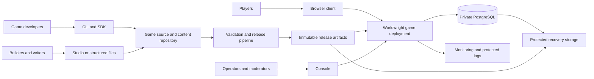
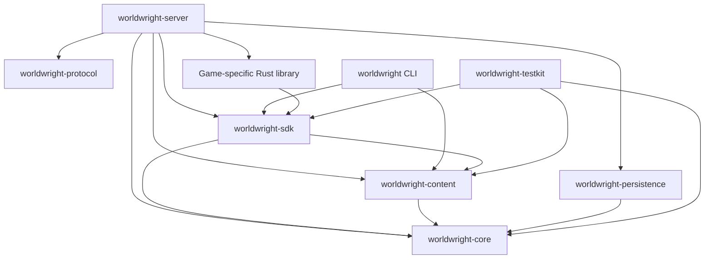
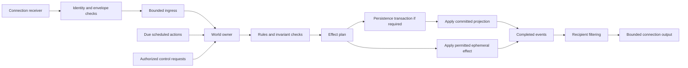
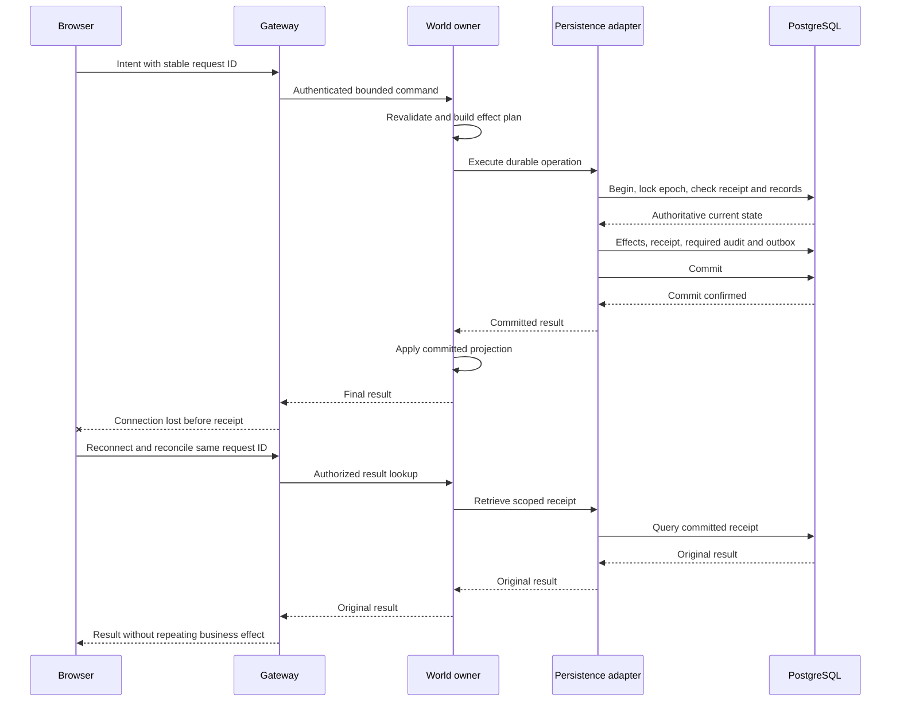
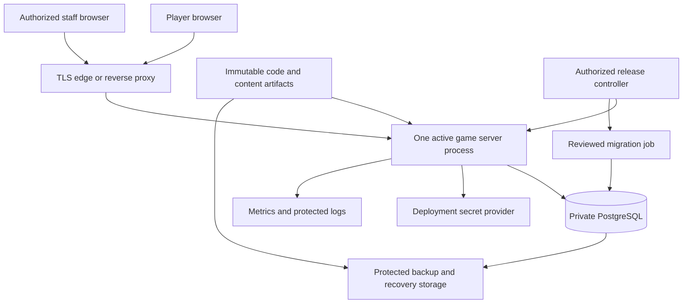

# Worldwright — Architecture

**A Rust toolkit for building and operating persistent multi-user domains**

| Attribute | Value |
|---|---|
| Document version | 0.1 — proposed baseline |
| Prepared | October 20, 2026 |
| Architecture style | Modular monolith; one authoritative world per server process initially |
| Implementation status | In-memory runtime, strict JSON content loading, Local Play, and authenticated process-local Transport v0.1; see verification for Windows evidence and provenance limits; no public deployment |
| Companion documents | [README.md](README.md) · [DESIGN.md](DESIGN.md) |

> **Reading guide:** This file maps the target system, with rationale in [DESIGN.md](DESIGN.md). [RUNTIME.md](docs/RUNTIME.md) documents the implemented local subset: the core runtime owns state and attachment records, evaluates scoped rules, stages changes, and resolves message recipients before returning a committed in-memory result. Testkit builds a two-room world through its public builder. Transport v0.1 adds a separate bounded loopback service; no database participates yet. The wider diagrams remain proposed infrastructure, with prose explanations for readers without Mermaid support.
>
> **Not a deployment specification:** The local default `127.0.0.1:3000` listener is implemented for Transport v0.1. Production listener ports, domains, topology, dependency versions, cloud products, sizing, and public API deployment remain unassigned. Their eventual values must be verified against real code and deployment artifacts. The architecture does not claim production readiness, automatic failover, or measured capacity.

## Contents

- [Architecture at a Glance](#architecture-at-a-glance)
- [System Context](#system-context)
- [Logical Components](#logical-components)
- [Workspace and Dependency Structure](#workspace-and-dependency-structure)
- [Runtime Process Model](#runtime-process-model)
- [Interfaces and Trust Boundaries](#interfaces-and-trust-boundaries)
- [Runtime Flows](#runtime-flows)
- [Data Architecture](#data-architecture)
- [Content and Tooling Architecture](#content-and-tooling-architecture)
- [Deployment Views](#deployment-views)
- [Startup and Shutdown](#startup-and-shutdown)
- [Release and Recovery Architecture](#release-and-recovery-architecture)
- [Observability](#observability)
- [Security Placement](#security-placement)
- [Scaling and Evolution](#scaling-and-evolution)
- [Implementation Order](#implementation-order)
- [Architecture Review Checklist](#architecture-review-checklist)
- [Document Control](#document-control)

## Architecture at a Glance

Worldwright separates reusable engine infrastructure, developer tools, and individual games. The initial server combines transport, application services, simulation coordination, and persistence adapters in one process. It does not split every product name into a service.

### Reference stack

| Concern | Proposed choice | Architectural responsibility |
|---|---|---|
| Implementation language | Rust | Typed domain model, explicit ownership, libraries and applications |
| Async networking | Tokio | Connection tasks, timers, bounded I/O coordination |
| HTTP / WebSocket adapter | Axum | Request routing, authentication integration, protocol handling |
| Web presentation | Static HTML/CSS/JS and focused browser interaction; Askama deferred | Local player shell and transport reference client |
| Persistence | PostgreSQL through SQLx | Durable facts, atomic operations, receipts, audit, outbox |
| Content | Versioned JSON and immutable release artifacts | Game definitions and reproducible publication |
| Server configuration | Versioned TOML with secret references | Validated deployment behavior |
| Packaging | Reproducible binaries or containers | Exact code/content release identification |

The workspace selects Rust 1.85.1 / edition 2024 and package version 0.1.0-dev.0. Serde, serde_json, serde_path_to_error, Tokio, Axum, Argon2, getrandom, and futures are integrated for the local transport slice; SQLx/PostgreSQL and Askama remain deferred. Those libraries do not automatically provide the game's authorization, consistency, or recovery guarantees; those belong to the application design.

### Architectural commitments

- One authoritative mutable simulation owner per world.
- One active server writer for that world, with explicit takeover and durable writer fencing.
- PostgreSQL is authoritative for durable state; memory is its execution projection plus permitted ephemeral state.
- Tools use supported contracts, never unrestricted production database writes.
- Game rules are trusted Rust modules compiled with the server, not remotely uploaded native plugins.
- Content activation is a maintenance operation in the first release.
- HTTPS and secure WebSockets are the first player-facing transports.
- Separate preview, staging, and production credentials and data.

See the [decision register](DESIGN.md#decision-register) and [persistence contract](DESIGN.md#persistence-and-recovery) for rationale and failure semantics.

## System Context



Players interact with a deployed game. Developers and builders produce reviewed code and content; the release pipeline produces immutable artifacts. Console submits authorized operations to the game deployment. The private database and recovery storage are infrastructure, not client interfaces.

### Actors and ownership

| Actor | Entry point | Authority |
|---|---|---|
| Player | Browser account and gameplay interface | Own account/character and permitted world actions |
| Developer | CLI, SDK, repository, CI | Approved code changes and local development |
| Builder | Files or Studio | Scoped draft content and isolated previews |
| Publisher | Reviewed release workflow | Approved artifact activation for a specific environment |
| Moderator | Console | Scoped reports, conduct actions, and investigation |
| Operator | Console and deployment control | Drain, deploy, restore, inspect health |
| Security / project owner | Policy and review workflow | Identity, release, licensing, and risk decisions |

A developer workstation, a browser tab, and a production container are different trust domains even if one person operates all three.

## Logical Components

The following modules may initially live inside existing crates or the server application. Extract crates when a stable boundary provides value; do not create empty components just to reproduce this table.

| Component | Responsibility | Main inputs / outputs | Ownership boundary |
|---|---|---|---|
| Transport gateway | HTTP/WebSocket framing, limits, connection lifecycle | Requests and frames → authenticated envelopes | Owns sockets, not world entities |
| Identity service | Login, session lifecycle, account restrictions | Credentials/session handles → verified identity | Owns account/session transactions |
| Application coordinator | Maps requests, authorizes use cases, invokes adapters | Protocol DTOs → domain commands/results | Composition and orchestration |
| Session attachment registry | Character attachment and connection generation | Attach/takeover/revoke → current attachment | Coordinates with world owner |
| World owner | Serializes authoritative command and timer processing | Commands and due work → state transitions | Sole mutable simulation owner |
| Rule evaluator | Resolves reusable and game-specific behavior | Read context + intent → effect plan | No direct transport/persistence calls |
| Scheduler | Ordered delayed work and cancellation | Schedule intents + time → due actions | Mutated by world owner |
| Content registry | Loaded immutable validated definitions | Release artifact → definition lookups | Immutable for active release |
| Persistence adapter | Implements durable operation transactions | Effect/operation plans → committed records/results | Owns SQL, locks, mapping, receipt lookup |
| Audit service | Attributable protected control records | Authorized action metadata → durable audit | Participates in required transactions |
| Output projector | Visibility filtering and presentation messages | Completed events/snapshots → recipient output | Cannot change world state |
| Outbox dispatcher | Retries committed external side effects | Durable outbox rows → delivery attempts | Separate from game-rule execution |
| Supervisor / health | Startup, drain, failure propagation, readiness | Task state and dependencies → service state | Can stop admission and terminate world |

### What is not a service

“Engine” and “SDK” are not network endpoints. “Studio” is not automatically a production content microservice. “Testkit” is not a second game server with independent rules. “Console” is not an unrestricted shell.

In the initial deployment, staff pages can be modules hosted by the server while preserving distinct authentication, authorization, and route exposure. Separately packaging them is an operational choice, not a prerequisite for a clean design.

## Workspace and Dependency Structure

### Proposed tree

The four application and six library directories below contain the workspace, core interfaces, implemented local transport, and remaining integration stubs. Runtime responsibilities beyond [CORE_INTERFACES.md](docs/CORE_INTERFACES.md) remain proposed. Studio/Console and persistence remain stubs. Cargo.lock is included; `scripts/` and `.github/workflows/ci.yml` supply local/CI checks. Other deployment/content directories remain guidance placeholders. See [development](docs/DEVELOPMENT.md), [SERVER.md](docs/SERVER.md), and [verification](docs/VERIFICATION.md).

```text
worldwright/
├── Cargo.toml
├── Cargo.lock                    # Cargo-generated and supplied; keep committed
├── scripts/                      # Bash and PowerShell developer workflows
├── .github/workflows/ci.yml       # Configured Linux/Windows checks
├── README.md
├── DESIGN.md
├── ARCHITECTURE.md
├── SECURITY.md                   # Proposed security policy; reporting route pending
├── CONTRIBUTING.md               # Proposed contribution and review policy
├── CODE_OF_CONDUCT.md             # Proposed conduct/reporting/appeal policy
├── DEFINITIONS.md                 # MU* terms, traditions, and compatibility limits
├── apps/
│   ├── worldwright/              # Developer CLI
│   ├── worldwright-server/       # Server composition root and reference host
│   ├── worldwright-studio/       # Optional separately packaged builder app
│   └── worldwright-console/      # Optional separately packaged staff app
├── crates/
│   ├── worldwright-core/
│   ├── worldwright-content/
│   ├── worldwright-protocol/
│   ├── worldwright-persistence/
│   ├── worldwright-sdk/
│   └── worldwright-testkit/
├── examples/                     # Reference-game content and scenario fixtures
├── migrations/                   # Reviewed toolkit database migrations
├── tests/                        # Cross-component and deployment verification
├── docs/
│   ├── decisions/
│   ├── content/
│   ├── testing/
│   └── operations/
└── deploy/                       # Future environment/deployment artifacts
```

Keep application directory, Cargo package, and binary names aligned. A separately compiled reference-game binary also belongs under `apps/`; reusable game-specific Rust libraries belong under `crates/` or in their own game workspace. Do not turn the `examples/` content directory into an undocumented alternate location for production application binaries.

### Library boundaries

| Package | Owns | Allowed internal dependencies | Must not depend on |
|---|---|---|---|
| `worldwright-core` | IDs, world records, commands/effects, rule contracts, scheduling primitives | None of the other Worldwright packages | Axum, SQLx, application binaries, game-specific packages |
| `worldwright-content` | JSON models, validation, manifest and runtime-definition conversion | Core | Server app, production DB, SDK facade |
| `worldwright-protocol` | Wire DTOs, envelope/version rules, protocol validation | Prefer none; keep transport representation independent | Core mutation APIs, SQLx, server app |
| `worldwright-persistence` | SQL mappings, transaction implementations, migration integration | Core | Protocol presentation, game UI, server app |
| `worldwright-sdk` | Supported public facade, registration helpers, stable exports | Core, content | Server app, concrete database adapters |
| `worldwright-testkit` | Fixtures, fake clock/RNG, scenarios, assertions | Core, content, SDK; persistence for optional integration support | Production server application internals |

The application coordinator translates between protocol DTOs and core types. This avoids making a wire-format change propagate directly into gameplay rules.

Rule interfaces belong in core and are re-exported or wrapped by SDK; core must not depend on SDK, which would create a cycle. External games depend on SDK and supply implementations registered by their server composition root.



Arrows mean **compile-time dependency**, not network traffic. The game-specific library is optional in the generic host but required when a game supplies custom compiled rules. Optional Testkit persistence integration is omitted from the diagram for readability.

### Composition root

The server application selects concrete adapters, creates bounded channels, loads content and the local account registry, registers game rules, and supervises the owner/connection tasks. Tokio and Axum are assembled here for Transport v0.1; SQLx/PostgreSQL and durable configuration remain future composition-root work.

Keep async orchestration out of pure rule code. Avoid a globally accessible application-state object containing both unrestricted world mutation and database credentials. Transport state should hold only the capabilities required to submit requests and inspect safe service status.

## Runtime Process Model

### Task placement

| Task / activity | Execution location | Blocking / backpressure policy |
|---|---|---|
| HTTP accept and routing | Tokio/Axum tasks | Request-body and concurrency limits |
| WebSocket receive | Per-connection task | Frame limits, bounded ingress admission |
| WebSocket send | Per-connection writer task | Bounded output; disconnect slow consumers |
| Authentication hashing | Bounded blocking-work facility | Explicit concurrency and input limits |
| World owner | One supervised task per process | Ordered state-changing execution |
| Durable world operation | Awaited through SQLx adapter by world owner | One pending mutation initially; transaction deadline |
| Snapshot construction | World-owner boundary or safe versioned projection | Bounded cost and output size |
| Outbox dispatch | Supervised background task | Bounded concurrency, retry/backoff, age monitoring |
| Content validation | CLI/build process; bounded startup validation | Not on the gameplay hot path |
| Preview | Separate process/environment | Separate database/state and credentials |
| Health/metrics | Lightweight handlers and supervisor state | Must not wait on a long world command to report health |

A Rust async task is not a security sandbox. CPU-heavy callbacks can starve their execution thread, and arbitrary native code cannot be safely killed with an async timeout. Enforce code-review constraints and process-level recovery; add isolation only through a separate reviewed design.

### Command flow inside the process



The ephemeral path is permitted only for effects explicitly classified as non-durable. It must not become a shortcut for inventory, rewards, or administrative changes.

### Admission and fairness

Bound both per-connection queues and total world work. Fair scheduling prevents one active account from monopolizing the world even when each individual message is valid.

Reserve a bounded control path for drain, shutdown, revocation, and other supervisory signals so player traffic cannot indefinitely delay them. Control messages still need authorization and cannot interrupt a database transaction by pretending it did not happen.

When the owner awaits a durable operation, socket tasks can continue receiving only until their admission budgets are exhausted. This baseline knowingly couples database latency to world progress. Improve it only after profiling and a revised conflict/recovery design.

## Interfaces and Trust Boundaries

These are semantic interface contracts; Transport v0.1 wire schemas are specified in [PROTOCOL_V1.md](docs/PROTOCOL_V1.md), while production URLs and durable interfaces remain open.

| Interface | Caller → receiver | Transport | Authentication / authorization | Contract location |
|---|---|---|---|---|
| Account lifecycle | Browser → identity/application layer | HTTPS | Login-specific controls; revocable session afterward | Future HTTP specification |
| Gameplay | Browser → transport gateway | Secure WebSocket | Session, allowed origin, character ownership, connection generation | Future versioned protocol specification |
| Content validation | CLI/Studio → validator | In-process library / local tool call | Filesystem/project permissions | Content schema and diagnostic format |
| Preview launch | Developer/Studio → preview supervisor | Local process control initially | Project access; isolated credentials | Preview lifecycle documentation |
| Publication request | Authorized publisher → release workflow | Authenticated control channel | Environment scope, artifact identity, approval | Future control API/workflow contract |
| Administrative operation | Console → application/control layer | HTTPS | Current capability, target scope, reason, audit | Future control API specification |
| Core rule call | Owner → trusted game module | Rust call | Registered trusted module; bounded interface | SDK/core API documentation |
| Durable operation | Coordinator → persistence adapter → DB | Rust call / PostgreSQL protocol | Least-privilege DB credential and writer epoch where applicable | Transaction contract and migrations |
| External side effect | Outbox dispatcher → external service | Reviewed service protocol | Scoped machine credential | Adapter-specific contract |

HTTP routes should ultimately have an OpenAPI or equivalent authoritative specification, and WebSocket messages need their own explicit schema/compatibility documentation. An HTTP specification alone does not describe the complete interactive protocol.

### Boundary rules

- Browser fields never establish trusted account, role, or world ownership.
- Console and Studio are clients of application contracts, not database owners.
- Game data cannot select arbitrary code to execute.
- Deployment secrets are resolved by the server environment, not embedded in content artifacts.
- Logs and telemetry receive sanitized data, not complete credential-bearing requests.
- Every separate adapter translates failure semantics rather than reducing all failures to “command failed.”

## Runtime Flows

### Player entry

1. Browser establishes a session using the chosen account flow over HTTPS.
2. Player requests a character attachment.
3. Server validates account restrictions, ownership, and current connection policy.
4. WebSocket upgrade validates the expected browser origin and session.
5. Runtime establishes the controlling attachment generation.
6. Client and server agree on supported protocol behavior.
7. Server sends a visibility-filtered initial snapshot and current stream identity.
8. The connection begins submitting bounded command intents.

The attachment and transport handshake may be combined or ordered differently in the final API, but the invariants must hold before any game command is admitted. Reconnect follows the [design's generation and receipt reconciliation rules](DESIGN.md#protocol-and-player-experience).

### Durable action and lost response



The adapter also compares intent fingerprints and enforces business uniqueness independent of the request ID. The diagram shows a confirmed commit followed by a lost response; an uncertain commit is a different state requiring resolution before further mutations.

### Moderator action

1. Moderator authenticates with the approved privileged-access policy.
2. Console requests only information within the moderator's scope.
3. A mutation request carries target, reason, and operation identity.
4. Application services recheck capability and target scope.
5. World-affecting changes enter the authoritative owner; account restrictions use the identity service and trigger attachment revocation.
6. The action and required audit commit together within the responsible transaction boundary.
7. Runtime updates projections/attachments before acknowledging the completed control action.
8. Console receives a structured result, not unrestricted database output.

Cross-boundary actions, such as a durable account ban followed by disconnecting live attachments, need explicit convergence: the ban is authoritative immediately after commit, new admission is denied, and existing attachments are invalidated even if the requesting browser disconnects.

### Content release

1. Builder edits files or a Studio draft.
2. Shared validator resolves the complete content graph.
3. CI runs static validation and scenario tests.
4. An artifact is assembled with a manifest and digest.
5. A publisher approves the artifact for a named environment.
6. Staging starts against isolated data and runs acceptance scenarios.
7. Production enters maintenance and drains the old runtime.
8. The release workflow performs compatibility checks and approved migrations.
9. Server loads the exact active artifact and durable state.
10. Readiness and smoke checks allow player admission.

Artifact digest verification detects corruption or mismatch. It does not prove provenance if an attacker controls both artifact and expected digest; protect the release pipeline and artifact metadata, with signing when the threat model requires it.

## Data Architecture

### Authoritative stores

| Store | Contents | Writer | Readers |
|---|---|---|---|
| PostgreSQL account/security data | Accounts, session records, restrictions, capabilities | Identity and authorized control services | Authentication and scoped staff queries |
| PostgreSQL world data | Persistent characters, locations, items, claims, progression | Fenced persistence operations invoked by world owner | World load, transactional validation, scoped queries |
| PostgreSQL operation receipts | Scoped intent fingerprints and committed results | Same transaction as the protected operation | Authorized retry/reconciliation path |
| PostgreSQL audit | Privileged actions and approved summaries | Responsible transactional services | Authorized investigation and review |
| PostgreSQL outbox | Durable pending side effects and delivery state | Business transactions; dispatcher updates delivery metadata | Dispatcher and operations monitoring |
| Immutable artifact storage | Code images/binaries, content bundles, manifests | Approved build/release pipeline | Deployments and restore procedures |
| Runtime memory | Active projection, connections, timers, queues | Explicit task owners | Safe query/effect interfaces |
| Protected backup storage | Recoverable database state and required artifacts | Backup/recovery system | Authorized restore process |

These are logical data groups, not finalized table names. A single private database may host the initial groups. Splitting them into independent databases would introduce cross-store consistency work and is not the baseline.

### Durable-state mapping

Implementation should provide an explicit mapping from domain concepts to relational constraints:

- Typed IDs → primary keys and validated references.
- Item holder → exclusive valid ownership relationship.
- Reward generation → uniqueness constraint for the business entitlement.
- Request identity → scoped uniqueness plus intent fingerprint.
- Aggregate version → optimistic conflict check or locked-record transition.
- Writer epoch → transactionally checked world authority.
- Content reference → persisted identifier with a compatible release/migration mapping.
- Administrative mutation → attributable audit in the same transaction.

Database constraints supplement application checks. A single world task cannot protect data against maintenance scripts or a second process unless write authority is constrained and the database transaction checks it.

### Query paths

Player state reads are visibility-filtered application queries. Operator dashboards may use read models with explicit freshness indicators. Do not let a stale read model approve an item transfer or reward claim.

Live staff interfaces must not hold long database transactions or run arbitrary unbounded queries against gameplay tables. Export/reporting jobs require resource limits and appropriate data access.

### Recovery coupling

A database backup without its compatible content release may be insufficient to restore a game. Preserve the release manifest and content artifacts referenced by the recovery point. Restored services must not load whichever content file happens to be newest on disk.

See [Persistence and Recovery](DESIGN.md#persistence-and-recovery) for commit uncertainty, fencing, and the distinction between process recovery and disaster recovery.

## Implemented Content Loading v0.1

The developer CLI delegates to `worldwright-content`: bounded file/byte read -> streaming duplicate/depth guard -> version dispatch -> private schema records -> semantic/reference validation -> immutable validated definitions -> deterministic room mapping -> `WorldBuilder`. Core remains independent of Serde, JSON, and filesystem APIs.

`WorldInstantiation::into_parts()` separates the builder and `WorldLookup`. The host supplies world identity, characters, rule registry, and attachments. Named exit lookup resolves syntax without weakening core movement checks. The `content validate` preflight builds a character-free world with an empty rule registry and never executes commands or starts a listener. The separate `play` command consumes the same builder/lookup, supplies one local actor and ReferenceGame, and executes typed commands in-process. Its input framer and terminal renderer live under `apps/worldwright/src/commands/`; the core runtime and content loader remain unchanged. No socket or database is opened. SDK exposes the content crate as `worldwright_sdk::content`.

Source responsibilities and limits are in [schema v1](docs/content/SCHEMA_V1.md); the runnable reference is [examples/two-room](examples/two-room/README.md). Release digests, activation, persistence, browser transport, and Studio remain future work.

## Implemented Transport v0.1

`apps/worldwright-server` now combines the HTTP/WebSocket gateway, bounded account/session service, and one world-owner task. The owner exclusively holds `WorldRuntime`, `WorldLookup`, operation/tick state, and exact attachment routes. Gameplay, control, and per-connection output channels are bounded; cancellation is out of band for takeover, logout/expiry, shutdown, slow consumers, and internal failures.

The gateway requires one exact configured Origin, binds only to loopback, uses a process-local 12-hour opaque session cookie, and serves a same-origin text browser client. Default mode expects an HTTPS edge while the application listener remains plaintext loopback; explicit insecure HTTP is local development only. No persistence, restart recovery, built-in TLS termination, proxy trust, public deployment, or stable SDK compatibility is implied.

Protocol details are in [PROTOCOL_V1.md](docs/PROTOCOL_V1.md), runnable setup is in [SERVER.md](docs/SERVER.md), and the real loopback WebSocket cases are covered by server library tests.

## Content and Tooling Architecture

### Shared content pipeline

`worldwright-content` is the shared source of validation and conversion behavior. CLI, Studio, server startup, and Testkit use that library rather than implementing independent parsers with subtly different rules.

The pipeline transforms:

**Authoring documents → Validated definition graph → Release manifest/artifact → Immutable runtime registry**

Game-specific content extensions register validators and conversion logic through reviewed SDK facilities. Production never treats unknown extension data as executable code.

### Studio placement

Initial Studio capability may be limited to file editing plus CLI validation. A later server-rendered or separately packaged editor uses the same diagnostic contract and an explicit draft revision model.

Studio preview has its own server process, game data, content release, and credentials. It may use an ephemeral development database, but must not accidentally bind to a production connection string through inherited environment variables.

### CLI placement

The CLI is a local orchestrator, not a second authority for game state. It may invoke builds, validate content, prepare artifacts, or start isolated development services once those operations are implemented and documented.

Production deploy/control functionality must require a separate authorized target and explicit confirmation for destructive operations. Local and remote operations must be distinguishable to avoid “development” commands unexpectedly altering a live world.

### Testkit placement

Pure scenarios call the same core and game rule implementations with controlled clock and randomness. Persistence integration tests use real PostgreSQL behavior, not an in-memory mock claiming transactional equivalence.

A fault-injection seam around persistence can simulate failures before execution, during transaction progress, and after a committed result is lost. Full process-kill tests remain necessary to verify what a mock cannot reproduce.

## Deployment Views

### Local development

```text
Developer workstation
  |
  +-- Repository: Rust sources + structured content
  +-- Worldwright CLI / test runner
  +-- Game server process
  |     +-- Browser and optional local staff interfaces
  |     +-- One authoritative world owner
  |
  +-- Development PostgreSQL
  +-- Isolated preview server/database when needed
```

Local services use loopback or deliberately configured interfaces. Development credentials and sample data must be visibly distinct from production. A container-based database is an option, not a requirement specified by this document.

### Staging and initial production



Staging and production use separate instances of these resources. The diagram is a logical topology; edge, host, database, and storage can be selected for the organization's hosting environment.

### Network exposure

| Surface | Initial exposure rule |
|---|---|
| Player HTTPS / secure WebSocket | Public edge only |
| Staff application routes | Strong authorization plus approved restricted exposure where feasible |
| Application listener behind edge | Private interface or local socket/loopback as topology permits |
| PostgreSQL | Private, limited to approved application/migration/recovery identities |
| Metrics / diagnostic detail | Internal monitoring only |
| Health probes | Minimal status; sensitive detail remains restricted |
| Artifact / backup administration | Privileged deployment/recovery identities only |

No application-specific port number is assigned. The edge may use conventional HTTPS service exposure, but actual listener ports and proxy trust settings must be specified in deployment configuration and reflected in README instructions once verified.

### Process and credential policy

- Run the application as a non-root identity where supported.
- Give the runtime only the database privileges needed for reviewed operations.
- Use a separate, more privileged migration identity during controlled release windows.
- Keep backup and restore authority separate from ordinary gameplay credentials.
- Use a read-only application filesystem where practical, with explicit writable locations.
- Obtain secrets from the selected deployment mechanism; never bake them into a container layer or content artifact.
- Pin the deployed binary/image and content by immutable identity.
- Do not allow a load balancer to spread one world's players across independently mutating replicas.

Container orchestration does not make two active world owners safe. Start with a single active instance and an explicit, fenced replacement procedure.

## Startup and Shutdown

### Startup sequence

1. Parse configuration, validate the schema, and resolve allowed overrides.
2. Resolve secrets without logging their values.
3. Initialize sanitized logging, metrics, and supervision.
4. Verify binary, game module, protocol, content, and schema compatibility.
5. Connect to PostgreSQL and verify required migrations are present.
6. Acquire world writer authority through the approved startup/takeover workflow.
7. Load the exact active content artifact and validate its integrity.
8. Load durable world state and reconcile all required content references.
9. Construct game rules, scheduler state, and the runtime projection.
10. Start bounded connection/output paths, outbox dispatch, and control interfaces.
11. Run startup checks, then mark readiness and enable player admission.

Public admission remains closed until reconstruction succeeds. Migration execution is a controlled release action, not an automatic race among starting application replicas.

If the server obtains a writer epoch and then fails startup, it remains unavailable. Recovery uses a new controlled attempt; do not keep retrying takeover in competing processes.

### Service states

| State | Admission | Mutation | Meaning |
|---|---|---|---|
| Starting | Closed | Initialization only | Configuration, compatibility, authority, and load checks |
| Ready | Open under limits | Enabled | Safe to serve intended workload |
| Degraded | Restricted by cause | Only explicitly safe operations | A dependency or budget is impaired |
| Draining | Closed | Finishes admitted work under deadline | Preparing controlled stop or maintenance |
| Failed | Closed | Disabled | Invariants or authority cannot be established |
| Stopped | Closed | None | Process/world service terminated |

“Degraded” must have a precise reason. It is not permission to acknowledge durable commands while the database is unavailable.

### Graceful shutdown

1. Mark not-ready and stop new player admission.
2. Notify connected players of maintenance where possible.
3. Stop accepting new game mutations and new expensive background jobs.
4. Finish or resolve the current durable transaction within the shutdown budget.
5. Persist required checkpointed state according to its defined policy.
6. Stop background dispatch cleanly; remaining outbox rows stay durable.
7. Close player attachments, pools, and task supervisors.
8. Exit; replacement authority is acquired through the release workflow.

If the shutdown deadline forces termination, startup recovery must handle it. A signal handler cannot guarantee every in-flight transaction's outcome is known, and deployment must not treat forced exit as proof of rollback.

## Release and Recovery Architecture

### Release unit

A deployable release combines:

- Engine/server build identity and trusted game module versions.
- Protocol compatibility metadata.
- Content release identity and digest.
- Database migration range and game-state schema version.
- Configuration schema compatibility.
- Dependency/license inventory and applicable template/content notices.
- Relevant test and approval evidence.

The release manifest is the reference used during deployment, diagnosis, and recovery. “Latest image plus latest content” is not an acceptable release identity.

### Pipeline stages

| Stage | Required checks / outputs |
|---|---|
| Source review | Scoped change, intended contract, ownership/license provenance |
| Build checks | Formatting, compile, lint, unit tests on selected toolchain |
| Integration | PostgreSQL transactions, migrations, receipt/recovery tests |
| Content validation | Complete graph, semantics, scenarios, immutable artifact |
| Security/dependency review | Dependency risks, secrets, access boundaries, required notices |
| Staging | Full release tuple, isolated data, smoke play and failure exercises |
| Approval | Service/security/content owners accept relevant evidence |
| Production change | Drain, backup/recovery readiness, migrate, start, verify |
| Post-release | Monitor error/latency/queue signals and record deployed identities |

### Rollback versus restore

- **Binary rollback:** valid only when the older code understands the current schema and game-state encodings.
- **Content rollback:** valid only when persistent references and effects remain compatible.
- **Forward repair:** needed when reverting code/content would not reverse a durable migration safely.
- **Restore:** replaces state from an approved recovery point and may lose post-point changes; requires explicit operational approval and player-impact assessment.

Do not run a destructive down-migration automatically because the new server failed readiness. Prefer expand/contract schema evolution and rehearsed recovery procedures.

### Recovery drills

A restore drill should use isolated infrastructure, restore the required database and artifacts, disable or redirect external side effects, validate world reconstruction, and run a short scripted game scenario.

External notification replay deserves special care: a restored outbox can include events delivered after the backup point. Consumers need deduplication where applicable, and restore procedures must prevent accidental re-sending of sensitive or costly effects.

Record measured recovery time, recovered point, unresolved discrepancies, and corrective actions. RPO/RTO targets are open decisions listed in DESIGN, not values asserted here.

## Observability

### Measurements

| Area | Signals |
|---|---|
| Connections | Active/accepted/rejected, disconnect reason classes, heartbeat failures |
| Admission | Command rate, queue depth, queue wait, fairness/rejection categories |
| World owner | Processing duration, timer lag, callback duration, state transition errors |
| Persistence | Transaction duration, pool wait, rollback/conflict rate, unknown outcomes |
| Integrity | Duplicate-claim prevention, stale epochs, failed invariant checks |
| Content | Active release, validation failures, incompatible references |
| Outbox | Pending count, oldest age, attempts, terminal delivery failures |
| Security | Login failures, session revocations, denied privileged operations |
| Recovery | Backup age, restore-drill result, last successful recovery verification |

Keep metric labels bounded. Account IDs, names, raw commands, and operation identifiers belong only in appropriately controlled diagnostic records when necessary—not as metric dimensions.

### Correlation

Logs should correlate a request, world, release identity, and operation ID without exposing credentials or private content. Distinguish user rejection, conflict, infrastructure failure, and internal invariant violation.

Trace the time spent in ingress, world queue, rule execution, database transaction, and output delivery. Otherwise a slow client, a slow query, and a hung rule all look like the same “lag.”

### Alert ownership

Every alert needs an owner and action: stale backup, unknown transaction outcome, writer fencing failure, failed content activation, sustained queue growth, or repeated authentication abuse.

Do not imply round-the-clock response until staffing and escalation are established. Operational beta requires named service ownership and an honest support policy.

## Security Placement

The detailed behavioral baseline is in [Identity and Authorization](DESIGN.md#identity-and-authorization). [SECURITY.md](SECURITY.md) adds proposed reporting, support, threat-model, privacy, and release requirements; its reporting routes and staffing remain pending. This section maps controls to components.

| Threat / concern | Control placement |
|---|---|
| Forged player identity | Identity layer and trusted command-envelope construction |
| Stale queued command after takeover/revocation | Execution-time generation and capability checks in world owner |
| Cross-site browser requests | HTTP CSRF handling and WebSocket origin checks at gateway |
| Stored/reflected script injection | Output projection, escaping, safe templates, browser policy |
| Login resource exhaustion | Bounded password-hashing work and layered admission limits |
| Valuable item duplication | Persistence uniqueness/locking, receipts, business claim keys |
| Tool bypass of game invariants | No production DB access for Studio/Console; authorized application operations |
| Malicious content artifact | Bounded validation, provenance-controlled publication, immutable activation |
| Untrusted native extension | Prohibited in baseline; future isolation requires separate design |
| Accidental dual server | Release-controller fencing plus transactional writer epoch |
| Secret exposure | Secret provider, redaction, filesystem/process access policy |
| Privileged abuse | Scoped roles, stronger authentication, reason/approval, transactional audit |
| Sensitive data over-retention | Explicit retention, access, and deletion policies |
| Compromised build or dependency | Reviewed build pipeline, pinned artifacts, dependency/license inventory |

Network isolation is defense in depth, not a substitute for authentication. A same-origin staff page is not automatically authorized. A separate staff hostname, if later chosen, requires a deliberate cookie, origin, and identity design rather than casually widening CORS.

## Scaling and Evolution

### Scale only the observed bottleneck

1. Measure queue wait, rule cost, database latency, and fan-out.
2. Correct inefficient rules/queries and excess output.
3. Improve read projections and cache immutable content.
4. Tune bounded I/O concurrency and database pooling.
5. Consider independent worlds as separately deployed server instances.
6. Consider partitioning one world only when evidence justifies the consistency cost.

A connection gateway can eventually scale independently, but commands still need routing to the correct world owner. Scaling web frontends does not increase single-world simulation throughput by itself.

### Possible future boundaries

| Future change | Why it might help | Required new design |
|---|---|---|
| Separate gateway | More connections / transport isolation | Owner routing, authentication propagation, backpressure across network |
| Multiple independent worlds | Natural population or game isolation | World-specific data/credentials, routing, per-world recovery |
| Zone workers inside one world | Expensive simulation partitioning | Cross-zone ownership transfer, messaging order, timers, failure handling |
| Async aggregate-level persistence | Continue unrelated work during DB waits | Reservations, conflict scopes, completion ordering, uncertain-outcome recovery |
| Hosted multi-tenant toolkit | Managed service business model | Tenant isolation, quotas, credential boundaries, billing/legal review |
| Untrusted scripts | Builder programmability | Real sandbox, capability model, fuel/memory limits, upgrade policy |
| Traditional-client gateway | Legacy client support | Negotiation, text encoding, TLS/auth policy, terminal escaping |
| Live content activation | Less maintenance downtime | Compatible live references, migration barriers, rollback semantics |

Do not introduce Kafka, Redis, Kubernetes, an ECS framework, or a distributed scheduler solely because multiplayer software often uses them. Each adds operational and consistency responsibilities that must solve a demonstrated problem.

## Implementation Order

Implement vertically through the boundaries, not one enormous subsystem at a time.

| Step | Minimal implementation | Verification before expansion |
|---|---|---|
| 1 | Workspace, core IDs, minimal content loader, CI | Reproducible checks and validated two-room fixture |
| 2 | World owner, look/move rules, fake clock, Testkit scenario | Deterministic headless traversal and invalid-command rejection |
| 3 | Browser transport, sessions, attachments, bounded queues | Implemented locally; two-user, stale attachment, takeover, revocation, and slow-client tests pass; broader production/deployment gate remains open |
| 4 | Persistence schema, writer fencing, one durable item/reward flow | Next major increment: transaction failure windows, duplicate attempts, restart |
| 5 | Release manifest, content validation/package/activation | Staging activation and incompatible-content rejection |
| 6 | Console control path, privilege scopes, audit, observability | Unauthorized actions denied; controlled drain and recovery |
| 7 | Isolated preview and initial Studio conveniences | Builder completes a zone without production credentials |
| 8 | Second game and SDK refinement | Reuse without changing transport or core invariant logic |

Security is not postponed to step 6: authentication and authority are necessary in earlier slices; step 6 completes privileged operational workflows.

Do not ship a CLI command merely because its name appears in a roadmap. Once implemented, verify it, document real options and paths in README, and add regression tests for destructive or environment-sensitive behavior.

## Architecture Review Checklist

Before marking an architectural change ready:

- [ ] The affected DESIGN decision and invariant IDs are identified.
- [ ] Ownership of every new mutable state object is explicit.
- [ ] Compile-time dependency direction remains acyclic.
- [ ] No network handler or tool bypasses the world owner for gameplay mutations.
- [ ] Durable effects have transaction, retry, and uncertain-outcome semantics.
- [ ] New tables/fields have constraints, migrations, and compatibility coverage.
- [ ] New queues, jobs, and inputs have size/concurrency/time limits.
- [ ] Privilege, origin, and secret boundaries are documented and tested.
- [ ] Content activation and recovery still reconstruct a coherent release.
- [ ] Deployment cannot accidentally create two authoritative writers.
- [ ] New observability avoids secret leakage and unbounded metric cardinality.
- [ ] Source, template, dependency, and content licensing remain explicit.
- [ ] README, DESIGN, ARCHITECTURE, and applicable runbooks are updated together.
- [ ] Verification claims distinguish inspection, automated tests, and untested proposals.

## Document Control

This architecture elaborates the product defined in README and implements the proposed contracts in DESIGN. If the three documents disagree, resolve the discrepancy explicitly rather than letting implementation teams select different interpretations.

The documentation package supplies:

- [README.md](README.md): product, suite, roadmap, and proposed licensing.
- [DESIGN.md](DESIGN.md): invariants, decisions, subsystem behavior, compatibility, and acceptance gates.
- [ARCHITECTURE.md](ARCHITECTURE.md): components, dependencies, flows, topology, and lifecycle.
- [CONTRIBUTING.md](CONTRIBUTING.md): proposed governance, review process, contribution rights, and verification standards.
- [CODE_OF_CONDUCT.md](CODE_OF_CONDUCT.md): proposed conduct, reporting, conflict, and appeal procedures.
- [DEFINITIONS.md](DEFINITIONS.md): MU* traditions, glossary, and explicit compatibility limits.
- [SECURITY.md](SECURITY.md): proposed reporting/support policy, threat model, safeguards, privacy, and release gates.

These policies require owner adoption and real reporting channels; documents are not evidence of staffed enforcement or implemented controls. [CORE_INTERFACES.md](docs/CORE_INTERFACES.md) identifies current code boundaries and [DEVELOPMENT.md](docs/DEVELOPMENT.md) covers the supplied local/CI workflows. Protocol v1/local networking and the pinned Windows Rust 1.85.1 gate are implemented and verified. A Linux Transport rerun, hosted CI, persistence, production deployment, migrations, and operational procedures remain pending.

The proposed **MIT OR Apache-2.0** licensing status remains unchanged and pending authorization. No source-code license grant or production capability is established by this architecture description.
