# Worldwright Road Map

## Purpose

This road map converts the product direction in `README.md`, the behavioral contracts in `DESIGN.md`, and the component boundaries in `ARCHITECTURE.md` into dependency-ordered implementation increments. It records what each increment will deliver, what it will deliberately defer, and what evidence is required before the next increment begins.

The intended readers are developers implementing the toolkit, reviewers assessing correctness, builders preparing content, and operators deciding whether an increment is ready for its intended environment. Each milestone describes scope, dependencies, work packages, representative examples, implementation considerations, and an evidence-based exit gate.

A checked box means the repository contains the implementation and its stated verification evidence. It does **not** imply production readiness, an adopted support policy, or completion of later security and recovery work. A passing local test run is not a substitute for deployment verification.

### Document scope and evidence boundary

This expanded edition is based on the supplied `ROAD-MAP.md`. The repository, linked design documents, source code, database migrations, and verification logs were not supplied with it and were not independently inspected during this expansion.

- **Reported baseline** means a capability or test result stated in the original road map, not a new verification claim.
- **Planned requirement** means behavior to implement and verify in a later increment.
- **Proposed implementation** means a concrete starting design for review, not an adopted repository contract.
- **Illustrative example** means a scenario, conceptual structure, or pseudocode example; it is not a guaranteed executable API or file format.
- **Owner decision** means a choice that implementation must not silently settle.

Existing endpoint paths, command names, limits, and test counts are preserved where the source road map specified them. Newly introduced data fields, state names, and examples are explicitly illustrative or proposed. The actual source and versioned contracts must be checked before turning these examples into code.

### How to use this road map

1. Identify the active milestone and confirm its prerequisites.
2. Resolve the decisions that block its first work package.
3. Split work packages into reviewable issues with explicit acceptance tests.
4. Implement the smallest end-to-end path before adding adjacent features.
5. Run positive, negative, concurrency, and recovery tests appropriate to the change.
6. Update the authoritative documents and record the exact verification environment.
7. Move milestone status only when the required evidence exists.

The road map defines **what must be demonstrated**. Detailed API definitions belong in protocol/API documents; architectural reasoning belongs in `DESIGN.md` and `ARCHITECTURE.md`; operating procedures belong in runbooks.

## Contents

- [Current Baseline](#current-baseline)
- [Milestone Chart](#milestone-chart)
- [Delivery Principles](#delivery-principles)
- [Milestone 1 — Foundation and Core](#milestone-1--foundation-and-core)
- [Milestone 2 — Runtime, Content, and Local Play](#milestone-2--runtime-content-and-local-play)
- [Milestone 3 — Multiplayer Transport v0.1](#milestone-3--multiplayer-transport-v01)
- [Milestone 4 — Durable Gameplay v0.1](#milestone-4--durable-gameplay-v01)
- [Milestone 5 — Content Release and Preview v0.1](#milestone-5--content-release-and-preview-v01)
- [Milestone 6 — Operational Control v0.1](#milestone-6--operational-control-v01)
- [Milestone 7 — Builder Workflow and Studio v0.1](#milestone-7--builder-workflow-and-studio-v01)
- [Milestone 8 — Toolkit Maturity](#milestone-8--toolkit-maturity)
- [Decisions Required Before Later Gates](#decisions-required-before-later-gates)
- [Maintenance Rule](#maintenance-rule)
- [Appendix A — Work-Package and Verification Templates](#appendix-a--work-package-and-verification-templates)
- [Appendix B — Cross-Milestone Failure Scenarios](#appendix-b--cross-milestone-failure-scenarios)

## Current Baseline

### Reported repository capabilities

The supplied road map reports the following baseline:

| Area | Reported capability | Boundary or limitation |
|---|---|---|
| Workspace | Rust 1.85.1 workspace with ten packages and a committed lockfile | Package paths, feature combinations, and dependency availability must be checked in the repository |
| Domain model | Typed domain identifiers, commands, effects, rules, scheduling primitives, deterministic test support | Scheduling primitives do not imply a deployed scheduler or durable scheduled jobs |
| Runtime | Non-cloneable, single-owner in-memory runtime | In-memory success is not durable commitment |
| Authority | Authoritative attachment generations | Stale attachments must remain invalid across queued work and disconnect cleanup |
| Gameplay | Staged Look, Move, and Say execution | Inventory, combat, progression, and NPC behavior are not part of this baseline |
| Content | Strict JSON content schema v1 loading and validation | This is not yet a content publication or activation system |
| Instantiation | Deterministic runtime creation and named-exit lookup | Instantiation is not restart reconstruction of durable player state |
| CLI | `worldwright content validate <path>` and `worldwright play <path>` | Local terminal workflows are not multiplayer persistence workflows |
| Earlier verification | Linux evidence for runtime, content, and local play | Provenance limits remain recorded in `docs/VERIFICATION.md` |
| Transport | Local development server/protocol implementation | Milestone 3 evidence is Windows-local; Linux rerun, hosted CI, and deployment verification remain pending |

The server and protocol are locally implemented development slices. Persistence, Studio, and Console remain incomplete. **Durable Gameplay v0.1 is the next active increment.** “Active” here identifies the next implementation priority; it does not assert that the planned persistence work is already implemented.

### What must not be inferred from the baseline

- A successful login does not establish a durable account lifecycle or recovery process.
- A WebSocket `accepted` response does not mean a command executed.
- A `command_result` in protocol v1 reports successful in-memory execution, not a database commit.
- A runtime revision is not automatically a database version, receipt ID, or replay position.
- A process-local session does not survive a restart.
- A local test count is not evidence that the same revision passed another operating system or hosted CI.
- A content file that validates is not automatically authorized for production activation.

### Baseline refresh procedure

Before implementing Milestone 4, pin the repository revision and inspect the actual workspace manifests, runtime interfaces, protocol DTOs, server composition root, and linked documentation. Record discrepancies between the repository and this road map rather than building against assumed names.

**Example:** if the source now implements a durable session store, do not repeat Milestone 4.3 blindly. Record the existing implementation, verify its expiry and revocation behavior, and scope the remaining work around any gaps.

## Milestone Chart

This chart shows implementation dependency and reported status, not delivery dates. Green means the local implementation gate described by the source road map has been met; it does not mean release readiness.

```mermaid
flowchart LR
    M1["Milestone 1<br/><strong>Foundation and Core</strong><br/>Workspace, typed contracts, CI structure"]
    M2["Milestone 2<br/><strong>Runtime, Content, and Local Play</strong><br/>Single-owner runtime, JSON v1, terminal host"]
    M3["Milestone 3<br/><strong>Multiplayer Transport v0.1</strong><br/>Authentication, protocol v1, browser/WebSocket"]
    M4["Milestone 4<br/><strong>Durable Gameplay v0.1</strong><br/>PostgreSQL, writer fencing, durable item/reward flow"]
    M5["Milestone 5<br/><strong>Content Release and Preview</strong><br/>Artifacts, staging activation, isolated preview"]
    M6["Milestone 6<br/><strong>Operational Control</strong><br/>Capabilities, audit, observability, recovery"]
    M7["Milestone 7<br/><strong>Builder Workflow and Studio</strong><br/>Editing, preview, publication requests"]
    M8["Milestone 8<br/><strong>Toolkit Maturity</strong><br/>Second game, SDK stabilization, measured scaling"]
    M1 --> M2 --> M3 --> M4 --> M5 --> M6 --> M7 --> M8
    classDef complete fill:#d1fae5,stroke:#047857,color:#064e3b,stroke-width:2px
    classDef next fill:#fef3c7,stroke:#b45309,color:#78350f,stroke-width:3px
    classDef planned fill:#f3f4f6,stroke:#6b7280,color:#1f2937,stroke-width:1px
    class M1,M2,M3 complete
    class M4 next
    class M5,M6,M7,M8 planned
```



| Visual status | Meaning | Required reading |
|---|---|---|
| Green | Implemented with recorded local verification, as reported by the source | Milestone-specific evidence and outstanding verification limitations |
| Amber | Next dependency-ordered milestone | Entry criteria, blocking decisions, and proposed design |
| Gray | Planned after the current milestone | Scope and prerequisites; not permission to bypass earlier gates |

### Dependency and handoff summary

| Milestone | Consumes | Produces for the next milestone |
|---|---|---|
| 1 | Product direction and domain boundaries | Typed contracts, workspace boundaries, repeatable verification structure |
| 2 | Core contracts | Deterministic in-memory gameplay and strict content loading |
| 3 | Runtime and content | Authenticated, bounded multiplayer transport |
| 4 | Transport and runtime | One authoritative durable operation, receipts, fencing, restart reconstruction |
| 5 | Durable state and compatibility rules | Reviewed immutable releases, staging activation, isolated preview |
| 6 | Durable operations and release controls | Scoped control, attributable administration, exercised recovery |
| 7 | Shared validation, preview, publication control | End-to-end builder workflow without production database access |
| 8 | Multiple proven vertical slices | Reuse-driven SDK policy and measured improvements |

Design, threat modeling, fixture preparation, and usability research may overlap milestones. Activation of a later feature must not bypass a prerequisite gate. For example, Studio mockups may be explored early, but production publication must use the release and authorization controls from earlier milestones.

## Delivery Principles

Every increment must preserve the following constraints.

### 1. One task owns mutable world state

Network handlers never mutate the world directly. The owner task receives bounded requests, validates the relevant authority, and calls runtime operations. Database workers and output writers do not gain general access to mutable runtime state.

**Example:** a WebSocket handler parses `go north`, then submits intent to the owner. It does not look up a mutable character object and change its room.

**Implementation notes:** keep ownership structural, not merely conventional. Avoid sharing the entire runtime behind a general-purpose lock to make integration easier. If durable work runs asynchronously, return a typed completion to the owner and revalidate its operation context before applying it.

### 2. Input expresses intent, not authority

The client may ask to act, but may not establish account, character, connection, or world authority. Authentication supplies the principal; the server supplies the authorized character mapping and current attachment.

**Example:** an `attach` message must not let a caller select an arbitrary character by including a foreign character ID.

**Implementation notes:** translate transport DTOs into domain requests only after validation and authorization. Reject fields that pretend to carry server-only authority rather than ignoring them silently.

### 3. Keep lifecycle facts distinct

| Fact | Meaning | Does not establish |
|---|---|---|
| Authentication | Identity was accepted under the current policy | Runtime attachment or command permission for every target |
| Attachment | A particular connection/generation currently controls a character | Durable session lifetime or command success |
| Admission | Bounded capacity accepted work | Execution, commitment, or delivery |
| In-memory execution | Runtime accepted and applied an operation | Restart survival |
| Durable commitment | Required database changes committed atomically | Receipt of the result by the client |
| Delivery | A result was sent or acknowledged at a specified transport layer | Exactly-once execution or durable client knowledge |

**Example:** a socket closes after a reward commits but before the result reaches the player. The reward may exist even though the player saw no success message. Reconciliation, not an unconditional retry with a fresh key, resolves the uncertainty.

### 4. Bound every untrusted input and asynchronous queue

Bounds include bytes, element counts, concurrent tasks, queue depth, timeouts, retained history, and database/outbox growth policy.

**Implementation notes:** define the rejection or shutdown action alongside every limit. A bounded channel with an unbounded number of tasks waiting to send into it can still cause unbounded memory growth.

### 5. Isolate slow and malicious clients

The owner must not await individual socket writes. A connection that stops reading must not prevent unrelated players from progressing.

**Example:** a full critical output queue causes that route to disconnect; it does not silently drop a command result while presenting the connection as healthy.

**Implementation notes:** test stalled readers and abusive senders separately. Bound producer concurrency and consider fairness between connections as well as total capacity.

### 6. Separate wire DTOs from core mutation APIs

The transport schema is a versioned external contract. The core represents authoritative game behavior. The server is the translation boundary between them.

**Example:** a Move DTO carries a visible exit label. The owner resolves the label against the current room and uses the existing runtime Move contract; the DTO does not directly specify an authoritative destination.

### 7. Render browser output as data

Server content, player names, speech, validation diagnostics, and error text are untrusted display data. Use text-safe DOM operations and bounded rendering.

**Example:** the speech text `` must appear as literal text, not as an image element or executable script.

**Implementation notes:** apply this rule to Studio and operator surfaces too. Sanitized logs and browser-safe rendering are separate concerns; neither substitutes for the other.

### 8. Completion requires aligned evidence and documentation

Implementation, negative tests, documentation, and verification records must agree. A feature that works in a happy-path demonstration but lacks bounds, rejection tests, or documented recovery behavior is incomplete.

**Implementation notes:** record actual commands and environment. Do not copy old test counts forward without rerunning the relevant suite. Do not mark a pending hosted CI run complete because an equivalent local command passed.

## Milestone 1 — Foundation and Core

**Status:** Reported complete in the source milestone chart; the breakouts below explain the baseline rather than asserting newly verified work.

### Goal and scope

Establish a reproducible Rust workspace and a transport-independent domain foundation. Core contracts must be usable by a terminal host, multiplayer server, and future games without giving those hosts arbitrary mutation authority.

### 1.1 Workspace, toolchain, and package boundaries

The reported baseline is Rust 1.85.1, ten packages, and a committed lockfile. Confirm package responsibilities from `Cargo.toml` and `ARCHITECTURE.md`; this document does not invent a package list.

**Implementation notes:** pin the supported toolchain, keep dependencies in their owning layers, and make optional features explicit. For new application packages, prefer the established repository convention; if adopting `apps/`, align directory, package, and binary names without relocating existing packages casually.

**Example:** a protocol-only serialization test should not require a running PostgreSQL instance or a browser build.

**Evidence:** reproducible workspace checks with dependency source and toolchain recorded; unsupported environment assumptions listed explicitly.

### 1.2 Typed identifiers and domain contracts

Use distinct identifier types for distinct authorities and entities. Account, character, connection, room, and operation identifiers must not be interchangeable merely because their underlying representation is similar.

**Implementation notes:** parse and validate at boundaries; keep construction rules explicit. Checked counters must fail closed on exhaustion instead of wrapping into a previously valid authority value.

**Example:** accidentally passing a room identifier where a character identifier belongs should be rejected by the type system where the existing type model supports it.

**Evidence:** unit and, where appropriate, compile-fail tests for type separation and invalid construction. Do not attribute the reported two doctests to a particular invariant without inspecting their source.

### 1.3 Commands, rules, effects, and scheduling primitives

Keep game intent, rule evaluation, effect production, and application boundaries explicit. A host should not reimplement game rules in a network handler.

**Example:** both local `look` and multiplayer Look invoke the same runtime-backed behavior rather than maintaining separate room-description logic.

**Implementation notes:** deterministic clock/tick and identifier inputs make rule tests reproducible. Scheduling primitives describe future work; durability, restart behavior, and execution integration remain separate later requirements.

### 1.4 Deterministic test support and verification structure

Create fixtures that make the same input sequence produce the same observable result under the same starting state. Keep external I/O out of pure domain tests.

**Example:** a two-room fixture with one directed exit supports successful movement, nonexistent-exit, and wrong-direction tests without random setup differences.

**Exit gate:** typed core contracts and deterministic tests support Milestone 2 without network or persistence dependencies. Verify the actual CI configuration and execution history separately; the source chart's reference to CI is not proof that hosted runs have completed.

## Milestone 2 — Runtime, Content, and Local Play

**Status:** Reported complete, with Linux evidence subject to `docs/VERIFICATION.md` provenance limits.

### Goal

Make a small game playable locally using strict content loading and a single authoritative runtime, establishing the behavior later hosts must preserve.

### 2.1 Single-owner runtime and attachment generations

The runtime is non-cloneable and single-owner. Attachment generations distinguish the current controller from older connections or host handles.

**Illustrative takeover sequence:**

```text
Connection A attaches to character C -> generation g
Connection B is authorized to take over C -> generation g+1
Queued command from A arrives -> reject stale attachment
Disconnect cleanup from A arrives -> do not detach B
```

Generation values above are conceptual. The actual representation and API must come from the runtime source.

**Implementation notes:** generation validation belongs at execution, not only at enqueue time. A request can become stale while waiting in a queue.

### 2.2 Staged Look, Move, and Say execution

- **Look:** produces the current room view through the runtime.
- **Move:** checks the directed edge from the current room and applies permitted movement.
- **Say:** produces addressed speech output for eligible occupants according to the runtime rules.

**Example:** room A may have an exit to room B without a reverse exit. The host must not invent a return path.

**Implementation notes:** preserve staging boundaries so rejection does not leave partial effects. Inspect the existing runtime contract before expanding its revision or output semantics.

### 2.3 Strict JSON content schema v1

Validate syntax, schema, identifiers, references, and runtime capacity before instantiation. Deterministic instantiation means the same accepted content produces equivalent starting structure under the documented rules.

**Illustrative validation scenarios:** duplicate room identity, entry room that does not exist, exit destination that does not exist, unknown schema field, and duplicate exit label in a scope where labels must be unique. Confirm the exact accepted schema and diagnostic codes in the content implementation before creating JSON fixtures.

**Implementation notes:** keep world content separate from account credentials and deployment secrets. Do not weaken strict parsing merely to make an editor export load successfully.

### 2.4 Named-exit lookup and local terminal host

The terminal host exercises the existing commands:

```bash
worldwright content validate <path>
worldwright play <path>
```

Replace `<path>` with an actual content file. These command forms are reported by the supplied road map; exact optional flags and output formatting must be checked against the CLI.

**Example walkthrough:** validate a two-room world, start local play, Look, Move through a named exit, then Look again. Attempting an exit that does not exist should produce a controlled rejection without moving the character.

**Implementation notes:** Local Play performs Move followed by a separate runtime-backed Look. These are two executions, not one atomic transaction.

### 2.5 Exit gate and regression handoff

Required baseline behavior includes deterministic loading, invalid-content rejection, directed movement checks, staged execution, and stale-attachment rejection. Preserve local play while adding multiplayer; the network host must be another composition of the same behavior, not a divergent game implementation.

## Milestone 3 — Multiplayer Transport v0.1

**Status:** Implemented and locally verified on Windows according to the supplied road map; Linux rerun, remote CI, and deployment verification remain pending.

### Completion evidence

The source records a final Windows gate with **164 unit/integration tests and 2 compile-fail doctests passing**, including **32 server library tests, 2 server smoke tests, and 14 protocol tests**, and reports **seven real loopback WebSocket acceptance cases**. Formatting, compilation, Clippy, build, and rustdoc were also reported passing. These figures are historical reported evidence, not new runs; do not add subgroup counts together or assume the seven acceptance cases are an additional test total.

See [protocol v1](docs/PROTOCOL_V1.md), [server guide](docs/SERVER.md), and [verification](docs/VERIFICATION.md). Linux rerun, hosted CI, durable persistence, and deployment verification remain pending. The linked files were not inspected for this expansion.

### Goal

Provide a minimal browser-accessible, authenticated, two-player vertical slice over the implemented content loader and `WorldRuntime`. Two independently authenticated sessions must be able to attach to configured characters, Look, Move through named exits, and Say to one another without weakening runtime ownership or attachment-generation checks.

### Explicit non-goals

This increment does not add:

- PostgreSQL, durable accounts, durable sessions, saved character state, receipts, or restart recovery.
- Public internet deployment, built-in TLS termination, proxy-header trust, containers, or a production port assignment.
- Registration, account recovery, email delivery, MFA, roles, moderation, or privileged administration.
- Inventory, combat, NPCs, scheduling integration, item transfer, content activation, Studio, or Console behavior.
- Exactly-once command execution or replay across reconnects. Request IDs are bounded stream-local correlation values only.
- A stable public SDK or wire compatibility promise beyond the documented protocol-v1 development contract.

### 3.1 Versioned protocol contract

`worldwright-protocol` replaces its former placeholder with transport-only DTOs and validation. The following contract is carried forward from the source road map; consult the actual DTO definitions for exact JSON field names and tagged-enum layout.

#### Client message families

| Family | Purpose | Authority boundary |
|---|---|---|
| `hello` | Offer a bounded list of supported protocol versions | Does not authenticate or attach |
| `attach` | Request attachment for the server-authorized character | Cannot authorize a different character |
| `command` | Submit a bounded request ID and Look, Move-by-exit-label, or Say intent | Does not carry trusted account/connection authority |
| `ping` | Keep an otherwise idle application-level stream alive | Does not extend a session beyond its expiry policy |

#### Server message families

| Family | Meaning | Client interpretation |
|---|---|---|
| `welcome` | Select protocol v1 and publish heartbeat interval | Negotiation succeeded, not attachment |
| `accepted` | Bounded admission succeeded | Work may still fail during execution |
| `attached` | Server-authorized character attachment established | Commands may now follow the documented state machine |
| `output` | Room, movement, speech, or system text | Render as text data |
| `exits` | Current character's visible exit labels | A hint for intent, not a bypass of Move checks |
| `command_result` | Successful in-memory execution and runtime revision | Not a durable receipt |
| `error` | Stable code, bounded safe text, fatal/nonfatal marker | Display safely and obey connection-state semantics |
| `pong` | Application heartbeat response | Not a gameplay acknowledgement |

Every server message has an envelope containing protocol version, a random per-connection stream epoch, and a checked monotonically increasing sequence. A sequence detects gaps within a stream; it is **not** a durable replay offset. A new epoch on reconnect is a new stream, not proof that missed output was recovered.

#### Validation limits

| Input | Limit or rule | Representative negative case |
|---|---|---|
| Text frame | Maximum 16 KiB before JSON decoding | Oversized input rejected before parser allocation grows |
| JSON shape | Objects with known fields; malformed, duplicate, and unknown fields rejected | Same field supplied twice |
| Offered versions | At most eight | Nine entries, even if each entry is valid |
| Request ID | 1–128 bytes, restricted visible ASCII alphabet | Empty ID, disallowed character, or 129-byte value |
| Exit label | `[a-z][a-z0-9_-]*`, at most 64 bytes | Leading digit, uppercase label, or overlength label |
| Say text | 1–4096 UTF-8 bytes, nonblank, no control characters | Whitespace-only or multibyte input exceeding byte limit |
| Frame type | Binary gameplay frames refused | Binary payload containing otherwise valid JSON |
| Protocol version | Unsupported versions refused | No mutually supported version |

**Implementation notes:** measure UTF-8 bytes, not browser character count. Duplicate-key rejection must occur in a decoding path that preserves/detects duplicate members; parsing first into a generic map may discard the evidence. Enforce frame limits in the WebSocket implementation as well as message validation. Fatality and exact error-code values belong in `docs/PROTOCOL_V1.md`, not invented examples here.

#### Illustrative exchange, not serialized JSON

```text
Browser -> HTTP login with credentials and exact Origin
Server  -> Session cookie
Browser -> Authenticated WebSocket upgrade
Browser -> hello offering v1
Server  -> welcome selecting v1
Browser -> attach
Server  -> attached for the session-authorized character
Browser -> command with request r1: Look
Server  -> accepted for r1
Server  -> output / exits / command_result as defined by protocol v1
```

The final message ordering must follow the real protocol contract; this schematic is not an additional ordering guarantee. Additional negative tests should cover duplicate hello, commands before attachment, sequence exhaustion handling, and stream gaps without automatic replay assumptions.

### 3.2 Bounded local account registry and sessions

The server loads a separate bounded JSON account registry at startup. It is operational input, not world content and not a durable database.

#### Registry v1 records

Records contain a normalized login name, an Argon2id PHC password hash using the reviewed v0.1 cost profile, explicit typed account and character IDs, and a bounded player-visible character name.

Startup validation rejects oversized files, unknown fields, unsupported versions, duplicate login/account/character identities, malformed IDs, invalid names, invalid password hashes, and more configured characters than the runtime limit.

**Implementation notes:** normalization must be deterministic and shared by registry loading and login lookup. Do not select case-folding or Unicode normalization behavior casually; verify the existing rule. Reject unsupported or excessive hash parameters rather than allowing a registry value to create uncontrolled verification cost. The source does not state the numerical Argon2 profile, registry size limit, or runtime capacity; record the real values from code rather than guessing.

#### Login flow

`POST /api/v1/session`:

1. Require the configured exact browser `Origin`.
2. Bound the body and password length before expensive verification.
3. Run Argon2id verification in a concurrency-limited blocking task.
4. Return one generic unauthorized response for unknown accounts and bad passwords.
5. Generate a high-entropy opaque session identifier from the operating system RNG.
6. Store account/character authority on the server with an absolute expiry.
7. Set an HttpOnly, SameSite=Strict cookie; use `Secure` except in explicit loopback-only insecure development mode.

**Illustrative negative scenario:** an attacker submits many login attempts while two players are active. The number of concurrent password verifications and waiting requests remains bounded, and gameplay ownership never moves into the password-verification workers.

**Further hardening to verify:** comparable handling for nonexistent accounts, no account-existence leakage through response text, bounded session-store capacity, and documented treatment of active WebSockets after expiry or logout. These details must be checked in source before being claimed as implemented.

#### Logout and restart semantics

`DELETE /api/v1/session` validates origin, revokes the process-local session, and expires the cookie. Sessions are lost on restart and are never accepted from WebSocket query strings.

Revoking future upgrades and terminating an already upgraded connection are distinct operations. Confirm and document the existing behavior; a later durable-session implementation must specify how quickly revocation reaches live connections.

**Evidence:** registry rejection tests, successful and failed password verification, expiry tests using a controllable clock where practical, logout behavior, and restart invalidation without secrets in logs.

### 3.3 Single-owner world service

#### Composition sequence

1. Load and validate JSON world content.
2. Load and validate the account registry.
3. Add configured characters at the content entry room.
4. Register `ReferenceGame` and build one `WorldRuntime`.
5. Move the runtime and host-only `WorldLookup` into one supervised Tokio owner task.
6. Expose separate bounded gameplay and attachment/control channels.

The owner generates checked process-local operation IDs and monotonic ticks; calls `attach`, `detach`, `snapshot`, and `execute`; resolves named exits from the issuing character's current room; and uses normal Move execution to recheck the directed edge.

#### Authority and output routing

Output is routed only to an exact current **account/character/connection/generation tuple**. Authenticated takeover replaces the attachment. Old disconnect cleanup must not remove the replacement. Closed or full output queues cause route disconnection.

**Illustrative queue race:**

```text
A is attached at generation g
A queues Move
B takes over at generation g+1
Owner receives A's queued Move -> stale, reject
Owner receives A's detach -> stale, ignore for B's attachment
B remains able to Look and Say
```

**Implementation notes:** queued work must carry the server-established authority context, and the owner must recheck it. Route cleanup should be idempotent. Prioritizing control work must not accidentally starve gameplay; sustained gameplay must not indefinitely delay revocation or shutdown.

#### Movement follow-up

Move is followed by a separate runtime-backed Look, preserving Local Play behavior. If Move succeeds but follow-up output cannot be delivered, do not describe the entire interaction as rolled back. Document the distinct executions and the resulting observable state.

**Evidence:** takeover tests with controlled ordering, stale queued command rejection, stale detach protection, invalid exit rejection, full-route disconnection, and owner supervision behavior.

### 3.4 HTTP and WebSocket gateway

`worldwright-server serve` accepts explicit content, account-registry, allowed-origin, and loopback bind settings. Default startup without `serve` continues to fail closed. Exact flag spellings are not specified in the source road map and are not invented here.

#### Reported route surface

| Method and path | Purpose | Key boundary |
|---|---|---|
| `GET /` | Minimal keyboard-first player page | Public page is not gameplay authority |
| `GET /app.js` | Same-origin JavaScript | No requirement for third-party script delivery |
| `GET /app.css` | Same-origin stylesheet | Asset hosting does not bypass API checks |
| `POST /api/v1/session` | Login and session creation | Exact Origin, bounded input, constrained password work |
| `DELETE /api/v1/session` | Session revocation | Exact Origin and documented cookie clearing |
| `GET /api/v1/play` | Authenticated WebSocket upgrade | Session plus exact Origin |
| `GET /health/live` | Process liveness | Not a database or world correctness assertion |
| `GET /health/ready` | World owner is accepting work | Must not advertise readiness after owner failure |

This is a route summary, not an OpenAPI specification. Status codes, content types, cookie names, and request/response field layouts require the actual route source or API contract.

#### Deployment and security constraints

- Bind only to loopback in v0.1.
- Enforce exact allowed-origin checks for login, logout, and upgrade.
- Require HTTPS origins and Secure cookies by default.
- Permit plain HTTP only with an explicit development flag and both loopback bind and loopback origin.
- Do not infer trusted proxy behavior, production ports, or built-in TLS support from these settings.
- Bound HTTP bodies, WebSocket frames, ingress queues, output queues, handshake times, and idle times.
- Use a separate connection writer path; the world owner never awaits socket I/O.
- Reject admission immediately when the gameplay queue is full.
- Disconnect instead of silently losing critical outbound messages.
- Apply security response headers and no wildcard authenticated CORS.
- Never log passwords, cookies, raw gameplay frames, or chat bodies.

**Implementation notes:** CORS is not authentication, and WebSocket origin validation is its own check. Origin matching must compare the configured origin rather than accept suffix matches such as an attacker-controlled hostname ending with a familiar string. Missing/opaque origins require explicit refusal under the strict browser contract, not an undocumented bypass.

**Capacity worksheet:** inventory frame bytes, decoded-message size, queue depths, active connections, writer buffers, login workers, and session entries. Test combined worst-case pressure rather than treating each independent bound as sufficient.

**Evidence:** loopback enforcement, development-mode restrictions, bad-origin refusal, unauthenticated upgrade refusal, overload behavior, stalled-reader isolation, writer failure cleanup, and sanitized diagnostics.

### 3.5 Minimal browser client

The reference browser surface provides labeled username/password inputs; explicit login, connection-status, and logout controls; bounded output history; command input; hello/attach sequencing; heartbeats; and structured errors. Keyboard-first interaction and an `aria-live` output region are an initial accessibility baseline, not a completed accessibility certification.

#### Command examples

```text
look
l
go north
say Hello, traveler.
```

`look` and `l` request Look. `go <exit-label>` requests Move by a visible label. `say <text>` sends speech intent. The client parser helps users but does not replace server validation.

#### Proposed UI state model

```text
Signed out -> Authenticating -> Connecting -> Negotiating -> Attaching -> Ready
Any connected state -> Disconnected or protocol error
Ready -> Logout -> Signed out
```

These state names describe behavior to check, not existing JavaScript identifiers. Disable or clearly reject commands before readiness. Show fatal errors distinctly from recoverable command rejection. Do not automatically replay earlier commands after reconnect under protocol v1.

**Implementation notes:** bound DOM nodes as well as any backing array; use `textContent` or text nodes rather than HTML insertion. Preserve keyboard focus when output arrives. Avoid making an `aria-live` region so noisy that each update rereads the entire history. Clear password input after authentication and do not put session tokens in browser storage or URLs.

**Example negative case:** receiving speech containing markup displays literal markup and creates no new executable DOM content.

### 3.6 Verification and exit gate

#### Automated coverage

| Test group | Required demonstration |
|---|---|
| Protocol | Round trips; malformed, duplicate-field, unknown-field, oversized, semantically invalid message rejection |
| Accounts and sessions | Registry bounds, duplicate detection, password verification, generic failures, expiry, logout |
| Gateway | Exact-origin enforcement and refusal of unauthenticated upgrades |
| Multiplayer | Two distinct authenticated clients attach to configured characters |
| Movement | Look and named-exit Move against the committed two-room world |
| Speech | Delivery to both exact current attachments in the same room |
| Takeover | Old attachment invalidated; queued stale execution and detach cannot affect replacement |
| Backpressure | Bounded ingress rejection and slow/closed output-route detachment |
| Stream lifecycle | Sequence monotonicity, unsupported versions, heartbeat, disconnect cleanup |
| Regression | Existing content, runtime, Local Play, and application tests remain green |

Use real loopback sockets for acceptance coverage, not only mocked channels. Use controlled barriers or test hooks for races rather than sleep-based tests that pass only under favorable scheduling.

#### Completion commands

```bash
cargo fmt --all -- --check
cargo check --workspace --all-targets --locked --offline
cargo clippy --workspace --all-targets --all-features --locked --offline -- -D warnings
cargo test --workspace --locked --offline
cargo build --workspace --locked --offline
cargo doc --workspace --no-deps --locked --offline
```

Run from the actual workspace root. Offline commands require the recorded dependency cache or vendor source; missing dependencies are an environment limitation to report, not permission to claim a pass. Any preparatory online dependency retrieval must be separately recorded and must not silently change the lockfile.

#### Remaining verification work

- Rerun on Linux at a pinned revision.
- Observe hosted CI results rather than infer them from local commands.
- Record deployment-specific verification when a supported deployment is selected.
- Keep durable persistence outside the Transport v0.1 completion claim.

## Milestone 4 — Durable Gameplay v0.1

**Status:** Planned; next active implementation increment after Multiplayer Transport v0.1.

### Goal

Add the first PostgreSQL-backed valuable-state flow rather than attempting to persist every runtime field at once. One bounded item or reward operation must survive restart and retry without duplicate value, false success, or two accepted world writers.

### Entry criteria and explicit non-goals

Confirm the Milestone 3 baseline and preserve its authority, admission, and output guarantees. Before coding the first transaction, select the valuable operation, decide account/session ownership, and approve an initial persistence contract.

This milestone is not a promise of event sourcing, durable chat, universal command replay, multi-region writes, distributed mutable world ownership, full economic gameplay, or persistence of every runtime field. A development recovery test is required here; production backup policy and operational readiness remain Milestone 6 gates.

### 4.1 Relational schema and migration policy

#### Planned work

Define which facts are authoritative in PostgreSQL, which remain process-local, and which are reconstructed projections. Select and document the initial relational schema, constraints, migration mechanism, compatibility window, and failure behavior on unsupported schema versions.

#### Proposed entity breakout

| Conceptual entity | Required fact | Important constraint |
|---|---|---|
| World identity/writer state | Current write authority for a world | Exactly one serialized authority record per world |
| Account/identity mapping | Stable account authority | No accidental account merging during migration |
| Character durable projection | Fields needed to resume the chosen operation | Character belongs to an authorized account/world scope |
| Item or reward ledger | Durable value and ownership | Exclusive ownership or one grant per entitlement |
| Operation receipt | Scoped retry key, intent fingerprint, terminal outcome | Unique within the approved scope |
| Audit record | Attributable valuable-state action | Inserted with the required business change |
| Outbox record | Durable notification/publication work | Written with the change it describes |
| Schema history | Applied migration identity | Ordered, immutable applied migrations |

Names above are conceptual, not claimed table names. Resolve exact PostgreSQL types and identifiers against existing domain types.

#### Migration discipline

1. Classify each change as compatible/additive or breaking, including changed defaults and semantics.
2. Version the schema explicitly and refuse unsupported versions at startup.
3. Test clean installation and upgrade from each supported prior version.
4. Prefer expand/migrate/contract when live compatibility is required; do not assume it is needed for the first local slice.
5. Keep applied migrations immutable; corrective migrations are new entries.
6. Provide a migration path or a precise actionable error for unsafe changes.
7. Document whether rollback is application rollback, data migration reversal, or backup restore.

**Example:** adding an optional display preference may be additive. Changing ownership identity from character to account is a semantic breaking change even if both are represented as UUIDs.

**Evidence:** migration tests against real PostgreSQL, invalid-reference rejection, duplicate ownership/grant rejection, and startup refusal when application/schema compatibility is wrong.

### 4.2 World-writer epochs and transactional fencing

#### Required invariant

A stale process must not commit new world changes after a replacement writer becomes authoritative. A lease or heartbeat alone is not enough; every authoritative write transaction must enforce the current epoch.

#### Proposed locking protocol

Use a world authority row containing a monotonically increasing epoch. A gameplay transaction locks the row, compares the database epoch with the process's expected epoch, and keeps the lock through commit. A takeover transaction acquires the same lock, increments the epoch with checked semantics, commits, and only then activates the replacement writer.

```text
Gameplay transaction:
  BEGIN
  lock world authority row
  require stored epoch == this process's epoch
  perform authorized conditional durable changes
  insert required receipt, audit, outbox
  COMMIT

Takeover transaction:
  BEGIN
  lock the same world authority row
  advance epoch under the approved takeover policy
  COMMIT
  replacement may now advertise write readiness
```

If an old transaction already holds the lock, takeover waits for that transaction to finish or be terminated under the operational policy. Once takeover commits, later transactions using the old epoch fail. This defines the ordering clearly; it does not claim to retroactively cancel an earlier valid commit.

**Implementation notes:** all valuable-state write paths, including administration and background jobs, must follow the fence. Restrict direct database write privileges accordingly. Use lock/statement timeouts so a wedged transaction cannot block takeover indefinitely. A fencing check made outside the business transaction is insufficient.

**Example:** process A pauses with epoch 12. Process B takes over and commits epoch 13. A resumes and tries a reward transaction with epoch 12; the database-side check rejects it even if A still believes it is healthy.

**Evidence:** two competing processes/connections, in-flight transaction ordering, paused writer resumption, and no write path that bypasses the fence. Initial per-world serialization is acceptable if measured capacity supports it; optimize only after correctness is proven.

### 4.3 Durable accounts and sessions, or identity-provider integration

#### Owner decision

Choose whether PostgreSQL owns local account/session records or an identity provider owns authentication while Worldwright stores stable identity-to-account mappings. Neither approach is silently selected by this road map.

#### Required design breakout

- Define stable account IDs and character authorization independently of display names.
- Define migration from the development account registry without logging or copying secrets into content artifacts.
- Specify session creation, absolute expiry, revocation, logout, and active-connection invalidation.
- Define what survives application restart and what requires reauthentication.
- Preserve exact-origin and cookie protections for browser sessions.
- Bound session count and verification work; define expired-record cleanup.
- Specify disabled/deleted-account treatment and cross-world authorization.

**Proposed local-session hardening:** store a verifier/hash of a high-entropy session token rather than the bearer token itself, and never log either token or credentials. Password hashing and opaque-session-token verification are different mechanisms; do not impose expensive password hashing on every session lookup.

**Example:** after restart, an unexpired durable session may authenticate if the selected policy permits it, but it must obtain a new runtime attachment. Durable login state does not preserve the old connection generation.

**Evidence:** expiry across restart, revocation with live connections, account/character mapping conflicts, disabled accounts, and migration failure without partial identity duplication.

### 4.4 One item or reward operation with exclusive ownership

#### Proposed first slice

Use a one-time reward claim that grants a particular item entitlement to one authorized character. This is an illustrative candidate, not an adopted game requirement. A simple operation is preferable to introducing trading, inventory limits, combat drops, and progression simultaneously.

#### Required invariant breakout

- The caller is authorized for the character at the time the operation is admitted and at the required execution boundary.
- The entitlement exists and is eligible under the selected rule.
- The grant cannot happen twice, including with different retry keys.
- An item instance cannot have two owners.
- The durable projection references compatible world/content identities.
- Rejection leaves no partial ownership or reward balance change.

**Important distinction:** receipt uniqueness prevents duplicate processing of the **same request key**. Business constraints prevent duplicate value from **different request keys**. Both are necessary.

**Illustrative conditional ownership SQL:**

```sql
-- Proposed shape only; names and types must match the approved schema.
-- Execute inside the fenced transaction, with receipt/audit/outbox handling.
UPDATE item_instances
SET owner_character_id = :new_owner
WHERE item_id = :item_id
  AND world_id = :world_id
  AND owner_character_id = :expected_owner
RETURNING item_id;
```

The named placeholders are explanatory notation, not a PostgreSQL driver binding syntax. The calling layer must require exactly one returned row and distinguish a conflict from a successful transfer. For an unowned item, use an explicit null-aware predicate or model; ordinary equality with NULL does not match.

This SQL illustrates conditional ownership only; it is not a complete reward implementation and does not supply authorization, entitlement constraints, or idempotency by itself.

**Evidence:** simultaneous claims, two distinct idempotency keys for one entitlement, wrong-owner attempts, invalid target characters, and no double grant under transaction retries.

### 4.5 Scoped idempotency receipts and intent fingerprints

#### Receipt contract

Define a durable operation key scoped to the authenticated principal and world/operation domain as approved in the persistence contract. It must be distinct from protocol v1's stream-local request ID.

A receipt records the key, a versioned canonical intent fingerprint, and enough stable outcome data to resolve retry. Specify the receipt lifetime and the behavior after expiry before clients rely on it.

| Attempt | Expected behavior |
|---|---|
| New key, valid intent | Execute transaction and record terminal outcome |
| Same key, same canonical intent | Return the previously recorded outcome without granting value again |
| Same key, different intent | Reject key reuse as a conflict |
| Different key, same one-time entitlement | Enforce business uniqueness; no duplicate value |
| Expired or purged key | Follow documented retention/expiry policy; never imply unlimited deduplication |

#### Fingerprinting notes

Fingerprint the server-resolved semantic intent, including fields that determine value, scope, and target. Exclude incidental presentation text or transport sequence values unless the contract explicitly requires them. Do not hash raw JSON bytes and assume different key ordering represents different intent. Include a fingerprint version so future normalization changes do not silently reinterpret older receipts.

**Example:** retrying the same reward claim after a connection loss returns the original granted item identity. Reusing that key to claim a different reward is rejected rather than treated as another claim.

**Concurrency note:** concurrent first attempts must serialize or conflict under a unique constraint and a documented recovery path. Catching a uniqueness error inside a PostgreSQL transaction without appropriate rollback/savepoint handling does not leave that transaction usable.

**Evidence:** sequential and concurrent duplicates, changed payload under the same key, semantic equivalence under canonicalization, and retention-boundary behavior.

### 4.6 Atomic effects, receipt, required audit, and outbox

#### Proposed transaction sequence

```text
1. Begin transaction and verify current writer fence.
2. Resolve an existing receipt for the scoped key, if any.
3. If the fingerprint differs, reject key reuse.
4. Validate authoritative durable preconditions and authorization context.
5. Apply conditional value/ownership changes.
6. Insert terminal receipt, required audit, and outbox rows.
7. Commit.
8. Inform the single owner of the confirmed outcome.
9. Update/reconcile the in-memory projection and publish bounded output.
```

The exact uniqueness/reservation strategy for step 2 must be specified in implementation; this outline does not eliminate concurrent insertion races on its own. A business rejection may be recorded as a durable rejected receipt if that is the adopted policy. Transient infrastructure failures must not be mislabeled as terminal business rejection.

#### Outbox semantics

The outbox closes the gap between a database commit and later notification. Workers deliver committed entries with bounded batches, retry/backoff, and monitoring. Delivery is generally at least once; consumers must deduplicate using stable event identity where duplicates matter.

Marking an entry delivered after sending still permits duplicate delivery if the worker crashes between those actions. Marking it delivered before sending can lose delivery. Do not claim the outbox alone gives exactly-once network delivery.

**Implementation notes:** a required audit insertion failure aborts the transaction. Never grant in memory first, emit success, and then attempt persistence as a best-effort follow-up. If memory projection application fails after commit, pause affected mutations and reconstruct/reconcile rather than invent a rollback of committed value.

**Evidence:** failure injection after each durable step, rollback of all uncommitted rows, committed outbox recovery, duplicate delivery handling, and owner projection reconciliation after commit.

### 4.7 Confirmed, rejected, and uncertain outcomes

#### Proposed lifecycle

| Outcome | Meaning | Safe next action |
|---|---|---|
| Confirmed | Authoritative receipt/commit proves success | Return stable result; reconcile projection if needed |
| Rejected | Authoritative validation/receipt proves terminal rejection | Return safe reason; no value change |
| Uncertain | Transport/database failure prevents knowing the result | Reconcile using the original scoped key |

A timeout is an observation about waiting, not proof that the transaction failed. If the database connection is lost while COMMIT is in progress, the server may not know whether PostgreSQL committed.

**Example:** a player clicks Claim, loses connection, then reconnects. The client preserves the durable operation key under the approved client contract and asks for reconciliation. If the receipt confirms the claim, display the original result. If no receipt is visible, account for a possibly still-running transaction before attempting execution with that same key.

**Implementation notes:** a missing receipt on one immediate read is not always proof of failure. Re-execution must use the same uniqueness and business constraints and account for concurrent work. Durable outcomes require a separately reviewed protocol extension/version; do not redefine the existing v1 `command_result` silently.

**Evidence:** lost responses, ambiguous commit, delayed transaction completion, reconnect, and absence of both false failure and duplicate value.

### 4.8 Restart reconstruction and stale-writer refusal

#### Proposed startup sequence

1. Verify database connectivity and supported schema version.
2. Load the compatible content identity for the durable world.
3. Acquire new writer authority under the approved policy.
4. Read a coherent durable projection under that authority.
5. Reconstruct runtime state and verify references/invariants.
6. Reconcile committed receipts/outbox work needed for safe resumption.
7. Start the owner and accept new attachments.
8. Advertise readiness only after reconstruction succeeds.

**Implementation notes:** receipt history alone may not contain all fields required to reconstruct gameplay; explicitly inventory the needed durable state. Process-local connections and generations are recreated. A character referencing a removed room or unsupported item definition requires a documented compatibility/migration decision, not an arbitrary fallback.

**Example:** restart after a committed reward and before its output was sent. The player reattaches, sees exactly one owned item in the reconstructed projection, and can reconcile the original claim.

**Evidence:** restart at controlled interruption points, incompatible content refusal, corrupted-reference refusal, delayed readiness, and stale old-process writes rejected after takeover.

### 4.9 Failure testing and exit gate

Use a real PostgreSQL instance with isolated test state. Mocks are useful for unit behavior but cannot prove PostgreSQL locking, isolation, uniqueness, or commit ambiguity semantics.

| Scenario | Required assertion |
|---|---|
| Duplicate request, same key | Same stable outcome, no second grant |
| Duplicate entitlement, different keys | Business rule prevents duplicate value |
| Same key, changed intent | Conflict, not reinterpretation |
| Failure before commit | No partial effect, receipt, audit, or outbox commit |
| Lost connection during commit | Outcome remains uncertain until reconciled |
| Crash after commit, before reply | Durable value survives and is discoverable |
| Crash during outbox delivery | No lost committed notification work; duplicates handled |
| Two writers contend | Database serialization/fence defines one valid authority |
| Stale writer resumes | Write rejected under old epoch |
| Restart with invalid projection | Readiness stays false; actionable diagnostic |
| Required audit failure | Business transaction aborts |

**Exit evidence:** one valuable operation survives restart and retry tests without duplicate value, false success, or two accepted writers. Record schema version, PostgreSQL version, isolation assumptions, failure injection points, platform, and exact test commands. Preserve Milestone 3 regressions and document the limits of the first durable slice.

## Milestone 5 — Content Release and Preview v0.1

**Status:** Planned.

### Goal and scope

Turn validated content into an immutable, reviewable release artifact that can be previewed in isolation, activated in staging, and replaced with a known-good release under a defined policy. This milestone adds release control, not unrestricted live world editing.

**Dependencies:** strict content validation from Milestone 2; durable identity/state compatibility and writer control from Milestone 4. Production exposure still requires the Milestone 6 operational gate.

### 5.1 Immutable content manifests

#### Planned breakout

A manifest records the artifact digest, content schema version, game compatibility, and provenance metadata. Define exactly which bytes are hashed and how the manifest binds to them; avoid a self-referential digest over a manifest that includes its own digest.

**Illustrative manifest, not the accepted schema:**

```json
{
  "manifest_version": 1,
  "release_id": "forest-zone-r3",
  "content_schema_version": 1,
  "game_compatibility": {
    "game_id": "reference-game",
    "contract_version": "development-v1"
  },
  "payload_digest": {
    "algorithm": "sha256",
    "value": "<digest of the precisely defined payload bytes>"
  },
  "provenance": {
    "source_revision": "<reviewed source revision>",
    "builder_identity": "<recorded build identity>"
  }
}
```

**Implementation notes:** schema version, game compatibility, release identity, and payload digest are distinct. A digest proves integrity relative to trusted metadata; it does not establish who approved the content. Decide signing/attestation and trust-root requirements before using provenance as an authorization claim. Keep secrets, account data, and production connection settings out of artifacts.

**Evidence:** deterministic packaging rules, tamper detection, missing metadata rejection, and immutable release identity behavior.

### 5.2 Package validation and compatibility checks

Validate package structure, bounded size, file count, allowed paths, supported schema, payload digest, game compatibility, and semantic content references. Reuse the content validator rather than introducing a looser packaging parser.

**Implementation notes:** if archives are adopted, reject traversal paths, absolute paths, symlink escapes, duplicate entries, and decompression bombs. Define whether identifiers removed by a new release are referenced by durable players/items before activation. Schema compatibility alone does not prove durable-world compatibility.

**Example:** a zone package validates structurally but removes a room occupied by saved characters. Reject activation or require an explicit reviewed migration; do not teleport everyone silently.

**Evidence:** malformed and malicious package fixtures, unsupported versions, altered bytes, missing destinations, and references incompatible with durable state.

### 5.3 Staging activation and known-good retention

#### Proposed release progression

```text
Draft -> Validated -> Packaged -> Reviewed -> Staged -> Activated
                       |           |           |
                    Rejected    Rejected    Rolled back under policy
```

These labels are proposed workflow states, not existing database values. Review approval must bind to the immutable artifact digest, not merely a mutable filename.

#### Activation sequence

1. Select an approved artifact and expected current release.
2. Revalidate integrity and compatibility in the target environment.
3. Establish the required write/admission barrier.
4. Record activation intent and audit under the appropriate authority.
5. Load/switch the content and reconcile required state.
6. Run readiness and gameplay smoke checks.
7. Mark activation successful only when the world is coherent.
8. Retain the previous known-good artifact and required metadata.

**Implementation notes:** database release pointers and runtime state cannot be assumed to change atomically without a defined recovery protocol. Specify what restart does if a crash occurs between recording activation and loading the runtime. Prevent two concurrent publication jobs from activating different artifacts based on the same stale starting release.

**Evidence:** successful staging activation, expected-release conflict, crash during activation, retained known-good artifact, and coherent post-activation Look/Move.

### 5.4 Maintenance-mode production activation and rollback policy

Production activation uses maintenance mode rather than promising seamless hot reload. Stop admitting affected mutations, settle/reconcile in-flight durable operations, establish writer authority, activate, verify, and reopen only after readiness succeeds.

**Rollback distinctions:**

| Action | What changes | Required caution |
|---|---|---|
| Content rollback | Active artifact reference/content | Old content must still understand current durable state |
| Application rollback | Executable version | Database and protocol compatibility must hold |
| Data migration reversal | Durable schema/data | May be lossy or unsupported |
| Backup restore | Database state to an earlier recovery point | May lose newer committed actions within the approved recovery policy |

**Example:** a release introduces a new item type and players acquire it. Returning to the old artifact is unsafe if it cannot load those items. The activation plan must prohibit that rollback or provide a compatible recovery/migration path.

**Evidence:** an exercised staging rollback; documented production procedure; explicit refusal of unsupported rollback. A production activation capability is not itself production readiness.

### 5.5 Isolated preview process and state

Preview uses its own process/state and no production credentials. The isolation boundary must cover more than a different database name.

| Resource | Preview requirement |
|---|---|
| Database | Dedicated disposable state and least-privilege credentials |
| Network | No production database/control access; restricted egress where needed |
| Filesystem | Separate output/storage area; no production secrets mounted |
| Identity | Test identities, not copied live session tokens |
| External effects | Disabled or replaced with safe test integrations |
| Capacity | CPU, memory, storage, connection, and lifetime limits |
| Cleanup | Remove expired preview state without touching production |

**Example:** a builder previews a reward quest. The resulting item exists only in preview state and cannot be transferred into the production world.

**Implementation notes:** content remains data unless executable extensions are explicitly introduced and separately sandboxed. Do not assume a process boundary alone contains arbitrary executable plugins.

**Evidence:** denied production access, distinct credentials, cleanup after crash, bounded previews, and proof that preview actions do not alter production records.

### 5.6 CLI packaging and publication requests

Provide workflows to validate, package, inspect a manifest, preview, and request publication. Exact command names and flags are **to be designed**; no new executable CLI syntax is asserted here.

**Illustrative user flow:** validate a zone, package it into an immutable artifact, preview that artifact, submit its digest with a target environment and expected current release, then receive a durable request identity/status. Submission is not activation approval.

**Conflict rules:** refuse accidental overwrite of an existing release identity with different bytes; distinguish identical-content reuse from conflicting content; require a refreshed approval if reviewed bytes change; reject stale expected-release requests rather than last-write-wins activation.

**Implementation notes:** machine-readable diagnostics and exit codes are needed for automation. Never upload credentials as artifact metadata. Record who requested publication separately from who approved and activated it.

### 5.7 Verification and exit gate

**Exit evidence:** a reviewed zone can be packaged, previewed, activated in staging, rejected when incompatible, and returned to the previous known-good release where rollback is supported.

The demonstration must include artifact tampering, stale publication requests, preview-to-production isolation, crash-interrupted activation, and a durable-state incompatibility case. Record the exact digest throughout the workflow so the tested, reviewed, and activated artifacts are demonstrably the same bytes.

## Milestone 6 — Operational Control v0.1

**Status:** Planned.

### Goal and entry criteria

Add controlled administration, attribution, observability, and exercised recovery. Operators must be able to explain what changed, who authorized it, and how to restore service without bypassing single-writer and durable-state invariants.

Prerequisites are Milestone 4's transaction/fencing model and Milestone 5's release workflow. Console remains incomplete until implemented and verified; an operator API or runbook does not automatically imply a finished Console UI.

### 6.1 Capability-scoped operator and moderator APIs

Define capabilities by action and target scope, rather than giving every authenticated administrator unlimited authority.

**Illustrative capability matrix; names are proposed, not API constants:**

| Capability | Typical target scope | May permit | Must not imply |
|---|---|---|---|
| View operational status | Environment/world | Read bounded diagnostics | Read credentials or unrestricted player data |
| Moderate player interaction | World/account | Apply approved moderation action | Arbitrary durable item mutation |
| Request content publication | Project/environment | Submit reviewed artifact | Approve own production activation automatically |
| Activate release | Specific environment/world | Run approved activation workflow | Edit artifact bytes in place |
| Drain world | World | Stop admission and coordinate shutdown | Unfenced database writes |
| Initiate recovery | Environment | Execute approved recovery procedure | Permanent unrestricted database credentials |

**Implementation notes:** authorize server-side on every action and resource. Deny by default. Bind actions to authenticated principals and scoped targets, not role names supplied in the request. Revalidate permissions for long-running jobs before irreversible steps under the selected policy.

**Example:** a moderator for staging cannot activate a production release by replacing a world ID in a request body.

**Evidence:** cross-world and cross-environment denial, absent capability denial, revoked capability handling, and direct API access tests that bypass the UI.

### 6.2 Strong privileged authentication

Select the identity-provider and MFA policy before exposing privileged operations. Separate player login requirements from privileged identity assurance.

#### Required breakout

- Trusted issuer and identity mapping rules.
- Required MFA or authentication strength for privileged actions.
- Session lifetime, reauthentication/step-up requirements, and revocation propagation.
- Service-account authentication and key/credential rotation.
- Break-glass access, approval, expiry, audit, and post-use review.
- Account offboarding and privilege removal.

**Implementation notes:** if a token-based identity provider is chosen, validate signature, issuer, audience, expiry, and the provider-specific assurance claims required by policy. A role claim alone does not prove MFA occurred. Fail closed when required identity validation is unavailable unless an explicitly approved emergency process applies.

**Example:** an operator with an ordinary authenticated session can view status but must satisfy a stronger assurance requirement before initiating production takeover.

**Evidence:** wrong issuer/audience, expired or revoked credentials, insufficient assurance, offboarded operator, and bounded break-glass workflow tests.

### 6.3 Transactional administrative audit

Record the actor, action, target scope, reason, authorization context, correlation identity, time, and bounded relevant before/after information. Exact schema and retention remain owner decisions.

**Illustrative audit record, not an accepted schema:**

```json
{
  "actor": "<authenticated operator identity>",
  "action": "<approved action name>",
  "target": {"environment": "staging", "world": "<world identity>"},
  "reason": "Activate reviewed zone correction",
  "correlation_id": "<operation correlation>",
  "artifact_digest": "<approved immutable digest>",
  "outcome": "confirmed"
}
```

**Implementation notes:** required audit for a database change belongs in the same transaction as that change. Multi-step external actions need durable intent/progress/outcome records rather than pretending they are one SQL transaction. Denied requests should be captured through an appropriate bounded security-event channel. Do not store raw passwords, session tokens, unrestricted chat text, or secrets in audit payloads.

**Example:** if a required audit insert fails while an operator changes item ownership, the ownership transaction fails too.

**Evidence:** no unattributed administrative mutation, required reason validation, bounded payloads, restricted audit access, and audit failure behavior.

### 6.4 Readiness, liveness, metrics, logs, and correlation

#### Operational signals

| Signal | Question answered | Key constraint |
|---|---|---|
| Liveness | Is the process functioning enough to be considered alive? | Do not restart-loop solely because a downstream service is briefly unavailable |
| Readiness | Can this instance safely accept its intended workload? | False during reconstruction, drain, lost writer authority, or owner failure |
| Metrics | What is happening across requests/worlds? | Bounded cardinality; no per-user/request labels |
| Structured logs | What event or failure occurred? | Sanitized, bounded, no credentials/chat bodies |
| Correlation | Which stages belong to one operation? | Distinguish transport request, durable operation, stream, and writer epoch |

**Proposed metrics:** admission rejections, queue occupancy, connected clients, heartbeat disconnects, password-verification saturation, transaction latency, fence rejection count, uncertain operation count/age, outbox backlog/oldest age, activation failures, and reconstruction duration.

**Implementation notes:** define alert ownership and action, not just dashboards. Sampling must not erase mandatory audit. Public health responses should not expose credentials, detailed topology, or sensitive error payloads. Database outage behavior may differ between read-only and mutation paths; specify readiness semantics rather than adopting a generic check.

**Example:** rising outbox age with successful commits means durable value is progressing but notification is delayed. Alert on that distinction rather than calling every request a database failure.

**Evidence:** load tests checking cardinality/memory, secret-canary log tests, loss-of-fence readiness, and actionable alert/runbook linkage.

### 6.5 Controlled drain and shutdown

#### Proposed state progression

```text
Running -> Draining -> Quiescent -> Stopping -> Stopped
                \-> Deadline exceeded -> documented forced-stop path
```

1. Mark readiness false and stop new admission/attachments as specified.
2. Notify connected users through bounded output where possible.
3. Complete or reject admitted in-memory work under the drain policy.
4. Settle or record/reconcile uncertain durable operations.
5. Stop new background durable work; finish safe in-flight transactions.
6. Persist necessary progress and release resources.
7. Stop owner and connection tasks within a bounded deadline.

**Implementation notes:** a shutdown timeout does not prove in-flight database transactions rolled back. Restart must reconcile ambiguous operations. If the deadline expires, a forced stop may be necessary, but its data guarantees and follow-up procedure must be explicit. Old writer authority cannot remain a usable bypass after replacement.

**Example:** a deployment begins while a reward transaction is committing. The server stops accepting new claims, preserves the original receipt key, and either confirms the result or leaves it for reconciliation after restart.

**Evidence:** shutdown while idle, under sustained load, with a slow client, during commit ambiguity, and with a failed dependency.

### 6.6 Backup, restore, and writer-takeover runbooks

#### Required recovery decisions

Select PostgreSQL deployment/backup mechanics, encryption and access controls, retention, recovery point objective (RPO), recovery time objective (RTO), restore ownership, and writer-takeover authorization. Numeric targets remain owner decisions until measured and approved.

#### Proposed restore exercise

1. Record the source revision, schema, content artifact digest, and recovery target.
2. Restore into an isolated environment with no production write credentials.
3. Validate database integrity and supported schema/content compatibility.
4. Ensure old production writers cannot reach or write the restored authority domain.
5. Establish writer authority safely for the restored environment.
6. Reconstruct a playable world without skipping invariant checks.
7. Verify accounts, the valuable-state flow, receipts, and outbox treatment.
8. Perform Look/Move and retry/reconciliation smoke tests.
9. Measure actual data-loss window and time to readiness.
10. Record results, failures, and required runbook corrections.

**Critical fencing note:** restoring an old database can restore an old epoch value. A simple increment may collide with an epoch held by a still-running pre-restore process. Recovery must isolate/terminate old writers and define a restore-safe authority scheme, such as an independently managed incarnation plus epoch, before reconnecting services. Ordinary takeover and disaster restore are different operations.

**Outbox note:** restoration may replay previously delivered events. Consumers or recovery procedures must handle duplicates and external side effects; a database restore cannot undo an external notification already sent.

**Evidence:** an exercised backup restore, measured RPO/RTO, coherent gameplay, no stale-writer access, and a runbook executable by someone other than its author.

### 6.7 Verification and exit gate

**Exit evidence:** unauthorized control requests fail, authorized changes are attributable, and a documented restore starts a coherent playable world.

Include denied cross-scope requests, insufficient privileged authentication, transactional audit failure, drain under load, stale-writer takeover, and recovery from a selected backup. Production release requires approved environment, identity, retention, support, and recovery decisions—not merely completion of operator endpoints.

## Milestone 7 — Builder Workflow and Studio v0.1

**Status:** Planned.

### Goal and scope

Let a builder create and validate a small zone, test it in isolation, and submit the exact reviewed artifact for publication. Studio is a client of shared validation and controlled release workflows, not a privileged shortcut into production data.

**Dependencies:** Milestone 5 artifact/preview/publication contracts and Milestone 6 authorization/audit. Collaborative real-time editing, a universal visual scripting language, direct production database editing, and automatic activation of every save are out of scope unless separately approved.

### 7.1 Schema-aware editing assistance

Provide structured editing for rooms, exits, and reference-game entities. Show required fields, valid references, limits, and meaningful diagnostics without silently inventing unsupported schema fields.

#### Editor breakout

- Room list and detail editing with stable identity handling.
- Exit editing with destination selection and label validation.
- Reference-game entity editing limited to the adopted schema.
- Dirty/unsaved state and explicit save result.
- Import/export without losing supported data.
- Clear separation between draft, validated snapshot, packaged artifact, and published release.

**Example:** renaming a room's display title should not change its stable identity. Deleting a referenced room should identify affected exits and durable compatibility concerns rather than silently rewriting them.

**Implementation notes:** decide whether Studio edits source files, service-backed drafts, or another approved representation before coding persistence. A convenient UI model must round-trip to the real schema. If unknown fields are forbidden by schema v1, the editor cannot preserve arbitrary extensions by smuggling them through.

**Evidence:** create/edit/save/reload, supported-field round trips, invalid labels, reference deletion warnings, and no silent loss of unsaved edits.

### 7.2 Shared validation diagnostics

Use the same authoritative validation engine/rules as CLI packaging and server loading. Studio may provide immediate field hints, but local UI hints do not override full validation.

**Proposed diagnostic structure:** stable code, severity, bounded message, entity identity, document field path, and optional source location. Exact shape must be designed against the existing validator.

**Illustrative diagnostic:**

```text
Severity: error
Entity: east-gate
Field: exits[0].destination
Message: Referenced room does not exist in this content snapshot.
Action: Select an existing room or add the missing room, then validate again.
```

**Implementation notes:** severity must have publication consequences; errors block packaging/publication, while warning policy is explicit. Do not echo unbounded content or secrets in diagnostics. When validation is asynchronous, label the snapshot being validated so results cannot be mistaken for the latest unsaved edit.

**Evidence:** identical input produces equivalent diagnostics in CLI and Studio; stale validation results are marked; malformed content cannot bypass checks through import.

### 7.3 Isolated preview launch and result display

Launch preview from a validated, identified snapshot or immutable artifact. Show which snapshot is running, its startup state, bounded output, validation/runtime errors, and how to stop it.

**Example:** a builder changes a north exit after launching preview. Studio must clearly show that the current preview still runs the earlier snapshot until restarted or rebuilt through the defined workflow.

**Implementation notes:** preview credentials are narrowly scoped and never production credentials. Bound concurrent previews and lifetime. Stop/cleanup must handle browser closure, lost connection, and preview crashes. Render preview output with the same text-safety guarantees as the player client.

**Evidence:** launch, reconnect/status display, stop, stale-snapshot indication, quota rejection, and cleanup without production access.

### 7.4 Review and publication-request integration

Submit an exact artifact digest with target scope, review context, and expected current release. Use the controlled publication workflow; Studio never writes directly to production databases.

#### Proposed review workflow

1. Save draft and validate the intended snapshot.
2. Package and identify immutable bytes.
3. Preview those bytes and record the result.
4. Submit publication request tied to the digest.
5. Reviewer sees artifact identity, diagnostics, changes, and target environment.
6. Authorized publication/activation follows the release process.
7. Studio displays status without implying that submission equals activation.

**Example:** editing the zone after approval creates a new digest. The earlier approval does not automatically authorize the changed artifact.

**Implementation notes:** handle optimistic-concurrency conflicts explicitly. If the current release changed since review, show a conflict and require refreshed validation/approval as policy dictates. Permission failures must be enforced by the service even if UI controls are hidden.

**Evidence:** exact digest continuity, stale expected-release rejection, modified-after-review rejection, unauthorized publication refusal, and durable request status across client reconnect.

### 7.5 Accessibility and destructive-action confirmation

#### Accessibility breakout

- Complete keyboard navigation and visible focus.
- Programmatic labels for fields and controls.
- Error summaries linked to affected fields.
- Status announcements that do not overwhelm assistive technology.
- Non-color-only indications for errors, preview status, and publication state.
- Usable zoom/reflow and predictable focus after dialogs close.
- Manual assistive-technology checks in addition to automated scans.

#### Destructive actions

Differentiate deletion of a local draft from removal of published content or production activation. Show target, scope, consequences, and recovery path. Require stronger confirmation where risk warrants it; do not use a generic “Are you sure?” for every action.

**Example:** deleting a room displays its incoming/outgoing references and whether the action only changes a draft. Activating a production artifact shows environment, world, digest, and expected current release.

**Evidence:** keyboard-only authoring and publication request, screen-reader error discovery, focus restoration, unsaved-change protection, and cancellation leaving state unchanged.

### 7.6 Verification and exit gate

**Exit evidence:** a builder creates and validates a small zone, tests it in isolation, and submits the exact reviewed artifact for publication.

The end-to-end demonstration includes a validation error, a corrected reference, a preview of a pinned snapshot, a publication conflict, and an unauthorized action. Record supported browser/accessibility test environments without implying universal support.

## Milestone 8 — Toolkit Maturity

**Status:** Planned.

### Goal

Prove that Worldwright is reusable beyond the reference game, then stabilize the public seams and improve tooling/performance based on observed use. Maturity is demonstrated by independent reuse and measured behavior, not by the number of abstractions or features added.

### 8.1 A second meaningfully different game

Select a game whose rules exercise different assumptions from the reference game while preserving shared ownership, authority, persistence, and transport boundaries.

**Illustrative candidates:** a cooperative investigation game driven by clues and conversations, or a turn-based expedition game driven by resources and scheduled encounters. The choice is an owner/product decision; adding a second set of room descriptions alone is insufficient evidence of reuse.

#### Evaluation questions

- Can the game supply its rules and content without transport-specific hacks?
- Can it express required commands/effects through documented extension points?
- Can it reuse attachment and writer-fencing behavior unchanged?
- Can it use shared packaging, preview, and operational controls?
- Which abstractions are genuinely reusable, and which remain reference-game policy?

**Evidence:** an independent implementation path, game-specific tests, and a documented reuse/gap report. Changes to shared layers must improve general contracts rather than add game-name conditionals.

### 8.2 SDK compatibility and deprecation policy

Define supported Rust/toolchain versions, public API surface, semantic-versioning policy, deprecation period, migration documentation, and protocol/content compatibility windows based on observed reuse.

| Contract surface | Compatibility question |
|---|---|
| Rust SDK API | Will downstream code compile and preserve semantics? |
| Protocol | Can supported clients negotiate and interpret messages? |
| Content schema | Can old artifacts load or migrate safely? |
| Database schema | Can supported application versions operate safely? |
| Game contract | Can this game interpret shared effects/content identities? |

**Implementation notes:** these versions are related but not interchangeable. A Rust API refactor can leave protocol compatibility intact; a changed message meaning can break clients even when JSON fields remain unchanged. Introduce migration guides before removing supported behavior.

**Example:** replacing a Move intent representation requires a source migration for SDK users, while the browser protocol may remain unchanged if the translation boundary is preserved.

**Evidence:** downstream compilation fixtures, supported version-pair tests, deprecation diagnostics/documentation, and an upgrade exercise for the second game.

### 8.3 Richer rules, scheduling, inventory, encounters, and progression

Add systems only where real game requirements justify them.

| System | Questions to resolve before implementation |
|---|---|
| Rules | Ordering, conflict resolution, rejection semantics, deterministic tests |
| Scheduling | Tick/time source, cancellation, overdue work, restart and deduplication |
| Inventory | Ownership, capacity, transfer, stack semantics, durable invariants |
| Encounters | Participation authority, turn/concurrency model, disconnect handling |
| Progression | Eligibility, one-time rewards, versioned rules, migration of existing characters |

**Example:** a scheduled reward that runs after restart needs a durable job identity and idempotent grant rule; merely persisting its scheduled time does not prevent duplicate value.

**Implementation notes:** do not mix wall-clock time with deterministic game ticks without explicit conversion rules. Reuse durable receipts and business uniqueness for valuable operations, and preserve single-owner mutation boundaries when adding background work.

**Evidence:** system-specific invariant tests, retries/restarts where durable, and demonstration that unrelated games need not adopt the feature.

### 8.4 Scaffolding, templates, diagnostics, and migration tooling

Provide a minimal project path that creates a working example, validates content, runs tests, and explains where game-specific code belongs.

#### Tooling breakout

- Minimal and feature-specific templates rather than one oversized starter.
- Clear separation of application binaries and reusable libraries under the adopted repository conventions.
- Diagnostics linking failures to actionable source/config fields.
- Dependency/toolchain setup documentation.
- Content/schema migration tools with dry-run, backup, and explicit output handling.
- Upgrade guides and sample changes for SDK/protocol transitions.

**Example:** a builder runs a migration preview and sees which room fields will change before choosing an output artifact. Existing reviewed artifacts remain immutable; migration produces a new artifact and digest.

**Implementation notes:** templates must be exercised in CI or equivalent repeatable tests so generated code does not rot. Do not overwrite user code or content silently. Generated application package/directory/binary names should stay aligned.

**Evidence:** generate/build/test from a clean environment, diagnostic usability checks, no destructive overwrite, and migration round-trip/compatibility tests appropriate to each supported conversion.

### 8.5 Measured performance and scaling

Establish reproducible workloads before optimization. Record hardware, OS, Rust build profile, PostgreSQL setup, dataset, client mix, duration, and warm-up. Measure latency distributions, throughput, queue occupancy, memory, CPU, database contention, and recovery behavior.

#### Proposed workload set

- Many idle connected clients with heartbeats.
- Sustained Look/Move/Say traffic with representative room occupancy.
- High fan-out speech with bounded slow consumers.
- Reward contention and duplicate/retry traffic.
- Outbox backlog and recovery.
- Content activation/reconstruction with realistic durable state.
- Long-running sessions to detect retained-memory growth.

**Implementation notes:** compare like-for-like revisions and report tail latency, not just average throughput. Optimization must retain negative tests and authority invariants. A per-world database lock may become a measured bottleneck, but removing it without equivalent fencing breaks correctness.

**Scaling direction:** prefer independent world partitioning when appropriate before distributing one mutable world across owners. Sharding, replication, or multi-region writes require a separate architecture decision and failure model, not an unreviewed performance patch.

**Evidence:** reproducible benchmark baselines, a diagnosed bottleneck, before/after results, and unchanged correctness tests. Numeric beta capacity targets remain owner-approved objectives, not invented benchmark claims.

### 8.6 Verification and exit gate

**Exit evidence:** an independent game reuses transport and core invariants without special-case changes to those layers. Support this with a reuse report, compatibility tests, migration documentation, template verification, and measured performance evidence appropriate to the intended beta capacity.

## Decisions Required Before Later Gates

The following remain owner decisions and must not be silently selected by implementation code. Role labels below identify responsibility to assign, not named owners or existing approvals.

### Decision register

| ID | Decision | Required output | Blocks | Suggested accountable role |
|---|---|---|---|---|
| D01 | Copyright ownership, outbound license, inbound terms | Approved legal/contribution policy | External distribution and contributions | Product/legal owner |
| D02 | Domains, edge/TLS, ports, supervisor, secrets | Deployment architecture and threat model | Non-loopback deployment and production gate | Service/security owner |
| D03 | Account recovery, identity provider, privileged MFA | Identity lifecycle and assurance policy | M4 identity choice; M6 privileged control | Identity/security owner |
| D04 | PostgreSQL schema/deployment/backup/RPO/RTO/takeover | Persistence decision record and recovery plan | M4 schema/fencing; M6 operations | Data/service owner |
| D05 | Receipt, audit, chat, account, network-data retention | Retention/deletion/access schedule | M4 receipt guarantees; M6 logging/operations | Data/privacy/security owner |
| D06 | SDK and protocol compatibility windows | Supported-version and deprecation policy | Public compatibility claims; M8 | Toolkit/product owner |
| D07 | Service ownership/support/vulnerability reporting/beta capacity | Operating model and approved capacity goals | External beta and production support | Service/product owner |

### D01 — Ownership, licensing, and contributions

Clarify who owns new code, which outbound license applies, how dependencies are reviewed, and what contributors must agree to. Include generated templates and example content if their reuse rights differ from the engine.

**Example:** a permissive engine license does not automatically establish redistribution rights for art or text bundled in a demo world.

**Completion evidence:** approved license/contribution files and dependency review process. Do not infer legal approval from repository visibility.

### D02 — Deployment topology and secrets

Decide public domains, certificate ownership/renewal, TLS termination, trusted proxy boundaries, listening interfaces/ports, process supervision, environment isolation, and secret delivery/rotation.

**Implementation notes:** if a reverse proxy is adopted, document exactly which peers/headers are trusted. Never accept arbitrary forwarded identity or scheme headers from clients. Production port numbers remain undecided in the source road map.

**Completion evidence:** reviewed architecture, configuration validation, certificate/secret rotation procedure, and deployment-specific tests.

### D03 — Identity lifecycle and privileged assurance

Choose local credentials versus an external identity provider, recovery procedures, enrollment/offboarding, account linking, privileged MFA, and emergency access policy. Document how account deletion interacts with owned value and required audit.

**Example:** allowing a recovered account to control existing characters requires stable identity mapping; matching a new login solely by a reused email address can assign the wrong authority.

**Completion evidence:** approved identity decision, lifecycle tests, and service-specific integration verification.

### D04 — PostgreSQL and recovery objectives

Approve database schema ownership, supported PostgreSQL versions, deployment mode, connection limits, transaction isolation, migrations, backups, RPO, RTO, and takeover authorization. Determine whether restore-safe writer incarnation is needed in addition to ordinary epoch fencing.

**Implementation notes:** RPO defines acceptable committed-data loss under the chosen disaster scenario; RTO defines time to a specified service level. Define the measurement boundaries and validate them by restore exercise.

**Completion evidence:** schema decision record, migration tests, fence tests, backup/restore evidence, and measured recovery results.

### D05 — Retention and data handling

Set retention for receipts, required audit, chat if any is ever retained, account records, access/security logs, and network metadata. The Milestone 3 rule against logging chat bodies remains; a retention decision does not authorize collecting data that is otherwise prohibited.

**Receipt-specific decision:** determine how long retry resolution is guaranteed. Purging receipts may allow old keys to appear new unless another durable business constraint/tombstone prevents reuse. The protocol and client retry policy must reflect the actual window.

**Completion evidence:** retention schedule, cleanup jobs, access control, deletion/export rules where applicable, and tests proving cleanup does not remove required recovery facts prematurely.

### D06 — Compatibility and deprecation

Identify supported protocol versions, SDK releases, content schema versions, and minimum client behavior. Decide rejection messages, migration tools, notification windows, and security-driven exceptions.

**Example:** rejecting an obsolete client explicitly during negotiation is safer than accepting it and silently changing the meaning of success responses.

**Completion evidence:** documented version matrix, compatibility fixtures, and a tested deprecation/upgrade path.

### D07 — Service ownership and beta capacity

Assign operational ownership, support coverage, escalation, vulnerability reporting, release approval, incident command, and capacity goals. Define what “supported beta” means in availability, user count/workload, recovery, and response expectations.

**Implementation notes:** a benchmark result does not create a support commitment. Capacity must include slow clients, durable-write contention, and operational headroom rather than only a happy-path socket count.

**Completion evidence:** approved operating model, reporting routes, on-call/support expectations, and workload-backed capacity results.

### Decision closure rule

Each decision record must include context, options, selected outcome, accountable approver, consequences, date, and linked tests/docs. Until approved, examples in this road map remain proposals. If a decision changes milestone scope, update the dependency chart and exit criteria in the same change.

## Maintenance Rule

Update this file in the same change that starts, completes, splits, reorders, or abandons a milestone. Keep implementation claims synchronized with `README.md`, `DESIGN.md`, `ARCHITECTURE.md`, `SECURITY.md`, `IMPLEMENTATION.md`, and `docs/VERIFICATION.md`.

### Documentation responsibility map

| Document | Primary responsibility | Update trigger |
|---|---|---|
| `README.md` | Build, run, configure, and use | CLI, setup, supported environment, user-visible workflow changes |
| `DESIGN.md` | Behavioral contracts, rationale, state transitions | Authority, durability, compatibility, or schema decisions |
| `ARCHITECTURE.md` | Components, ownership, dependency boundaries | New services/packages or changed data/control flow |
| `SECURITY.md` | Threat model and security guarantees | Authentication, authorization, secrets, TLS, exposure changes |
| `IMPLEMENTATION.md` | Implementation status and concrete technical map | Work moves from proposed to implemented or is reorganized |
| `docs/PROTOCOL_V1.md` | Exact protocol-v1 contract | DTO/validation/state-machine changes compatible with its version policy |
| `docs/SERVER.md` | Server-specific operation | Routes, flags, limits, deployment behavior |
| `docs/VERIFICATION.md` | What actually ran and what it proved | Every completion/verification claim |
| `ROAD-MAP.md` | Scope, dependencies, decisions, exit gates | Milestone status or scope changes |

These are references to documents named in the source roadmap; their contents and current presence were not independently checked in this expansion. Any new authoritative document should be explicitly introduced rather than implied to exist.

### Status transition discipline

Use a small explicit status vocabulary: **planned**, **in progress**, **blocked**, **implemented awaiting verification**, **locally verified**, and **verified for the stated environment**. Existing historical statuses are retained above; normalize future updates without inflating their meaning.

A status change records:

- What changed and which work packages are affected.
- Repository revision and evidence location.
- Exact scope of verification and remaining gaps.
- New or resolved owner decisions.
- Any backward-incompatible behavior and migration path.

### Pre-merge staleness check

- Do commands, route names, configuration fields, and ports match the real source?
- Are examples identified as executable, schematic, or proposed?
- Do test counts refer to an actual recorded run at a known revision?
- Are local evidence, hosted CI, and deployment verification clearly separated?
- Are persistence guarantees distinct from in-memory execution and delivery?
- Did schema changes include migration or actionable refusal behavior?
- Are deferred features still clearly deferred?
- Does each milestone exit gate have observable evidence rather than “works” language?
- Are diagrams, status text, and the decision register consistent?
- Have stale TODOs been resolved rather than left contradictory?

### Expansion record

This edition expands every original major section, adds retrospective detail for Milestones 1–2 shown in the original chart, breaks out each planned task in Milestones 4–8, and adds work-package/recovery examples. It reconciles Milestone 4's label with the source's stated next-active priority while keeping its implementation status planned. It does not mark any new implementation complete, rerun repository tests, approve owner decisions, or modify linked repository documents.

## Appendix A — Work-Package and Verification Templates

### A.1 Work-package template

```text
Title:
Milestone / section:
Status:
Accountable owner:

Objective:
User-visible behavior:
Dependencies and blocking decisions:
Authoritative source files/contracts inspected:
Scope:
Explicit non-goals:

Implementation steps:
Data/authority boundaries:
Input/queue/resource bounds:
Transaction and failure behavior:
Compatibility classification:
Migration or rollback procedure:

Positive tests:
Negative tests:
Concurrency/failure/restart tests:
Documentation updates:
Exit evidence:
Remaining limitations:
```

**Illustrative completed outline:**

| Field | Example for M4.5 receipts |
|---|---|
| Objective | Retry a one-time reward safely after a lost response |
| Dependency | Approved schema, writer fencing, reward eligibility rule |
| Scope | One operation type and approved receipt scope |
| Non-goal | Universal replay of Look/Move/Say |
| Negative test | Same key with changed reward identity conflicts |
| Concurrency test | Simultaneous retries produce one durable grant |
| Recovery test | Crash after commit returns original outcome on reconciliation |
| Documentation | Persistence contract, protocol extension decision, verification record |
| Exit evidence | Real PostgreSQL tests at a pinned revision |

### A.2 Verification record template

```text
Milestone / work package:
Repository revision:
Date and responsible verifier:
Operating system / architecture:
Rust and Cargo versions:
PostgreSQL version and configuration, if applicable:
Dependency source / lockfile identity:
Content artifact or fixture identity:

Commands actually run:
Observed exit status and test counts:
Evidence/log location:
Failure-injection method:
Scenarios demonstrated:
Scenarios not executed:
Environment or tooling limitations:
Unresolved failures:
Conclusion limited to the tested scope:
```

Do not replace “not executed” with “expected to pass.” If a suite cannot run offline because the cache is missing, state that fact separately from any source-level review.

### A.3 Completion checklist

- [ ] Scope and non-goals agreed.
- [ ] Relevant source/API/schema inspected before implementation.
- [ ] Owner decisions resolved or explicitly blocking.
- [ ] Authority and single-owner invariants preserved.
- [ ] Input, queue, concurrency, timeout, and retention bounds documented.
- [ ] Positive and negative behavior tested.
- [ ] Race, failure, retry, and restart cases tested where applicable.
- [ ] Compatibility and migration documented.
- [ ] Runbooks exercised where applicable.
- [ ] Living documentation updated in the same change.
- [ ] Verification evidence recorded at the actual revision/environment.
- [ ] Remaining limits stated without implying production readiness.

These are reusable template checkboxes, not claims that work in this expanded edition is complete.

## Appendix B — Cross-Milestone Failure Scenarios

| Scenario | Primary milestone | Required behavior | Evidence style |
|---|---|---|---|
| Unknown or duplicate JSON field | 2–3 | Strict rejection without partial state mutation | Parser and boundary tests |
| Unicode text exceeds byte bound | 3 | Reject by UTF-8 bytes despite smaller character count | Boundary-value protocol tests |
| Login verification flood | 3 | Bounded expensive work; no unbounded waiting tasks | Concurrency/load test |
| Authenticated takeover races queued command | 2–3 | Stale generation cannot execute or detach replacement | Deterministic race test |
| Client stops reading output | 3 | Disconnect saturated route; unrelated clients progress | Real socket acceptance test |
| WebSocket reconnect with old request ID | 3 | No promise of replay or durable deduplication | Stream lifecycle test |
| Same durable key, changed intent | 4 | Conflict; no second interpretation | Receipt test |
| Different keys, same one-time reward | 4 | Business uniqueness prevents duplicate value | Concurrent database test |
| COMMIT response lost | 4 | Uncertain until reconciled; no false failure/success | Database/network fault injection |
| Old world writer resumes | 4, 6 | Stale fenced transaction cannot commit | Competing writer test |
| Required audit storage fails | 4, 6 | Associated mutation does not commit | Transaction failure injection |
| Outbox worker restarts after sending | 4, 6 | Duplicate delivery safe; committed work not lost | Worker interruption test |
| Artifact changes after review | 5, 7 | Approval does not apply to changed digest | Publication integrity test |
| New content removes durable reference | 5 | Refuse activation or require approved migration | Compatibility fixture |
| Preview tries production access | 5, 7 | Access denied independently of UI | Isolation/security test |
| Activation crashes halfway | 5 | Restart resumes/reconciles a defined release state | Activation interruption test |
| Operator targets another world | 6 | Server-side scope denial | Authorization test |
| Shutdown during uncertain transaction | 6 | Preserve reconciliation path; no invented rollback | Drain/restart test |
| Old backup restores a reused writer epoch | 6 | Isolate old writers and establish restore-safe authority | Disaster recovery exercise |
| Studio shows stale validation/preview | 7 | Clearly identify snapshot; no accidental publication | Workflow acceptance test |
| Second game needs transport special case | 8 | Treat as an abstraction gap, not hidden game branching | Reuse review and contract tests |

Together, these scenarios define the intended progression: trustworthy in-memory behavior, bounded multiplayer transport, durable value, controlled content delivery, exercised operations, safe builder workflows, and evidence-driven toolkit reuse.
