# Worldwright Road Map

## Purpose

This road map converts the product direction in `README.md`, the behavioral contracts in `DESIGN.md`, and the component boundaries in `ARCHITECTURE.md` into dependency-ordered implementation increments. It records what each increment will deliver, what it will deliberately defer, and what evidence is required before the next increment begins.

A checked box means the repository contains the implementation and its stated verification evidence. It does not imply production readiness, an adopted support policy, or completion of later security and recovery work.

## Current Baseline

The repository currently provides:

- A Rust 1.85.1 workspace with ten packages and a committed lockfile.
- Typed domain identifiers, commands, effects, rules, scheduling primitives, and deterministic test support.
- A non-cloneable, single-owner in-memory runtime with authoritative attachment generations and staged Look, Move, and Say execution.
- Strict JSON content schema v1 loading, validation, deterministic runtime instantiation, and named-exit lookup.
- `worldwright content validate <path>` and single-player `worldwright play <path>` terminal workflows.
- Linux verification evidence for the existing runtime, content, and local-play increments, subject to the provenance limits recorded in `docs/VERIFICATION.md`.

The server and protocol are locally implemented development slices. Persistence, Studio, and Console remain incomplete; Durable Gameplay v0.1 is the next active increment.

## Milestone Chart

This chart shows implementation dependency and current status, not delivery dates.

```mermaid
flowchart LR
    M1["Milestone 1<br/><strong>Foundation and Core</strong><br/>Workspace, typed contracts, CI"]
    M2["Milestone 2<br/><strong>Runtime, Content, and Local Play</strong><br/>Single-owner runtime, JSON v1, terminal host"]
    M3["Milestone 3<br/><strong>Multiplayer Transport v0.1</strong><br/>Authentication, protocol v1, browser/WebSocket"]
    M4["Milestone 4<br/><strong>Durable Gameplay v0.1</strong><br/>PostgreSQL, writer fencing, durable item/reward flow"]
    M5["Milestone 5<br/><strong>Content Release and Preview</strong><br/>Artifacts, staging activation, isolated preview"]
    M6["Milestone 6<br/><strong>Operational Control</strong><br/>Capabilities, audit, observability, recovery"]
    M7["Milestone 7<br/><strong>Builder Workflow and Studio</strong><br/>Editing, preview, publication requests"]
    M8["Milestone 8<br/><strong>Toolkit Maturity</strong><br/>Second game, SDK stabilization, measured scaling"]

    M1 --> M2 --> M3 --> M4 --> M5 --> M6 --> M7 --> M8

    classDef complete fill:#d1fae5,stroke:#047857,color:#064e3b,stroke-width:2px
    classDef next fill:#fef3c7,stroke:#b45309,color:#78350f,stroke-width:3px
    classDef planned fill:#f3f4f6,stroke:#6b7280,color:#1f2937,stroke-width:1px

    class M1,M2,M3 complete
    class M4 next
    class M5,M6,M7,M8 planned
```



| Visual status | Meaning |
|---|---|
| Green | Implemented with recorded local verification |
| Amber | Next dependency-ordered milestone |
| Gray | Planned after the current milestone |

## Delivery Principles

Every increment must preserve these constraints:

1. One task owns mutable world state; network handlers never mutate it directly.
2. Client input expresses intent and never establishes account, character, connection, or world authority.
3. Authentication, runtime attachment, in-memory execution, durable commitment, and network delivery remain distinct facts.
4. Every untrusted input and asynchronous queue has an explicit bound and failure policy.
5. Slow or malicious clients cannot create unbounded memory growth or stall unrelated connections indefinitely.
6. Wire DTOs remain independent from core mutation APIs; the server translates between them.
7. Browser output is data, not executable HTML, and is rendered with text-safe DOM operations.
8. A feature is complete only when its implementation, negative tests, documentation, and verification record agree.

## Milestone 3 — Multiplayer Transport v0.1

**Status:** Implemented and locally verified on Windows; remote CI and deployment verification remain pending

### Completion evidence

The Transport v0.1 implementation and its final Windows gate are complete locally: the workspace run observed 164 unit/integration tests and 2 compile-fail doctests passing, with 32 server library tests, 2 server smoke tests, 14 protocol tests, seven real loopback WebSocket acceptance cases, formatting, compilation, Clippy, build, and rustdoc passing. See [protocol v1](docs/PROTOCOL_V1.md), [server guide](docs/SERVER.md), and [verification](docs/VERIFICATION.md). Linux rerun, hosted CI, durable persistence, and deployment verification remain pending.

### Goal

Provide a minimal browser-accessible, authenticated, two-player vertical slice over the implemented content loader and `WorldRuntime`. Two independently authenticated sessions must be able to attach to configured characters, Look, Move through named exits, and Say to one another without weakening runtime ownership or attachment-generation checks.

### Explicit non-goals

This increment will not add:

- PostgreSQL, durable accounts, durable sessions, saved character state, receipts, or restart recovery.
- Public internet deployment, built-in TLS termination, proxy-header trust, containers, or a production port assignment.
- Registration, account recovery, email delivery, MFA, roles, moderation, or privileged administration.
- Inventory, combat, NPCs, scheduling integration, item transfer, content activation, Studio, or Console behavior.
- Exactly-once command execution or replay across reconnects. Request IDs are bounded stream-local correlation values only.
- A stable public SDK or wire compatibility promise beyond the documented protocol-v1 development contract.

### 3.1 Versioned protocol contract

`worldwright-protocol` replaces its former placeholder with transport-only DTOs and validation.

The v1 client message families are:

- `hello`: offers a bounded list of supported protocol versions.
- `attach`: requests attachment for the character already authorized by the server-side session.
- `command`: carries a bounded request ID and one Look, Move-by-exit-label, or Say intent.
- `ping`: keeps an otherwise idle application-level stream alive.

The v1 server message families are:

- `welcome`: selects protocol v1 and publishes the heartbeat interval.
- `accepted`: confirms bounded admission, not execution success.
- `attached`: confirms the server-authorized character attachment.
- `output`: carries room, movement, speech, or system text as data.
- `exits`: carries only the current character's visible exit labels.
- `command_result`: reports successful in-memory execution and runtime revision.
- `error`: carries a stable code, bounded safe text, and a fatal/nonfatal marker.
- `pong`: answers an application heartbeat.

Every server message is wrapped in an envelope containing protocol version, a random per-connection stream epoch, and a checked monotonically increasing sequence. Sequence values detect gaps only; they are not durable replay offsets.

Protocol validation will enforce:

- A 16 KiB maximum text frame before JSON decoding.
- JSON objects with known fields; malformed, duplicate, and unknown fields are rejected.
- At most eight offered versions.
- Request IDs of 1–128 bytes using a restricted visible ASCII alphabet.
- Exit labels matching `[a-z][a-z0-9_-]*` and at most 64 bytes.
- Say text of 1–4096 UTF-8 bytes, nonblank, without control characters.
- Explicit refusal of binary gameplay frames and unsupported protocol versions.

### 3.2 Bounded local account registry and sessions

The server will load a separate bounded JSON account registry at startup. It is operational input, not world content and not a durable database.

Registry v1 records contain:

- A normalized login name.
- An Argon2id PHC password hash using the reviewed v0.1 cost profile.
- Explicit typed account and character IDs.
- A bounded player-visible character name.

Startup validation will reject oversized files, unknown fields, unsupported versions, duplicate login/account/character identities, malformed IDs, invalid names, invalid password hashes, and more characters than the runtime limit.

`POST /api/v1/session` will:

- Require the configured exact browser `Origin`.
- Bound the request body and password length.
- Run Argon2id verification in a concurrency-limited blocking task.
- Return one generic unauthorized response for unknown accounts and bad passwords.
- Generate a high-entropy opaque session identifier from the operating system RNG.
- Store the authenticated account/character mapping only on the server with an absolute expiry.
- Set an HttpOnly, SameSite=Strict cookie; use `Secure` except in the explicit loopback-only insecure development mode.

`DELETE /api/v1/session` will validate origin, revoke the current process-local session, and expire the cookie. Sessions are intentionally lost on restart and are never accepted from WebSocket query strings.

### 3.3 Single-owner world service

The server composition root will:

1. Load and validate JSON world content.
2. Load and validate the account registry.
3. Add each configured character at the content entry room.
4. Register `ReferenceGame` and build one `WorldRuntime`.
5. Move the runtime and host-only `WorldLookup` into one supervised Tokio owner task.
6. Expose separate bounded gameplay and attachment/control channels.

The owner will be solely responsible for:

- Generating checked process-local operation IDs and monotonic ticks.
- Calling `attach`, `detach`, `snapshot`, and `execute`.
- Resolving a Move exit label only from the issuing character's current room.
- Rechecking the runtime's directed edge through normal Move execution.
- Routing addressed output only to an exact current account/character/connection/generation tuple.
- Replacing an old attachment during authenticated takeover without allowing the old disconnect to remove the replacement.
- Disconnecting an output route whose bounded queue is closed or full.

Movement will retain Local Play's behavior: the Move execution is followed by a separate runtime-backed Look. The documentation and protocol will not claim that those two executions are one transaction.

### 3.4 HTTP and WebSocket gateway

`worldwright-server serve` will accept explicit content, account-registry, allowed-origin, and loopback bind settings. Default startup without `serve` will continue to fail closed.

Initial HTTP routes are:

- `GET /`: minimal keyboard-first player page.
- `GET /app.js` and `GET /app.css`: same-origin static assets.
- `POST /api/v1/session`: login and process-local session creation.
- `DELETE /api/v1/session`: session revocation.
- `GET /api/v1/play`: authenticated WebSocket upgrade.
- `GET /health/live`: process liveness only.
- `GET /health/ready`: whether the world owner is accepting work.

The gateway will enforce:

- Loopback binding only in v0.1.
- Exact allowed-origin checks for login, logout, and WebSocket upgrade.
- HTTPS origins and Secure cookies by default.
- Plain HTTP only when an explicit development flag is present and both bind address and origin are loopback.
- Bounded request bodies, WebSocket frames, ingress queues, output queues, and handshake/idle timeouts.
- A separate writer path per connection so the world owner never awaits socket I/O.
- Immediate overload errors when gameplay admission is full.
- Disconnect rather than silent loss when a critical outbound message cannot be queued.
- Security response headers and no wildcard authenticated CORS.
- No logging of passwords, cookies, raw gameplay frames, or chat bodies.

### 3.5 Minimal browser client

The included browser surface will provide:

- Labeled username and password inputs.
- Explicit login, connection-status, and logout controls.
- A bounded visible output history using DOM text nodes rather than HTML insertion.
- A command input supporting `look`, `l`, `go <exit-label>`, and `say <text>`.
- Protocol hello/attach sequencing, heartbeat messages, and visible structured errors.
- Keyboard-first interaction and an `aria-live` output region as an initial accessibility baseline.

This is a functional reference client, not the final visual design or evidence of completed accessibility testing.

### 3.6 Verification and exit gate

Automated coverage must demonstrate:

- Protocol round trips and rejection of malformed, duplicate-field, unknown-field, oversized, and semantically invalid messages.
- Account-registry bounds, duplicate detection, password verification, generic login failure, session expiry, and logout.
- Exact-origin enforcement and refusal of unauthenticated WebSocket upgrades.
- Two authenticated clients attaching to distinct configured characters.
- Look and named-exit Move behavior against the committed two-room JSON world.
- Say delivery to both exact current attachments in the same room.
- Authenticated takeover invalidating the previous attachment and preventing stale queued execution or detach.
- Bounded ingress rejection and slow/closed output-route detachment.
- Sequence monotonicity, unsupported-version refusal, heartbeat behavior, and clean disconnect cleanup.
- Existing content, runtime, Local Play, and application tests remaining green.

The completion gate is:

```text
cargo fmt --all -- --check
cargo check --workspace --all-targets --locked --offline
cargo clippy --workspace --all-targets --all-features --locked --offline -- -D warnings
cargo test --workspace --locked --offline
cargo build --workspace --locked --offline
cargo doc --workspace --no-deps --locked --offline
```

The verification record must state the actual platform, toolchain, dependency source, and any unexecuted checks.

## Milestone 4 — Durable Gameplay v0.1

**Status:** Planned after Multiplayer Transport v0.1

This milestone will add the first PostgreSQL-backed valuable-state flow rather than attempting to persist every runtime field at once.

Planned work:

1. Resolve the initial relational schema and migration policy.
2. Add world-writer epochs enforced by database transactions.
3. Add durable account/session records or integrate the selected identity provider.
4. Introduce one item or reward operation with exclusive ownership constraints.
5. Add scoped idempotency receipts with intent fingerprints.
6. Commit effects, receipt, required audit, and outbox rows atomically.
7. Reconcile confirmed, rejected, and uncertain outcomes without converting timeouts into definite failure.
8. Reconstruct a playable projection after restart and reject stale writers.
9. Test duplicate attempts, transaction failures, process interruption, restart, and lost responses.

Exit evidence: one valuable operation survives restart and retry tests without duplicate value, false success, or two accepted writers.

## Milestone 5 — Content Release and Preview v0.1

**Status:** Planned

Planned work:

- Immutable content manifests with digest, schema version, game compatibility, and provenance metadata.
- Package validation and compatibility checks.
- Staging activation with a retained known-good release.
- Maintenance-mode production activation and rollback policy.
- Isolated preview process/state with no production credentials.
- CLI packaging and publication-request workflows with explicit conflict and overwrite rules.

Exit evidence: a reviewed zone can be packaged, previewed, activated in staging, rejected when incompatible, and returned to the previous known-good release.

## Milestone 6 — Operational Control v0.1

**Status:** Planned

Planned work:

- Capability-scoped operator and moderator APIs.
- Strong privileged authentication according to the selected identity-provider/MFA decision.
- Transactional administrative audit with reason and target scope.
- Readiness, liveness, bounded metrics, sanitized structured logs, and correlation.
- Controlled drain and shutdown.
- Backup, restore, and writer-takeover runbooks with exercised recovery tests.

Exit evidence: unauthorized control requests fail, authorized changes are attributable, and a documented restore starts a coherent playable world.

## Milestone 7 — Builder Workflow and Studio v0.1

**Status:** Planned

Planned work:

- Schema-aware editing assistance for rooms, exits, and reference-game entities.
- Shared validation diagnostics rather than a Studio-specific validator.
- Isolated preview launch and result display.
- Review and publication-request integration without direct production database access.
- Accessibility and destructive-action confirmation tests.

Exit evidence: a builder can create and validate a small zone, test it in isolation, and submit the exact reviewed artifact for publication.

## Milestone 8 — Toolkit Maturity

**Status:** Planned

Planned work:

- A second meaningfully different game using the SDK.
- SDK compatibility and deprecation policy based on observed reuse.
- Richer rules, scheduling, inventory, encounters, and progression where justified by game requirements.
- Improved project scaffolding, templates, diagnostics, and migration tooling.
- Measured performance work driven by observed bottlenecks rather than speculative distribution.

Exit evidence: an independent game reuses transport and core invariants without special-case changes to those layers.

## Decisions Required Before Later Gates

The following remain owner decisions and are not silently selected by implementation code:

- Final copyright ownership, outbound license, and inbound contribution terms.
- Production domains, edge/TLS topology, ports, supervisor, and secret provider.
- Account recovery and privileged MFA/identity-provider policy.
- PostgreSQL schema, deployment, backup, RPO, RTO, and writer-takeover operations.
- Receipt, audit, chat, account, and network-data retention.
- Stable SDK and protocol compatibility windows.
- Service ownership, support coverage, vulnerability reporting routes, and beta capacity targets.

## Maintenance Rule

Update this file in the same change that starts, completes, splits, reorders, or abandons a milestone. Keep implementation claims synchronized with `README.md`, `DESIGN.md`, `ARCHITECTURE.md`, `SECURITY.md`, `IMPLEMENTATION.md`, and `docs/VERIFICATION.md`.