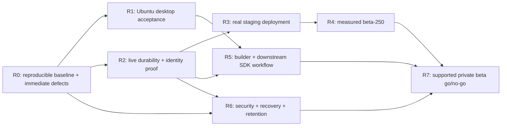

# Worldwright — ROADMAP v2

**Linux-first delivery, verified persistence, and a usable end-to-end game toolkit**

| Document field | Value |
|---|---|
| Review date | November 8, 2026 |
| Source repository | `E:\Hold\Worldwright`, inspected through EWW |
| Snapshot | Current working tree; no new commit identity or release tag established |
| Primary development/desktop baseline | Ubuntu 24.04 LTS / Linux |
| Retained secondary platform | Native Windows; Windows features and regression gates remain |
| Current package/toolchain baseline | `0.1.0-dev.0`, Rust 1.85.1, edition 2024, resolver 3 |
| Intended release posture | Private development/acceptance; not production-ready |
| Previous roadmap | `ROAD-MAP.md`, retained as historical planning material |
| Review ledger | `docs/verification/roadmap-v2-review-ledger.md` |

> **Executive decision:** Do not restart the foundation or describe Worldwright as an empty scaffold. The repository already has substantial runtime, content, transport, persistence, release, Studio, operator, SDK, and load tooling. The next work is to close real integration defects and produce Ubuntu, PostgreSQL, browser, deployment, and recovery evidence—not add more disconnected components.

## Implementation update — November 9, 2026

The playable second-game integration is now installed in source: generated
expedition executables and expedition previews run the shared real host; Studio
packages the selected game; browser expedition commands use the multiplayer
owner and page-unique receipt IDs. Added regression tests cover these paths.
WWV2-003/004 now need execution evidence, not their original source wiring.
WWV2-015 now includes relative bundled SDK dependencies, supplied matching bundle
support and playable entry points for both templates. Relocation/build tests are
authored but native acceptance remains open. See `docs/EXPEDITION_PLAYABLE.md`.
No current Cargo pass, real browser run or live PostgreSQL proof is claimed.
Multiplayer now has independently polled, fenced idle timer commits and RNG
rollback. The blocking terminal remains command-driven. WWV2-007 is not closed:
live idle/restart/failure/randomness evidence is still required.

## Selected P0 implementation follow-through — November 9, 2026

WWV2-001/002/003/004/008/009 source fixes and regression gates are installed.
Default XDG parent preparation is private/path checked; doctor/check-native now
report/enforce a reproducible native tuple; public preview/HTTP and browser/PG
receipt lifecycle regressions exist; OIDC schema activation is conditional;
required chart scripts parse actual YAML and fail on missing tools/native exits.
Ubuntu/Windows native/chart jobs, real Ubuntu Studio smoke and a disposable-PG
receipt job are configured. Branch protection/hosted runs are not adopted here.

Observed locally: eight synthetic launcher/diagnostic cases, five checker unit
tests, 27 schema cases, Node lifecycle fixture and syntax/grammar/job-wiring
checks passed. Two real Studio cases skipped; Cargo/rustfmt/PowerShell/Helm/PG/
hosted execution is unobserved. **Six source tracks implemented does not mean
six P0 acceptance tracks closed.** See `docs/P0_ACCEPTANCE.md` and
`docs/verification/p0-implementation-ledger.md` for current required commands.

## P1 continuation/status — November 9, 2026

All requested P1 IDs remain open for full acceptance. Source changes and authored
regressions are tracked in `docs/verification/p1-implementation-ledger.md`; run
commands and prerequisites are in `docs/P1_ACCEPTANCE.md`. Implemented source is
not a passing native build or an approval decision.

| ID | Current source follow-through | Remaining gate |
|---|---|---|
| WWV2-005 | Cookie-only session probe and page-resume connection; stale-response guards and Node lifecycle checks | Real provider/browser and concurrent auth-cookie race acceptance |
| WWV2-006 | Timer rollback/reconstruction, OIDC linking/concurrency/revocation and receipt-preserving cleanup DB regressions; CI runs full ignored suite | Live DB plus process/unknown-COMMIT/restore/provider matrix |
| WWV2-007 | Bounded owner idle polling, atomic fenced timer audit/state commit, durable-command RNG rollback | Real idle/restart/crash/randomness tests |
| WWV2-010 | Backend capabilities, UTF-8 hints, HTTP and 1024-room/64-exit DOM regressions | Real browser maximum-size/accessibility acceptance |
| WWV2-011 | Per-run output, streaming UTF-8, bounded input, I/O reaping before receipt, platform tree cleanup paths | Real stop/crash/SIGTERM and orphan/PID/pipe race evidence |
| WWV2-012 | Narrow runtime inspection and six fixed timing stages | Fixed beta-250 measurement and detailed clone/lock/commit profiling |
| WWV2-013 | External dispatch explicitly unsupported; bounded expired-session pruning preserves replay identities | Broader privacy/retention adoption and live cleanup/recovery |
| WWV2-014 | Separate loopback telemetry, full DB CI, container CLI smoke, reviewer-gated manual unchanged load profile, report retention | Hosted CI, reviewers/rulesets and real deployment/load acceptance |
| WWV2-015 | Relative bundled SDK, installed-source override and both playable templates; pre-build relocation regression | Approved native generated-project/bundle builds without original checkout |
| WWV2-017 | README/DESIGN/SECURITY/development/playable/migration docs reconciled; historical observations retained | Remaining architecture/handoff/status/helper sweep |
| WWV2-018 | Linux per-owner 0700 directory and 0600 slot creation; explicit refusal of unsafe existing paths | Windows ACL/key authority, multi-user/race/rotation review and real tests |
| WWV2-019 | Evidence/SBOM collector and exact-tuple owner/evidence records; no implied licensing or signing authority | Real advisory/notices/signing/legal/security/service approvals and pinned deployment images |

The container job is CLI/linkage smoke, not a running-service or deployed-image
certification. Its local image config ID is not a registry manifest digest.
The beta job never accepts tunable workload thresholds and is disabled unless
explicitly dispatched on the default branch using acceptance-only credentials.
GitHub.com and Enterprise artifact-action versions are selected separately;
organizational runner/action/environment approval remains necessary.

## P2 execution track — WWV2-016

The current backlog contains one explicitly P2 entry, WWV2-016. Its full item
list and evidence live in `docs/verification/p2-implementation-ledger.md`:
A — shared/versioned percentile recipes; B — SDK/CLI/bundle version drift;
C — retained downstream API-v1 fixture; D — documentation and native acceptance.
P0/P1 gates remain open and are not promoted by starting this track.

**Source implemented:** the sequential runtime benchmark now identifies schema
2 / `runtime-look-nearest-rank-v2`; both runtime and beta helpers use a shared
overflow-safe integer selector. Historical v1 measurements retain their original
formula. Beta-250 already used nearest rank: its schema/workload/thresholds remain
fixed. CLI/bundle/content metadata derive from SDK/content authority; the SDK's
transport-independent list is guarded against actual protocol exports by a
CLI dev-only test. A retained actual API-v1 fixture has an integrity inventory,
relocated bootstrap/locked rerun and local-dependency escape inspection.

Eight Python source/TOML/fixture checks and six negative mutation cases passed
on selected current readback files; twelve Rust files passed grammar parsing
only. Documentation and `docs/P2_ACCEPTANCE.md` are installed; CI captures both
source-contract logs, with missing-log refusal. Full native/relocated/hosted acceptance is NOT closed.
SDK lists still advertise only API version 1: no fictional prior package minor,
ABI support, optimization gain, or production-readiness claim is invented.

## R0/R1 execution follow-through — November 9, 2026

R0/R1 are the release tracks in section 5, not P0/P1 priority labels. Current
commands and every required gate are in `docs/R0_R1_ACCEPTANCE.md`; statuses and
observed blockers are in `docs/verification/r0-r1-acceptance-ledger.md`.

- R0 runner records the native source/lock/toolchain/config/graph/binary tuple,
  runs all required phases and rejects missing tools or source/log drift.
- Private packaging requires complete same-source Ubuntu R0 evidence; installed
  mode needs no Cargo/build checkout for supported Studio runtime operations.
- Session/pidfd cleanup, SIGHUP, timeout/crash and privacy rejection paths are
  installed; real supported-host process/browser acceptance remains required.
- Ubuntu CI and reviewed/default-branch Windows R0 CI are wired. Windows needs
  an approved disposable test DB secret and adopted environment protection;
  workflow existence does not prove adoption or execution.
- Current local checks: 14 helper tests and 10 synthetic launcher tests passed;
  two real-binary cases skipped without supplied binaries. Python/Bash syntax
  and workflow wiring checks passed on selected current readback files.
- The actual local R0 gate attempt stopped at missing Cargo before any native
  phase. Packaging refused failed R0 evidence; no real archive was created.
  R1 automation refused the absent real package; same-tuple closure returned
  NOT CLOSED. All six human observations remain unfilled, not fabricated.

**Neither R0 nor R1 is closed.** Native Ubuntu/Windows, real package/desktop,
manual browser/display/credential observations and authorized closure remain
execution/approval obligations. `r0-r1-local-observations.json` and explicitly
named local prerequisite-failure JSON files preserve that limited scope; they
are not accepted native reports or production-readiness evidence.

## Contents

1. [Review scope and evidence](#1-review-scope-and-evidence)
2. [Corrected current baseline](#2-corrected-current-baseline)
3. [Repository implementation map](#3-repository-implementation-map)
4. [Findings and prioritized backlog](#4-findings-and-prioritized-backlog)
5. [Dependency-ordered delivery plan](#5-dependency-ordered-delivery-plan)
6. [Acceptance recipes](#6-acceptance-recipes)
7. [Owner decisions and release gates](#7-owner-decisions-and-release-gates)
8. [Maintenance and deferred expansion](#8-maintenance-and-deferred-expansion)
9. [Source and evidence references](#9-source-and-evidence-references)

---

## 1. Review scope and evidence

### 1.1 What was examined

This is a **repository-wide roadmap-level review**. The complete directory tree and recursive Rust-source filename inventory were enumerated, excluding generated `target/` output and Git internals. The review covers all **14 workspace packages**, both browser asset sets, all **seven SQL migrations**, development/desktop scripts, CI, Docker, every Helm template and render script, and the principal design/security/roadmap/verification documents.

Source inspection followed the actual composition and execution paths, including the server's durable command flow, game-state adapter, OIDC identity flow, preview supervisor/worker, Studio packaging/publication, generated-project tooling, and fixed beta-load runner. The persistent ledger records **21 review units: 12 verified for roadmap evidence, nine with gaps found**.

**Coverage limitation:** This is not a line-by-line correctness review of every Rust file, every test, every historical document/log, or every transitive dependency. Large auth, CLI, operator, protocol, release, and SQL-adapter files used targeted sections; representative tests and observed execution records supplemented source inspection. The unit-level ledger must not be represented as exhaustive file-level security certification. A full dependency/security audit remains a separate acceptance task.

### 1.2 Evidence categories

| Category | Meaning |
|---|---|
| Implemented | The inspected source contains a concrete implementation and its wiring. |
| Source-confirmed gap | A specific inconsistency or missing integration is visible in inspected code. |
| User-observed verification | Command output supplied in this conversation establishes the stated result on that machine. |
| Historical evidence | Repository reports/logs describe an earlier snapshot with their original provenance limits. |
| Acceptance pending | The behavior has not been demonstrated in the required real environment. |
| Proposed work | A recommendation in this roadmap; not an adopted interface or implemented feature. |

No Cargo build, PostgreSQL test, Helm render, container build, cluster install, or real desktop session was executed through EWW during this review. EWW supplies filesystem operations, not a command executor. A separate sandbox reproduced the **OIDC-disabled Helm JSON Schema violations** from the inspected property rules/defaults; that was not a Helm or Kubernetes execution.

### 1.3 Current verification state

| Gate | Evidence available | Remaining qualification |
|---|---|---|
| Windows workspace compilation check, including test targets | User log completed with Cargo exit code 0 using Rust 1.85.1 and an explicit native target/fresh output directory. | Original missing-prelude failure was not isolated to one cause. |
| Windows Clippy, all targets/features, warnings denied | User output completed successfully. | Not a dependency vulnerability/security assessment. |
| Windows workspace test execution and doctests | All executed suites shown passed. | **19 PostgreSQL tests were ignored**, not passed. Do not copy historical aggregate totals into this run. |
| Windows application executable build | User output completed successfully. | Manual application operation was not established by compilation alone. |
| Formatting after Linux-first changes | Pinned formatter requested specific parser-test layout changes; those exact edits were applied through EWW. | Post-edit `cargo fmt --all -- --check` result has not been supplied. |
| Historical Linux core/content/local-play | Repository contains earlier reports/logs. | Snapshot and dependency/toolchain provenance limits remain; not current full-workspace Ubuntu evidence. |
| Ubuntu Studio launch and Unix signal cleanup | Source and synthetic launcher tests exist. | Real first-run/editor/preview/process-cleanup acceptance remains open; a first-run path defect was found. |
| PostgreSQL durability, OIDC and recovery | Source, migrations, and an ignored integration harness exist. | Real execution, dedicated new game-state/OIDC tests and fault/restart evidence required. |
| Docker, Helm, TLS ingress and fixed beta load | Artifacts and runner exist. | Actual builds/renders/deployment/load measurements remain open. |

The fresh native Windows run did not reproduce the 395 missing-prelude errors. Do not add suggested imports to cached registry dependencies or declare the earlier fault a proven dependency bug. Toolchain selection, target selection, and fresh build artifacts changed together.

---

## 2. Corrected current baseline

### 2.1 Material changes since the old roadmap

| Old/stale impression | Current source-grounded position |
|---|---|
| Eleven packages/four application directories | **14 packages: five applications and nine shared/game libraries.** |
| The second game still needs implementing | `worldwright-expedition` already implements supplies, threats, encounters, strikes, rest, progression ranks, and delayed counter recovery. |
| Durable expedition/gameplay is wholly absent | Game-state tables, `load_game_state`, `initialize_game_state`, `commit_gameplay`, and server `commit_durable_command` are implemented and wired. Live evidence remains absent. |
| Identity-provider integration is only a future idea | An OIDC authorization-code/PKCE/nonce/state path, issuer/subject mappings, invite linking, sessions, and audit exist. End-to-end browser use and provider/DB verification are incomplete. |
| Network load tooling still needs creating | `worldwright-load` already contains fixture generation, HTTPS/WebSocket clients, a fixed `beta-250-v1` profile, and create-new reports. The profile has not been demonstrated. |
| Deployment directory is future-only | A server Dockerfile and single-writer Helm chart exist. Their implementation is not deployment acceptance; chart/schema/test defects remain. |
| SDK is just a placeholder | API v1 exports, compatibility/deprecation declarations, and a reduced integrity-checked source bundle exist. Relocatable installed-tool behavior and historical compatibility proof remain open. |
| Every session is process-local | Local mode sessions are process-local; PostgreSQL sessions are stored durably. Protocol/status prose must describe both accurately. |
| “M8 complete” means operational readiness | M8 source/local evidence does not close PostgreSQL, Ubuntu, deployment, accessibility, retention, or recovery gates. |

### 2.2 Preserve historical milestone identities

Do not renumber or discard the M1–M8 evidence history. Use the following refreshed interpretation:

| Milestone | Current interpretation | Next action |
|---|---|---|
| M1 — Foundation/core | Implemented; typed contracts and workspace are real. | Refresh package inventory, toolchain/provenance and current CI evidence. |
| M2 — Runtime/content/local play | Implemented; strict content and reference terminal play work in supplied Windows tests. | Current Ubuntu acceptance; keep reference play separate from game-aware preview. |
| M3 — Multiplayer transport | Implemented; supplied Windows network tests pass. | Browser request identity/session resume, current Ubuntu, deployment acceptance. |
| M4 — Durable gameplay | Valuable-state transactions and general gameplay-state plumbing are implemented. | Execute the existing DB suite and add dedicated general-gameplay failure/restart tests. |
| M5 — Release/preview | Immutable artifacts, authorization, activation/rollback and preview infrastructure exist. | Correct game-contract parity; verify exact artifact through staging/recovery. |
| M6 — Operational control | Capability/MFA issuance, audit, drain, backup/restore/takeover tooling exist. | Exercise real authorization, recovery and retention; adopt operating policy. |
| M7 — Studio | Real browser editor, revisions, package, preview and publication workflow exists. | Fix first-run/UI/game parity; test real browser/operator workflow. |
| M8 — Toolkit maturity | Second game, generation, SDK bundle and in-process benchmark exist. | Prove relocation/compatibility; measure actual bottlenecks. |
| M9 — Operational beta preparation | Load runner, OIDC and deployment source are present. | Treat as **in progress**, not a passed operational-beta gate. |

### 2.3 Architecture to keep

- Modular monolith, one mutable world owner and initially one authoritative world per server process.
- Core rules remain transport/database-independent trusted compiled Rust—not a sandbox.
- PostgreSQL owns durable state; memory is the execution projection plus explicit ephemeral state.
- Immutable content/artifact identity is distinct from publisher authorization.
- Admission, in-memory execution, durable commitment, replay, and output delivery remain different facts.
- Studio submits controlled publication requests; it does not gain production database authority.
- Ubuntu/Linux is primary. Preserve Windows code, tooling and CI; do not force a Linux cross-target onto Windows builds.
- Current desktop architecture is **native Rust CLI/server processes with browser surfaces**. A native-window framework is an optional future decision, not an existing feature.

---

## 3. Repository implementation map

All paths below are relative to the repository root.

| Package | Actual role / principal source | Delivery implications |
|---|---|---|
| `apps/worldwright` | Developer CLI; `src/cli.rs`, `src/commands/{content,maturity,play,release,sdk}.rs` | Preserve validation/play/package/inspect/preview/generation/bundle commands; fix game-aware preview and installed-source resolution. |
| `apps/worldwright-server` | Composition, authentication/OIDC, bounded world owner, REST/WebSocket, operations and release CLI | Close browser/commit semantics and live DB/deployment gaps instead of building a second server. |
| `apps/worldwright-studio` | Loopback Axum editor; `workspace.rs`, `artifact.rs`, `preview.rs`, `publication.rs`, `web.rs` | Real authoring workflow; source now supports reference/expedition packaging, fixed workspace and loopback control client. New integration tests still need execution. |
| `apps/worldwright-console` | Local Argon2/TOTP operator credential/token issuer and bounded loopback HTTP control client | Signing-key placement and Windows ACL handling need explicit acceptance; not a public unrestricted administrator shell. |
| `apps/worldwright-load` | `cli.rs`, `fixture.rs`, `runner.rs`, `report.rs` | Fixed 250-account/7,500-command beta recipe is implemented, not measured. |
| `crates/worldwright-core` | IDs/intent/rules/effects/scheduler, staged runtime execution, scoped views, checkpoint/restore | Supports counter adjustment/scheduled counter adjustment. Generic item effects and `WakeCharacter` remain unsupported. `WorldStub` is a legacy startup guard, not proof the actual server is missing. |
| `crates/worldwright-content` | Seven modules for bounded structural load, v1 schema, diagnostics, graph validation and instantiation | Keep as the authoritative parser; no general v0/v2 migration or extension schema is implemented. |
| `crates/worldwright-expedition` | Independent SDK-based game library | Reuse is demonstrated at source/scenario level; carry the game contract across preview, Studio, activation and durability. |
| `crates/worldwright-operations` | Operator capabilities/tokens/TOTP, release-submission/review DTOs, signed backup manifest | Preserve bounded contracts; review key rotation, assurance and recovery-policy assumptions. |
| `crates/worldwright-persistence` | SQLx PostgreSQL, sessions, receipts/value transactions, general game state, OIDC, operations/releases | Real implementation with incomplete live verification; do not equate compiled ignored tests with transactional proof. |
| `crates/worldwright-protocol` | Strict v1 DTOs, encode/decode, stream/request bounds and durable result messages | Specify mode-dependent completion/replay semantics; synchronize stale process-local wording. |
| `crates/worldwright-release` | Deterministic `.wwr`, strict manifest/IDs/digests, reference/expedition game contracts | Integrity verified separately from approval; third-party game registry is future work. |
| `crates/worldwright-sdk` | API v1 facade, version inventory and deprecations | Policy declarations exist; prove them with real downstream consumers/version fixtures. |
| `crates/worldwright-testkit` | Fake clock/RNG, reference/expedition fixtures, scenarios and sequential in-process benchmark | Keep deterministic domain tests separate from network/database capacity measurements. |

### Existing boundaries and limits

These are source values, not production capacity commitments:

| Boundary | Inspected value |
|---|---|
| Content input/depth/diagnostics | 32 MiB / 32 levels / 100 diagnostics |
| Runtime room/character/exit limits | 1,024 rooms / 256 characters / 64 exits per room |
| Runtime scheduled actions / effect-plan size | 128 scheduled actions / 128 effects |
| Wire frame / request ID | 16 KiB / 128 bytes |
| Local account and session limits | 256 accounts / 1,024 sessions |
| Password hashing concurrency | Four verification slots |
| CLI preview | Four concurrent slots; default 900 seconds, maximum 3,600 seconds |
| Studio revision history | 10,000 revisions; artifact/publication lists have separate bounds |
| General durable-game payload bounds | 4,096 counters, 8 KiB intent, 64 KiB stored result |
| In-process benchmark | At most 100 clients / 10,000 total sequential commands |
| Beta profile | 250 clients × 30 Look commands = 7,500 measured completions |

A 250-client profile fits below the 256-character ceiling numerically; that is not evidence it satisfies latency, admission, persistence, or operational requirements.

---

## 4. Findings and prioritized backlog

**Priority here is delivery ordering, not a vulnerability severity rating.** P0 blocks a credible next acceptance run; P1 blocks an integrated beta; P2 improves maintainability or extends proven capability. Findings are not fixed merely by appearing in this document.

**The findings table preserves the original review snapshot.** Consult the P1
status section and ledgers above for source work completed since that review;
these historical observations are not current assertions that new code is absent.

| ID | Priority | Review-snapshot issue / evidence gap | Work and acceptance criterion |
|---|---|---|---|
| WWV2-001 | P0 | Source corrected: private owned default-parent preparation, path/permission checks and no silent chmod. Eight synthetic launcher/diagnostic contracts passed. | Real fresh-HOME/XDG Studio/package/reopen/SIGTERM tests are authored and CI-wired but unexecuted here; manual desktop acceptance remains open. |
| WWV2-002 | P0 | Source corrected: fuller redacted doctor, pinned compiler/Cargo enforcement and fresh explicit native check workflow on both hosts; first-failure and target isolation contracts passed synthetically. | Current fmt/compiler/Clippy/tests/build/rustdoc and PowerShell/Ubuntu/hosted runs must execute before acceptance. Historical Windows passes do not verify this patch. |
| WWV2-003 | P0 | Game-aware executable/preview/Studio source retained; added public-supervisor selected-game/immutability, unsupported-game and HTTP packaging regression cases. Rust grammar checked. | Execute current Rust tests and real Studio/browser smoke; exact-artifact deployment/live PG parity remains open. |
| WWV2-004 | P0 | UUID producer plus matching-sequence reload/new-tab/reconnect/stale stream/timer/logout Node fixture passed; focused real-PG receipt replay/conflict/disjoint-actor regression and nonzero-test CI guard added. | Execute the ignored PostgreSQL case and real browser/server lifecycle before full acceptance; no synthetic DB proof claimed. |
| WWV2-005 | P1 | OIDC callback sets a session cookie and redirects to `/`; browser JavaScript connects only after password-form login. | Add authenticated session-resume/connect behavior after page load, handling anonymous/expired/revoked/OIDC-disabled cases without exposing HttpOnly cookies. Successful OIDC must reach an attached playable character without a second password login. |
| WWV2-006 | P1 | Existing 19 ignored DB tests do not establish the newly added general-gameplay/OIDC paths; live DB execution is absent. | Run existing tests and add direct integration/process tests for gameplay snapshots, schedule recovery, replay, stale state, issuer/subject/invite linking, revocation, concurrent callbacks and rollback/unknown outcomes. |
| WWV2-007 | P1 | Owner invokes `runtime.advance` during commands, not an independent idle gameplay-timer branch; RNG is not part of checkpoint rollback. | Define command-driven versus real-time scheduling explicitly. If independent recovery is required, add bounded owner-driven ticks with durable commit semantics. Specify/retest randomness consumption on rejection/replay/restart; do not claim deterministic replay from checkpointing alone. |
| WWV2-008 | P0 | Source corrected with explicit Draft-07 enabled-only OIDC validation. All 27 schema cases passed; disabled/absent and strict enabled inputs covered; mandatory deployment gates unchanged. | Actual Helm lint/render matrix remains unobserved and must pass; schema-only does not close Helm/deployment acceptance. |
| WWV2-009 | P0 | Source corrected: complete-values/shared Python harness, immediate native exits, actual YAML secretName/secretKeyRef/security checks, missing-tool failure and Ubuntu/Windows chart jobs. Five synthetic checker tests passed. | Run four positive/16 negative actual Helm cases and observe both jobs. Missing Helm failure-policy proof is not render success; cluster acceptance remains separate. |
| WWV2-010 | P1 | Studio UI has 1,000-room/256-exit limits versus backend 1,024/64; text character limits differ from authoritative byte limits. | Expose or synchronize capabilities/bounds; use UTF-8 byte-aware hints. Do not hide the last valid rooms or permit misleading exit counts. Add maximum-size and multibyte browser tests. |
| WWV2-011 | P1 | Preview output reader threads write shared status across runs, decode individual chunks, and are not explicitly joined as part of run replacement; process-tree cleanup is not certified. | Tag output with run identity, handle split UTF-8 sequences, await/reap readers, bound input/stop operations, and prove no stale output or supervisor/worker leak after stop/crash/SIGTERM. |
| WWV2-012 | P1 | General gameplay commit rewrites the world counter/schedule set even for Look, and owner checks can clone full snapshots; network/DB costs have not been measured. | Instrument queue wait, clone/plan/SQL/commit/output costs. Prove the fixed beta profile before increasing concurrency. Optimize deltas/read-only behavior only under an explicit revised completion contract and unchanged invariants. |
| WWV2-013 | P1 | Outbox rows/backlog metrics exist, but no dispatcher is evidenced in the inspected module tree; 90-day audit retention is a constant, not an executed policy. General receipts retain rendered results. | Decide whether external delivery is in beta scope. Implement bounded retry/deduplication if needed; otherwise label it unsupported. Adopt privacy/retention rules for receipts/audit/OIDC/output, preserve replay guarantees and business uniqueness, and verify cleanup/recovery. |
| WWV2-014 | P1 | Metrics are implemented in the operator plane; public ingress mode rejects operator configuration. CI currently lacks dedicated DB, chart, browser, container and load jobs. | Design restricted telemetry exposure separately from public operator authority. Add independent evidence-producing CI/acceptance jobs and bounded-cardinality metrics. Never expose the operator plane just to scrape metrics. |
| WWV2-015 | P1 | Project generation uses compile-time source-tree absolute dependencies; generated `main` only prints metadata/game ID; its README suggests locked commands before a lockfile exists. Nested Cargo tests inherit output overrides. | Supply a relocatable private SDK/project path and honest first bootstrap. Generate a meaningful playable downstream example, explicitly isolate nested target directories, and run outside the original checkout on Ubuntu/Windows. Preserve source licenses/approval constraints. |
| WWV2-016 | P2 | In-process benchmark percentile formula differs from the fixed beta nearest-rank recipe. SDK/CLI compatibility arrays and bundle-version strings are repeated literals. | Version/document measurement recipes; share implementations or add drift tests. Derive compatibility/package data from authoritative structures; prove declared compatibility with downstream version fixtures. |
| WWV2-017 | P1 | Old roadmap/handoff/architecture/security/status comments contradict current packages, sessions, scheduling, OIDC, durability and deployment. Root smoke-helper documentation describes includes the actual app tests no longer use. | Synchronize current-state sections while preserving historical evidence. Deprecate/remove stale helper material deliberately; do not delete fail-closed `WorldStub` just to eliminate its name. |
| WWV2-018 | P1 | Shared `/tmp/worldwright-preview-v1` slots lack demonstrated multi-user ownership isolation. Console carries signing authority; Windows credential files rely on manual ACL protection. | Review per-user runtime directories/permissions, symlink/race behavior, key placement/rotation and OS-specific credential protection. A Rust process/environment clear is not an OS sandbox. |
| WWV2-019 | P1 | License/support/reporting owners are not approved; container digests, SBOM/dependency advisories, clean dependency provenance and release-signing policy are not established here. | Record legal/security/service owner decisions and supply-chain evidence before supported distribution. Keep `publish=false`; do not treat HMAC backup integrity or artifact hashes as confidentiality/authorship. |

### Additional design checks to include, not presumed failures

- Scheduled deadlines are reconstructed using database wall-clock timestamps relative to process monotonic time; verify transaction latency, process downtime, equal-deadline ordering and clock adjustment behavior.
- Test failed/unknown COMMIT without speculative success; prove same-intent replay restores a coherent current projection and does not rebroadcast historical room speech to unrelated recipients.
- Initial attachment executes durable Look and can create a receipt; test receipt identity across new stream generations and mode changes.
- OIDC invite linking applies to **pre-existing accounts/characters**, not open signup. Preserve issuer-plus-subject identity, one-shot invitation consumption and explicit recovery/offboarding policy.
- Content smoke requires an outgoing entry-room movement path; a structurally valid single-room Studio draft can fail activation smoke. Make the supported smoke contract visible to builders or deliberately amend it with tests.
- Verify independent game packages through public SDK seams without assuming the native module interface protects against malicious code.

---

## 5. Dependency-ordered delivery plan

Use **R0–R7** as the new execution tracks; preserve M1–M9 historical names. Owners below are roles to assign, not claims that named people have accepted responsibility. No unsupported completion date or production SLA is assigned.

### Delivery sequence



Security review begins in R0; R6 is its final integrated evidence track, not permission to postpone security.

### R0 — Reproducibility and integration blockers

**Owner:** Engineering/QA lead. **Prerequisite:** Current source inventory and user-observed Windows baseline.

1. Record commit/worktree identity, toolchain, host target, full locked dependency graph, relevant Cargo override sources and output paths.
2. Close WWV2-001/002/003/004/008/009 before claiming an integrated workflow.
3. Finish formatting proof and capture equivalent clean Ubuntu/Windows checks.
4. Correct first-run and nested test assumptions; source/build paths must be explicit and portable.
5. Convert newly found source inconsistencies into regression tests. Update docs beside code changes.

**Exit:** Same revision passes pinned fmt/check/Clippy/test/build/rustdoc on supported hosts; required chart-render tests cannot silently skip; first-run Studio works; artifact preview selects the correct game; browser IDs cannot accidentally reuse durable receipts.

**Non-goals:** No dependency upgrades purely to remove warnings, registry-source edits, distributed architecture, or license grant.

### R1 — Ubuntu-first desktop acceptance and private packaging

**Owner:** Linux application/QA lead. **Prerequisite:** R0.

1. Exercise fresh HOME/XDG, existing workspace, external working directory, spaces, read-only parents and permission failures.
2. On Ubuntu, complete import → edit → save → validate → package → correct-game preview → stop/reopen.
3. Test Ctrl+C, SIGTERM, terminal hangup, preview timeout, crash and orphan cleanup with real binaries.
4. Verify Firefox/Chromium as available, X11/Wayland and manual `--no-browser` use; make manual versus automated coverage explicit.
5. Package private Linux binaries plus assets/documented runtime dependencies; add desktop-menu integration if desired, without requiring a Rust toolchain at installed-app runtime.
6. Retain Windows smoke/preview/credential behavior and executable discovery.

**Exit:** A fresh Ubuntu desktop user can run the supplied private application package without the original build checkout. All draft/artifact identity, privacy, process and failure assertions hold. Windows regressions pass.

**Native-window decision:** Keep browser-based Studio as the recommended first delivery. If a native window is required, select and review its framework, Linux integration and accessibility separately; do not claim the launcher already creates one.

### R2 — Live PostgreSQL, gameplay and identity correctness

**Owner:** Persistence/identity lead. **Prerequisite:** R0; an isolated disposable test database.

1. Apply the complete current migration inventory in order (original seven plus the additive timer-audit migration: eight as of November 10, 2026) and verify fresh/upgrade/excess/future/checksum-mismatch/failed-ledger cases; never edit an already applied migration to make tests pass.
2. Run the existing ignored database suite with explicit credentials, database-name guard and schema cleanup.
3. Add dedicated reference/expedition game-state tests: counters, rooms, schedules, versions, initial state, replay/conflicts, concurrent writers and restart.
4. Add process-kill and commit-uncertainty cases; preserve receipts, required audit and independent entitlement uniqueness.
5. Exercise OIDC using controlled provider fixtures and then an approved test provider: issuer/audience/nonce/state/PKCE validation, key rotation, denied links, invitation expiry/consumption, revocation, outage and restart.
6. Close browser OIDC resume and document invite-only pre-seeded account behavior.
7. Define/test idle scheduling, clock reconstruction and gameplay RNG behavior before claiming durable game recovery.

**Exit:** Exact state and authority invariants survive concurrency, disconnect, failure and restart. OIDC reaches playable attachment. No skipped required test is counted as a pass. Store/owner behavior is verified on the current Ubuntu baseline, with retained cross-platform checks where applicable.

### R3 — One real, restricted staging deployment

**Owner:** Deployment/service lead. **Prerequisites:** R0 and R2.

1. Build and run the actual Docker image; record image digest/toolchain/source provenance rather than relying on mutable base tags.
2. Render/lint every supported chart profile, both game choices and OIDC enabled/disabled, with complete synthetic values and required-tool/exit-code gates.
3. Use one replica/Recreate and prove startup, reconstruction, readiness and termination behavior through actual TLS ingress.
4. Separate migration/runtime/recovery permissions. The current init/main containers reference the same DB secret; split identities or document a reviewed constrained exception.
5. Test private PostgreSQL access, secret rotation/restart, WebSocket upgrade/idle policy, and denial of public operator routes.
6. Review NetworkPolicy scoping to each release and its DNS/HTTPS egress, including OIDC; the current policy is disabled by default and does not imply restricted egress.
7. Test restart, failed rollout, content rollback versus schema compatibility, and Helm rollback limitations.

**Exit:** Recorded installation and fault exercises demonstrate coherent active-artifact/state startup and controlled shutdown on one staging deployment. No readiness assertion derives solely from rendered YAML.

### R4 — Fixed beta-load proof and measured optimization

**Owner:** Performance/QA lead. **Prerequisites:** R2 and R3; controlled load accounts and protected telemetry.

Preserve `docs/verification/milestone-9-load-contract.md` as the predeclared recipe. The public `run` profile is not tunable into an easier acceptance target.

| `beta-250-v1` requirement | Gate |
|---|---|
| Attached clients before common barrier | Exactly 250 |
| Measured commands | Exactly 7,500 successful matching completions |
| Login/attach/command/protocol/disconnect/readiness failures | Zero |
| p95 command latency | At most 750 ms |
| p99 command latency | At most 1,500 ms |
| Maximum latency | Below 10 seconds |
| Measured wall time | At most 90 seconds |

1. Perform tooling smoke first, then the fixed HTTPS/WebSocket/PostgreSQL run at an identified revision/artifact/deployment.
2. Preserve successful and failed create-new reports; capture operator/deployment and PostgreSQL evidence because the client cannot prove the storage adapter.
3. Instrument queue/owner/SQL pool/commit/output timing, CPU/RSS, transaction counts, timer lag and saturation.
4. Measure Look write amplification/full-world counter/schedule rewrites and snapshot cost before changing persistence/concurrency.
5. Add separate speech fan-out, reward/transfer/replay, slow-reader, reconnect, idle heartbeat and long-duration tests; do not label them equivalent to the Look-only recipe.
6. Optimize only proven bottlenecks; rerun integrity/failure suites and the unchanged acceptance recipe.

**Exit:** The fixed profile passes with complete environment/storage provenance. A separate soak report demonstrates bounded resource/history growth under the adopted retention plan. This supports only the tested environment/profile—not 500+ players or general production capacity.

### R5 — Builder workflow and downstream SDK delivery

**Owner:** Toolkit/Studio lead. **Prerequisites:** R1 and R2; may develop in parallel with R3/R4.

1. Synchronize Studio capabilities/byte limits with backend contracts and test maximum-size multibyte drafts.
2. Carry the selected game identity across save/package/preview/review/activation, without silently changing persisted workspace formats.
3. Exercise real Studio → loopback authorized publication → independent review → activation → status/rollback.
4. Bound and test async UI results, token expiry/renewal, stale previews, conflict recovery and publication-record crash recovery.
5. Make reduced SDK bundle creation/integrity verification and downstream bootstrap relocation-safe. Include authoritative lockfile/version policy and no implicit license grant.
6. Produce a generated reference/expedition consumer that actually runs rules/scenarios, not only prints metadata.
7. Enforce compatibility/deprecation declarations against retained downstream fixtures; synchronize repeated version/capability literals and test-support discovery docs.

**Exit:** An independent developer/builder outside the original checkout completes a meaningful game/content workflow through supported seams. The exact reviewed artifact is the one previewed and activated; UI accessibility/manual browser evidence is recorded.

### R6 — Security, recovery, privacy and operation closure

**Owner:** Security/service lead. **Prerequisite:** Begins in R0; integrated proof requires R2/R3.

1. Review operator token issuer trust/key distribution: possession of HMAC signing authority is a different privilege from holding a scoped bearer token.
2. Verify current DB grant/session/assurance checks, offboarding, account suspension, break-glass, automation and interrupted long-running jobs.
3. Harden/test multi-user Linux preview slots and OS-specific credential permissions; keep secrets out of preview workers and browser assets.
4. Exercise backup/create/verify/restore/takeover using real tools and an isolated empty target. Reconcile revived security state, receipts/outbox, content and incarnation/epoch fencing.
5. Code currently carries **RPO 24 hours, RTO four hours and audit 90 days**. Treat these as implementation targets requiring owner adoption and measured drills—not established guarantees.
6. Adopt retention/privacy policy for ordinary logs, rendered gameplay receipts, OIDC identity audit, security audit and backups. Cleanup must not reopen previously completed business entitlements.
7. Decide external-effect/outbox scope; implement or explicitly defer a bounded dispatcher/deduplication contract.
8. Produce SBOM/dependency advisory and license/provenance reviews, private reporting routes, named owners and realistic response coverage.

**Exit:** An independent operator executes the runbooks and verifies recovery objectives, authority/security-state reconciliation and bounded retention. Residual risks and support boundaries receive named approval before beta.

### R7 — Supported private beta / first release decision

**Owner:** Authorized project owner with engineering, security and service reviewers. **Prerequisites:** R1–R6 relevant gates closed.

Release only when all of the following are recorded for the **same release tuple**:

- Code commit/build and clean-worktree or documented patch identity.
- Native Ubuntu and retained Windows evidence; explicit runtime dependency/browser support matrix.
- Active content digest/game contract and migration/checksum range.
- Passing live DB, identity, release/rollback, process and recovery evidence.
- Fixed beta-load and separately scoped soak/abuse results.
- Protected deployment configuration, secrets/rotation and restricted monitoring.
- SDK/downstream and builder workflow evidence.
- Adopted license/distribution, support, security reporting and privacy/retention policy.
- Named service owner, recovery procedures and bounded exception list with expiry.

**Exit:** Approved private beta release notes/artifacts and operational go/no-go record. No numerical “percent complete” substitutes for these gates. Public registry publication and production rollout require their own approvals.

---

## 6. Acceptance recipes

Commands below use existing inspected interfaces. They are **recipes to execute**, not new successful results. Use approved package/toolchain/artifacts and synthetic accounts. Run destructive/recovery tests only in isolated authorized environments.

### 6.1 Native Ubuntu baseline

```bash
bash scripts/dev.sh bootstrap
bash scripts/dev.sh doctor
cargo fmt --all -- --check
cargo check --workspace --all-targets --locked --offline
cargo clippy --workspace --all-targets --all-features --locked --offline -- -D warnings
cargo test --workspace --locked --offline
cargo build --workspace --locked --offline
cargo doc --workspace --no-deps --locked --offline
bash -n scripts/dev.sh scripts/desktop.sh
```

Where an explicit native target/output directory is used, record it and use the same tuple for subsequent steps. Inspect shell environment and ancestor/user Cargo configuration; an ambient target directory can redirect nested builds even when the outer command has `--target-dir`.

### 6.2 Desktop smoke

The default parent defect is corrected in source. Run the fresh-HOME/XDG real-binary tests in `docs/P0_ACCEPTANCE.md` before certifying it; an explicit trusted path is still supported:

```bash
# An explicit workspace with an existing HOME parent avoids the missing
# XDG-parent first-run assumption; this does not close the default-path test.
bash scripts/desktop.sh --no-browser "$HOME/worldwright-studio-acceptance"
```

Test automatic browser opening separately. `--no-browser` suppresses launching a browser; it does not implement a native GUI/headless mode switch.

### 6.3 Live database suite

Provide `WORLDWRIGHT_TEST_DATABASE_URL` through the approved local secret mechanism. The inspected test harness requires the parsed database name to contain `worldwright_test`; it creates/drops generated schemas and must not target production.

```bash
cargo test -p worldwright-persistence --locked --offline -- --ignored
```

Record the count of tests actually executed, DB version/permissions, schema cleanup and outcomes. Follow with new general-gameplay/OIDC integration and full process-restart cases; executing the existing suite alone does not prove every newly added adapter path.

### 6.4 Artifact/game parity

```bash
cargo run -p worldwright --locked --offline -- content validate examples/expedition/world.json
cargo run -p worldwright --locked --offline -- content package examples/expedition/world.json \
  --output ./expedition-acceptance.wwr --release-id expedition-acceptance \
  --source-revision acceptance --builder acceptance --game expedition
cargo run -p worldwright --locked --offline -- content inspect ./expedition-acceptance.wwr --json
cargo run -p worldwright --locked --offline -- preview ./expedition-acceptance.wwr
```

The output path must be new and its parent available. **Current caveat:** expedition preview dispatch has now been implemented in source; run this recipe and the new tests before certifying preview parity. Current live deployment/PostgreSQL evidence is still absent.

### 6.5 Container/chart

```bash
docker build --tag worldwright-server:acceptance .
bash deploy/helm/worldwright/tests/render.sh
```

**Current caveat:** the render script/schema defects are corrected in source, with test-only Python requirements and required Helm 3. Execute the actual matrix and observe its CI jobs before claiming a passing gate. Container execution, chart rendering and cluster operation remain separate results.

### 6.6 Fixed network-load runner

```bash
cargo run -p worldwright-load --release --locked --offline -- generate \
  --seed-output ./load-seed.json --credentials-output ./load-credentials.json \
  --password-env WORLDWRIGHT_LOAD_PASSWORD

cargo run -p worldwright-load --release --locked --offline -- run \
  --base-url https://world.example.invalid --origin https://world.example.invalid \
  --credentials ./load-credentials.json --output ./beta-report.json \
  --server-revision reviewed-revision --artifact-digest <64-lowercase-hex-digest> \
  --environment-label isolated-staging
```

Replace the deliberately invalid example origin and digest with the controlled deployment's exact values. Seed/configure the real PostgreSQL world using the inspected database/release workflows before running. The password environment value is secret; the generated credentials file contains plaintext test passwords. Use protected test storage and destroy credentials/environment after acceptance. Existing output files must not be overwritten.

### Evidence record for every run

Capture revision/worktree patch, host/toolchain/target, dependency lock/provenance, commands/exit codes, active artifact/game, DB/schema/deployment identity, measured versus configured values, skipped/unrun cases and sanitized logs. Record the first real error rather than matching any line containing the word “error”; preserve failed runs as well as successful ones.

---

## 7. Owner decisions and release gates

| Decision | Responsible role | Required before |
|---|---|---|
| Browser-first private desktop versus a native-window deliverable | Product/application owner | Committing to native GUI packaging scope |
| Supported Ubuntu/Windows architectures and browser versions | Engineering/QA owner | First supported artifact |
| Approved PostgreSQL version, migration/runtime/recovery identities and upgrade path | Persistence/service owner | R2/R3 acceptance |
| OIDC provider, invite-linking/offboarding/account recovery and operator issuer trust | Security/identity owner | Identity-enabled beta |
| Receipt/privacy retention, outbox delivery and restored external effects | Security/service/legal owner | Durable beta/soak/recovery closure |
| RPO/RTO/audit constants versus adopted operating policy | Service/security owner | Recovery/support claims |
| SBOM, source/artifact signing, approved dependency acquisition and notices | Release/security/legal owner | Supported distribution |
| Source/license ownership and private/public publication terms | Authorized project/legal owner | Any license grant or public publication |
| Monitoring, incident roster/private reporting and actual response coverage | Service/security owner | Accepting external beta users |
| SDK previous-minor support, versioning and deprecation proof | Toolkit/engineering owner | Supported downstream compatibility promise |

The roles in this table are intentionally unassigned. This roadmap does not approve a provider, production domain, staffing plan, license, public port or service guarantee by filling in an example.

### Hard stop conditions

Do not advance to supported beta when:

- Correct game behavior is not preserved through preview and activation.
- Required DB/failure/recovery tests are skipped or replaced by mocks alone.
- Browser reload accidentally reuses persistent receipt identities.
- A successful identity callback cannot enter the playable session.
- Readiness is advertised without coherent artifact/state/authority reconstruction.
- A chart default or mandatory test is invalid/skipped while claimed passing.
- Preview/credential isolation, secrets or operating ownership remain unacceptable.
- Load/soak results omit DB/deployment provenance or change the fixed recipe to pass.
- Applied migrations or tests are silently weakened to match current implementation.

---

## 8. Maintenance and deferred expansion

### 8.1 Documentation/control updates

`ROADMAP_v2.md` is the current review/recommendation document. Retain `ROAD-MAP.md` and its milestone evidence history. Resolve which file is the ongoing delivery authority explicitly when linking v2 from README/DESIGN/ARCHITECTURE; do not silently convert recommendations into approved decisions.

In the same implementation changes, update current-state sections in:

- `README.md`, `DESIGN.md`, `ARCHITECTURE.md`, `IMPLEMENTATION.md`.
- `SECURITY.md` and the relevant identity/persistence/protocol/release/Studio/toolkit contracts.
- `migrations/README.md`, `deploy/README.md` and operator/recovery runbooks.
- `tests/README.md`, app smoke-helper discovery notes and benchmark recipe definitions.
- `docs/VERIFICATION.md` and per-run records, preserving original historical counts/provenance.

Do not repeatedly copy a Windows test count forward as fresh Ubuntu/DB evidence. Current formatting correction is source work until its pinned recheck succeeds.

### 8.2 What not to build yet

Defer unless a reviewed user requirement or measurement justifies it:

- Active-active worlds, distributed zones, unbounded concurrent mutation or automatic writer failover.
- New broker/cache infrastructure solely to resemble a large multiplayer stack.
- Untrusted native plugins, scripting marketplaces or an assumed Rust-trait sandbox.
- More game genres before both existing contracts work through real authoring/preview/deployment/recovery.
- Generic content-schema v2 migration before an actual supported extension/upgrade contract is agreed.
- Public multi-tenancy, payments or a 500+ player capacity promise.
- A native GUI framework replacement purely to satisfy “Linux-first”; browser-based Linux operation and native packaging are separate requirements.

### 8.3 Immediate engineering issue set

Open reviewable issues for WWV2-001–005 and WWV2-008–009 first. Prepare R2 DB/provider fixtures concurrently. Each issue records actual source contracts, owning component, bounds, positive/negative tests, migration impact, verification environment and documentation changes. Next, close WWV2-006/007/010/011 and instrument WWV2-012 before R4's fixed load run. Treat recovery/security/supply-chain ownership as gates, not final-week paperwork.

**Bottom line:** Worldwright is a substantial, locally tested implementation with unfinished cross-platform and operational acceptance. The strongest next release comes from making its existing paths correct, coherent, portable and demonstrably recoverable—not from reimplementing the historical milestones.

---

## 9. Source and evidence references

### Build/platform

- `Cargo.toml`, every application/library `Cargo.toml`, Worldwright package entries in `Cargo.lock`, `rust-toolchain.toml`, `.cargo/config.toml`.
- `scripts/dev.sh`, `scripts/dev.ps1`, `scripts/desktop.sh`, `.gitattributes`, `.github/workflows/ci.yml`.
- `apps/worldwright/tests/maturity.rs` and the supplied nested-build output-path evidence.

### Execution/content/game

- `crates/worldwright-core/src/{command,effect,game,rule,scheduler,time,world}.rs` and `src/runtime/{mod,state,execution,reference}.rs`.
- `crates/worldwright-content/src/{lib,schema,loader,diagnostic,validation,validated,instantiate}.rs`.
- `crates/worldwright-expedition/src/lib.rs`, `examples/{two-room,expedition}/world.json`.
- `apps/worldwright/src/commands/{maturity,play,release,sdk}.rs`, `crates/worldwright-sdk/src/lib.rs`, `crates/worldwright-testkit/src/benchmark.rs`.

### Server/durability/identity

- `apps/worldwright-server/src/{lib,application,world,auth,oidc,web,operator,metrics,lifecycle,cli,release_cli,release_runtime}.rs`.
- `crates/worldwright-protocol/src/lib.rs`, `crates/worldwright-operations/src/lib.rs`, `crates/worldwright-release/src/lib.rs`.
- `crates/worldwright-persistence/src/{lib,store,types,error,game_state,oidc,operations,operational,operational_queries,releases}.rs`.
- All seven files under `migrations/`; timestamps in filenames are migration identities, not claims about delivery/verification dates.

### Builder/browser/deployment

- All `apps/worldwright-studio/src/` modules and both applications' `assets/{index.html,app.js,app.css}`.
- `apps/worldwright-console/src/main.rs`, actual app smoke consumers and `tests/app_smoke.rs`.
- `Dockerfile`, `deploy/README.md`, chart values/schema/templates and both render scripts under `deploy/helm/worldwright/`.

### Evidence/control

- User-supplied native Windows check, Clippy, executed-test/doctest and build output in this conversation.
- `docs/verification/{linux-desktop-audit,roadmap-v2-review-ledger,milestone-8-report,milestone-8-performance,milestone-9-load-contract}.md`.
- `docs/VERIFICATION.md`, `ROAD-MAP.md`, `IMPLEMENTATION.md`, `ARCHITECTURE.md`, `SECURITY.md`, current DESIGN sections.

Historical performance report: 100 actors, 10,000 **sequential in-process** Look commands on the stated earlier Windows release build. Its microsecond-scale timings must not be represented as HTTPS/WebSocket/PostgreSQL capacity or as a fresh result from this review.

## R3 source feature-completion follow-through

The seven R3 tracks have concrete existing Docker/chart/startup/role/network/
rotation/rollback source, separate from their still-open real acceptance gates.
A source completion pass additionally closed unbounded collector output and lost
interrupted-phase evidence, and refused staging API redirects. The shared
`scripts/r3_io.py` and `test-r3-io.py` are wired into Ubuntu/Windows helper CI.
See the feature-completion section in `docs/verification/r3-acceptance-ledger.md`.
No native/hosted/image/cluster proof, applied migration repair or owner approval
is implied; R0/R2/R3 release acceptance is not closed by this source work.

## R4 implementation follow-through — source, not measured beta closure

R4 now has smoke-specific result handling, bounded fixed-profile latency capture,
owner snapshot/idle-lag and persistence pool-begin/commit/replacement observations,
opt-in loopback chart metrics, private read-only PG/CPU/RSS/telemetry sampling,
seven separate protocol/soak scenarios, source/deployment-bound collection and
strict signed closure/comparison. The predeclared beta-250-v1 recipe is unchanged.
Native integrity/R2/R3 gates and reviewer-retention adoption are mandatory;
actual measurements and any justified optimization remain open. New docs and
`docs/verification/r4-acceptance-ledger.md` distinguish implemented source,
local/helper/supplemental checks, configured CI and actual accepted deployment.

## R5 continuation — workspace and R4 gates remain open

Studio now adds edit-generation/async-result isolation, bounded UI network waits,
verified artifact-game identity, optional server-side token-file renewal and
explicit local publication replacement recovery. Existing persisted workspace
formats and game-neutral drafts remain unchanged. Node timing fixtures and real
Chromium/loopback fixture checks are separate from native Studio/PG/operator and
manual acceptance. Continuation adds known-ID authorized status reconciliation,
a nonqueueing publication gate, cooperative serve exclusion with manual crash
sentinel recovery, total five-second network deadline and journal/credential-read
hardening. No automatic resubmission, review or activation is introduced.
See docs/R5_ACCEPTANCE.md, docs/R5_CHECK_PLAN.md and the R5 implementation ledger.
The retained local record covers 18 Node cases, five Chromium fixture groups and
ten Rust grammar subjects only; current native/live/independent gates are open.
Previously observed Windows SDK/terminal successes are retained, not promoted
into complete workspace or R5 closure. R1/R2, remaining native workspace checks,
all R4 deployment/load/soak/adoption, real reviewed publication and manual
accessibility/independent-builder gates stay OPEN.
